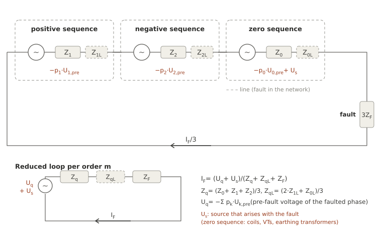
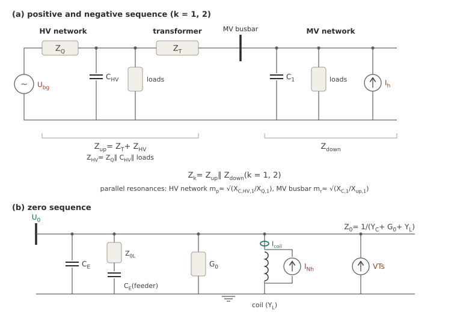
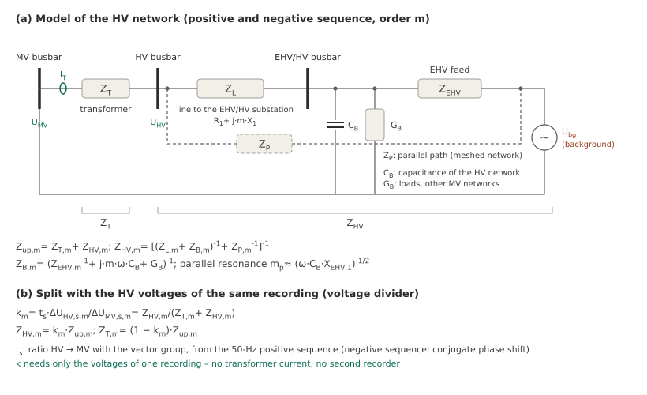
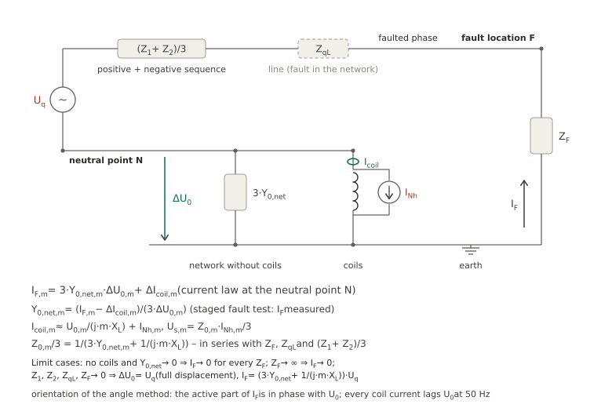

# Model and equations

The forecast describes the earth-fault loop at one MV busbar per harmonic order m by a Thevenin equivalent. The
staged fault tests calibrate it, every earth fault recorded at the busbar updates it, and harmonic voltages measured
in normal operation drive it. This page derives the equations, explains what the impedances contain and lists the
assumptions; [Working with the network model](guide.md) shows how to run it, and
[Measurements for the model](recording.md) what has to be recorded. The estimates without an earth fault (V0 to V3)
are on [Without an earth fault](without-fault.md).

## Symbols and conventions

| Symbol | Meaning |
|---|---|
| m | harmonic order (frequency m·f1) |
| k | sequence: 0 zero, 1 positive, 2 negative |
| p_k | phase factor of the faulted phase (table below) |
| U_k,pre | sequence voltage of the busbar before the fault (mean over the pre-fault interval) |
| ΔU_k | change during the fault, U_k,fault − U_k,pre |
| Z_k | sequence impedance of the network seen from the busbar |
| Z_kL | series impedance of the line from the busbar to a fault location in the network |
| Z_F | fault impedance – the additional impedance of a staged test |
| I_F | fault current, counted from earth into the faulted phase |
| U_q | source voltage from the pre-fault voltage of the faulted phase |
| U_s | source that arises with the fault |
| Z_q, Z_qL | source impedance of the loop at the busbar, contribution of the line |

All quantities are RMS phasors of the order m, referred to the fundamental of U_L1-L2
([angle reference](../methods/index.md#angle-reference)), as in the result files of the evaluation. The fault current
is counted from earth into the faulted phase – the orientation of the angle method, in which the active part of the
fundamental fault current is in phase with U_0. The phase factors rotate the sequence components to the faulted phase
(\(a = e^{\,j120^\circ}\)):

| Faulted phase | p_0 | p_1 | p_2 |
|---|---|---|---|
| L1 | 1 | 1 | 1 |
| L2 | 1 | a² | a |
| L3 | 1 | a | a² |

Because |p_k| = 1, the magnitude of a phase quantity Σ p_k·X_k is the magnitude of that phase.

## Fault loop per order



A single-line-to-earth fault connects the positive-, negative- and zero-sequence networks in series with three times
the fault impedance; all three carry the same loop current I_F/3 (for L1; for L2 and L3 rotated by the phase factors).
Each network is represented, seen from the fault location, by its Thevenin equivalent: the voltage at the fault
location before the fault and the impedance with all sources set to zero. For a fault at the busbar these are the
pre-fault sequence voltages of the busbar and the sequence impedances Z_k; for a fault behind a line the series
impedances Z_kL of the line add (dashed in the figure). The loop reduces per order to

\[
\underline{I}_{\text{F},m} = \frac{\underline{U}_{q,m} + \underline{U}_{s,m}}
  {\underline{Z}_{q,m} + \underline{Z}_{qL,m} + Z_\text{F}}
\]

\[
\underline{Z}_{q,m} = \tfrac{1}{3}\left(\underline{Z}_{0,m} + \underline{Z}_{1,m} + \underline{Z}_{2,m}\right),
\qquad
\underline{Z}_{qL,m} = \tfrac{1}{3}\left(2\,\underline{Z}_{1L,m} + \underline{Z}_{0L,m}\right)
\]

with

\[
\underline{U}_{q,m} = -\sum_{k} p_k\,\underline{U}_{k,\text{pre},m}
\]

the pre-fault voltage of the faulted phase with the sign of the current orientation. **U_q** follows the harmonic
voltage of the network in normal operation – the quantity a power-quality measurement records. **U_s** is a source
that exists only during the fault: at the full displacement voltage, Petersen coils, voltage transformers and earthing
transformers are driven into saturation and inject harmonic currents into the zero sequence, mostly at the orders 3,
9, 15 … ([below](#source-that-arises-with-the-fault)). The derivation is the usual one for a fault in a linear network:
the voltage of the faulted phase at the fault location is U_pre,ph + Z_q·I_F (superposition of the pre-fault state and
the change caused by the injected current) and equals −Z_F·I_F; solving for I_F gives the equation above with
U_s = 0.

## What the sequence impedances contain



**Positive and negative sequence.** Seen from the busbar, the upstream impedance Z_up of the transformer and the HV
network lies in parallel with the MV network Z_down – the cable capacitance, the loads with their damping, and the
harmonic sources of the MV network (converters, rectifiers):

\[
\underline{Z}_{k,m} = \underline{Z}_{\text{up},m} \parallel \underline{Z}_{\text{down},m} \quad (k = 1, 2),
\qquad
\underline{Z}_{\text{up},m} = \underline{Z}_{\text{T},m} + \underline{Z}_{\text{HV},m}
\]

The upstream inductance and the operating capacitance C_1 of the MV network form a parallel resonance at the busbar,

\[
m_\text{r} \approx \sqrt{X_{C,1}/X_{\text{up},1}}
\]

(X_C,1 = 1/(ωC_1) and X_up,1 at the fundamental). Near m_r, Z_1 and Z_2 become large and resistive – limited only by
the damping of the MV network – and the harmonic voltage of the busbar is amplified
([transformer node](../methods/transformer-node.md#resonance-of-the-mv-network)). The HV network itself is not a pure
inductance either. Its capacitance C_HV (lines, cables, compensation) in parallel with the network feeder Z_Q – the
short-circuit impedance from S″_k – forms a parallel resonance of its own,

\[
\underline{Z}_{\text{HV},m} = \left(\frac{1}{R_Q + j\,m\,X_{Q,1}} + j\,m\,\omega C_\text{HV} + G_\text{HV}\right)^{-1},
\qquad
m_\text{p} \approx \sqrt{X_{C,\text{HV},1}/X_{Q,1}}
\]

(both reactances referred to the MV side; G_HV the damping by the loads of the HV network). Below m_p, |Z_HV,m| rises
faster than m·X_Q,1; above it, Z_HV turns capacitive and partly compensates the transformer reactance. Near m_p the
measured upstream impedance therefore deviates from the nameplate estimate m·(X_T,1 + X_Q,1) by tens of percent in
either direction. A lumped C_HV is an effective value: the capacitance is distributed along the HV lines, and the
value seen from one substation is smaller than the total capacitance of the HV network and differs between
substations of the same HV network. Both resonances are contained in the measured Z_q; they matter where the model
is changed – another upstream impedance (below) or an estimate without calibration.



**HV network with its line.** Where a substation is fed by a line from the EHV/HV substation, the capacitance of the
HV network sits mostly at the far end of the line, at the EHV/HV busbar, in parallel with the EHV feed:

\[
\underline{Z}_{\text{HV},m} = \left[\left(\underline{Z}_{L,m} + \underline{Z}_{B,m}\right)^{-1} + \underline{Z}_{P,m}^{-1}\right]^{-1},
\qquad
\underline{Z}_{B,m} = \left(\underline{Z}_{\text{EHV},m}^{-1} + j\,m\,\omega C_B + G_B\right)^{-1}
\]

with the line Z_L,m = R_1 + j·m·X_1, the EHV feed Z_EHV,m, the capacitance C_B and the damping G_B of the HV network
and a parallel path Z_P of a meshed network (from S″_k at the substation: 1/Z_P = 1/Z_k − 1/(Z_L + Z_EHV) at 50 Hz).
The parallel resonance m_p ≈ (ω·C_B·X_EHV,1)^(−1/2) of the EHV/HV busbar then appears at the substation behind
the line, and the further the line, the more the HV share rises below m_p. At harmonic orders the parallel path need
not act as its 50-Hz value suggests – a radial model (Z_P omitted) can describe a substation at the end of a long
line better. The nameplate estimate m·(X_T,1 + X_Q,1) holds only well below m_p and without strong damping.

**Measuring the split.** The transformer recording gives Z_up per order
([transformer node](../methods/transformer-node.md)); with the HV voltages in the same recording the HV share follows
twice – from HV voltage and transformer current, and from the voltage divider of HV and MV voltages (panel b of the
figure), which needs no current at all. Read the sequence other than the natural one of each order
(m = 5, 11 …: positive, m = 7, 13 …: negative sequence): the natural sequence carries the pre-fault harmonic, whose
drift distorts the fault-related change.

**Zero sequence.** Z_0 contains the earth capacitances of the network – partly behind the series impedance of long
feeders, where each feeder is a series resonant circuit of its own –, the losses (G_0), the Petersen coils
(Y_L = 1/(3·j·m·X_L) per phase, X_L the reactance of the coils at 50 Hz) and every further path to earth. Coils,
voltage transformers and earthing transformers are nonlinear: at the full displacement voltage they inject the
harmonic currents I_Nh, which appear as the source U_s in the loop.

## Calibration with a staged fault test

All three sequence networks carry a loop current of the same magnitude, I_k = I_F/(3·p_k) (|p_k| = 1,
1/p_k = p_k*). The change of
each sequence voltage of the busbar is the voltage drop of this current across the sequence impedance,
ΔU_k = Z_k·I_F/(3·p_k), so

\[
\underline{Z}_{k,m} = \frac{3\,p_k\,\Delta\underline{U}_{k,m}}{\underline{I}_{\text{F},m}},
\qquad
\Delta\underline{U}_{k,m} = \underline{U}_{k,m}^{\,\text{fault}} - \underline{U}_{k,m}^{\,\text{pre}}
\]

for every order with a fault current measured (by default the odd orders from 3 on with at least 0.3 A). The voltages
before the fault are the mean over the pre-fault interval, the phasors during the fault those of the max window – the
same window as the fault current. Z_1 ≈ Z_2 for a passive network; away from the resonance m_r both are usually
smaller than Z_0, near it they become large and resistive. Z_q, the sum divided by three, is what the forecast needs; Z_0, Z_1 and Z_2
separately are needed for the update below.

One test is enough because the source voltage is measured – the pre-fault voltage of the faulted phase – and not
fitted. The [equivalent-source method](../methods/equivalent-source.md) describes the same loop by the same two
quantities but fits both from the currents of several tests; with small additional impedances its source voltage is
poorly determined, which matters beyond the tested range
([Within and beyond the tested range](../methods/equivalent-source.md#within-and-beyond-the-tested-range)). Apart from
the lead of the test without additional impedance, Z_q equals the source voltage divided by the fault current of that
test.

The calibration also holds for a staged test **behind a line**: the busbar voltages give the impedances at the
busbar, the fault current is measured at the fault location, and the line enters the loop as Z_qL. Its own earth
capacitance belongs to Z_0 of the network.

## Update with a recorded earth fault

A recorded earth fault – busbar voltages before and during the fault, no fault current – gives the ratios of the
sequence impedances, since ΔU_k/ΔU_0 = (Z_k/p_k)/(Z_0/p_0). With Z_0 from the calibration tests (median, one named
test or given):

\[
\underline{Z}_{k,m} = \underline{Z}_{0,m}\,\frac{p_k\,\Delta\underline{U}_{k,m}}{p_0\,\Delta\underline{U}_{0,m}},
\qquad
\lvert\underline{I}_{\text{F},m}\rvert = \frac{3\,\lvert\Delta\underline{U}_{0,m}\rvert}{\lvert\underline{Z}_{0,m}\rvert}
\]

Z_0 depends on the extent of the network and the tuning of the coils; Z_1 and Z_2 change with the load, the HV
network and the switching state. A recorded earth fault therefore brings in the part that varies from day to day,
Z_0 comes from a test with the same network extent. Orders with a small |ΔU_0| (default 0.5 V) are not updated, nor
are the orders of a source that arises with the fault: there the busbar voltage contains the source,
ΔU_0 = Z_0·I_F/3 − U_s, and neither the ratio nor 3·|ΔU_0|/|Z_0| describes the network.

## Node rule with the coil currents



If the recorder also records the currents of the Petersen coils, the fault current of a recorded earth fault follows
at every order – also where a source arises with the fault. The fault current flows in **one loop**: from earth through
the fault impedance into the faulted phase, along the line, through the positive- and negative-sequence impedances with
the source to the neutral point, and from there back to earth through the earth capacitances and losses of the
network – the zero-sequence admittance Y_0,net per phase without the coils – and through the coils (current I_coil from
the neutral point to earth). Network admittance and coils lie in parallel with each other and together **in series**
with Z_F; their parallel connection is the zero-sequence impedance of the loop,

\[
\tfrac{1}{3}\,\underline{Z}_{0,m} = \frac{1}{3\,\underline{Y}_{0,\text{net},m} + 1/(j\,m\,X_L)},
\]

and the zero-sequence voltage lies across it. Without coils and without earth admittance the loop is open: no fault
current flows, however small Z_F. Kirchhoff's current law at the neutral point, before and during the fault:

\[
0 = 3\,\underline{Y}_{0,\text{net}}\,\underline{U}_{0,\text{pre}} + \underline{I}_{\text{coil,pre}} + \underline{I}_\text{u},
\qquad
\underline{I}_\text{F} = 3\,\underline{Y}_{0,\text{net}}\,\underline{U}_{0,\text{fault}} + \underline{I}_{\text{coil,fault}}
  + \underline{I}_\text{u}
\]

I_u is the current that unequal earth capacitances of the three phases drive with the phase-to-neutral voltages; the
fault changes it only slightly – by the product of the small asymmetry of the earth capacitances and the change of the
positive- and negative-sequence voltages. The difference gives the **node rule**

\[
\underline{I}_{\text{F},m} = 3\,\underline{Y}_{0,\text{net},m}\,\Delta\underline{U}_{0,m} + \Delta\underline{I}_{\text{coil},m},
\qquad
\underline{Y}_{0,\text{net},m} = \frac{\underline{I}_{\text{F},m} - \Delta\underline{I}_{\text{coil},m}}{3\,\Delta\underline{U}_{0,m}}
\]

with the change of the coil current ΔI_coil (during minus before the fault) and Y_0,net from the staged tests (fault
current measured), applied to every recorded earth fault. The result files contain the coil currents before the fault
(mean over the pre-fault interval); for older ones the current during the fault is used – before the fault U_0 and the
coil currents are small at the harmonic orders. The node rule holds whatever the coils do: their current is measured,
not modelled. Split into the linear part and the nonlinear part I_Nh,

\[
\underline{I}_{\text{coil},m} \approx \frac{\underline{U}_{0,m}}{j\,m\,X_L} + \underline{I}_{\text{Nh},m},
\qquad
\underline{U}_{s,m}^{\,\text{coil}} = \underline{Z}_{0,m}\,\underline{I}_{\text{Nh},m}/3
\]

the coil currents also show which part of the source U_s comes from the coils; the rest comes from other nonlinear
paths such as voltage transformers and earthing transformers.

Each coil channel is oriented by its 50-Hz current, which lags U_0 by about 90° in this orientation – a reversed
current transformer is turned and reported. The node rule needs phasors of the same windows: the coil currents in the
**same recorder** as the busbar voltages, the currents of **every** coil of the busbar, and coil currents in the tests
as well (for Y_0,net). A coil that is not recorded acts as part of Y_0,net as long as it is linear; its nonlinear
current is then missing. Without coil currents the fault current of a recorded earth fault follows from
3·|ΔU_0|/|Z_0| at the orders without a source in the fault.

## Source that arises with the fault

At the orders of the zero sequence the pre-fault voltage is small, and the current of the test is largely driven by
U_s. The calibration with one test then gives the apparent impedance Z_q − U_s/I_F, which does not scale to another
fault impedance. Two or more tests i with different series impedances Z_i = Z_F,i + Z_qL,i,m (additional impedance
plus the line of a test in the network) separate Z_q and U_s by linear least squares,

\[
\underline{I}_{i}\,\underline{Z}_{q} - \underline{U}_{s} = \underline{U}_{q,i} - \underline{I}_{i}\,\underline{Z}_{i}
\qquad \text{(one equation per test } i\text{, unknowns } \underline{Z}_q, \underline{U}_s)
\]

The model uses this for the orders of `two_source` (default: m divisible by 3) and reports the largest relative
deviation of the fit. With a single test, or with tests of the same series impedance, the two cannot be separated: the
measured current is used for every fault impedance (`constant`) – on the safe side for larger series impedances, an
underestimate for smaller ones, which the forecast states. Tests whose currents do not separate the unknowns
(condition number above 10⁴) fall back to the pre-fault source.

U_s is driven by the 50-Hz displacement voltage. Between 0 Ω and a few ohms of fault impedance the displacement voltage
hardly changes, so U_s is constant over the tests; for high-impedance faults U_0 and with it U_s decrease, and the
forecast with the U_s of the tests stays on the safe side.

## Fault behind a line

For a fault location in the network the line from the busbar to the fault location adds to every sequence network:

\[
\underline{Z}_{1L,m} = \sum_i l_i\,(R'_{1,i} + j\,m\,X'_{1,i}),
\qquad
\underline{Z}_{0L,m} = \sum_i l_i\,(R'_{0,i} + j\,m\,X'_{0,i}),
\qquad
\underline{Z}_{2L,m} = \underline{Z}_{1L,m}
\]

over the segments i (cable, overhead line) with the per-length values at 50 Hz – the **50-Hz form**, with the
resistance independent of the frequency and the reactance growing with m. Both are approximations that act in opposite
directions: the resistance rises with frequency (skin effect, earth return, currents in bonded cable sheaths) – the
form underestimates it –, while the reactance of earth-return paths (overhead lines in the zero sequence) and of cables
with bonded sheaths rises less than proportionally – the form overestimates it. Which one dominates depends on the
line, so a forecast behind a line with 50-Hz values is not on the safe side by construction. Where the zero-sequence
return through earth and bonded sheaths dominates, the loop reactance of a line can rise from 50 to 250 Hz by a factor
well below 5; the 50-Hz form then overestimates the loop impedance and underestimates the fault current behind the line
by tens of per cent. The orders of interest therefore get **values of their own**:

\[
\underline{Z}_{1L,m} = \sum_i l_i\,\left(R'_{1,i}(m) + j\,X'_{1,i}(m)\right),
\qquad
\underline{Z}_{0L,m} = \sum_i l_i\,\left(R'_{0,i}(m) + j\,X'_{0,i}(m)\right)
\]

with R′ and X′ at m·50 Hz – computed for that frequency by a line-parameter calculation (conductor with skin effect,
cable sheaths bonded as in the network, earth return with the soil resistivity) or measured. A measured loop
contribution Z_qL,m of the whole line replaces the segments at its order. A line-parameter calculation should reproduce
the 50-Hz values of the network data before its harmonic values are used. The model neglects the shunt capacitance
along the line. That holds for a line short compared with a quarter wavelength at the order,

\[
l \ll \frac{\lambda_m}{4} = \frac{v}{4\,m\,f_1},
\qquad
v = \frac{1}{\sqrt{L'_1\,C'_1}},\quad L'_1 = \frac{X'_1}{2\pi f_1}
\]

and the forecast reports l/(λ_m/4) for the highest order when the capacitance per length is given. The source is the
voltage of the busbar: the pre-fault voltage at the fault location is taken equal to that of the busbar, which neglects
the load current and standing waves along the line. In the [limit-case check](#limit-cases-and-plausibility) the shunt
capacitance of 8 km of cable (4.1 µF) changes the fault current behind it by 0.3 % at 250 Hz, 2 % at 350 Hz and 4 % at
550 Hz.

**The line from a recorded earth fault.** For a fault behind a line the voltage of the faulted phase at the busbar is
the voltage drop of the fault current across the line and the fault impedance – zero for a fault at the busbar. With
the fault current from the busbar (node rule, or the zero-sequence voltage at the orders without a source in the fault)
the busbar voltages alone measure the line at every harmonic order
([`line_from_fault`][groundfault.forecast.model.NetworkModel.line_from_fault]):

\[
\underline{U}^{\,\text{fault}}_{\text{ph,bus},m} = -\left(\underline{Z}_{qL,m} + Z_\text{F}\right)\underline{I}_{\text{F},m},
\qquad
\underline{I}_{\text{F},m} = \frac{3\,\Delta\underline{U}_{0,m}}{\underline{Z}_{0,m}}
\]

The result contains the fault impedance (e.g. the earthing impedance of a substation) unless it is given; the shunt
capacitance of the line makes it a few per cent too small (8 km of cable: 2.5 % at 250 Hz, 7 % at 550 Hz).

**A fault behind a line can carry more current than at the busbar.** With the same source and Z_F = 0, a line of
length l changes the current of an order by

\[
\frac{\lvert\underline{I}_{\text{F},m}(l)\rvert}{\lvert\underline{I}_{\text{F},m}(0)\rvert}
  = \frac{\lvert\underline{Z}_{q,m}\rvert}{\lvert\underline{Z}_{q,m} + l\,\underline{z}'_{qL,m}\rvert},
\qquad
\underline{z}'_{qL,m} = \tfrac{1}{3}\left(2\,\underline{z}'_{1L,m} + \underline{z}'_{0L,m}\right)
\]

The line moves the loop impedance in the complex plane along the direction of its per-length value z′_qL. If Z_q
points more than 90° away from that direction – a capacitive Z_q against an inductive line –, |Z_q + l·z′_qL| first
decreases: a series resonance of the fault loop. Its smallest value lies at the foot of the perpendicular from the
origin onto that straight line,

\[
l^{*} = -\frac{\operatorname{Re}\left(\underline{Z}_{q,m}\,\underline{z}'^{\,*}_{qL,m}\right)}{\lvert\underline{z}'_{qL,m}\rvert^{2}},
\qquad
g_\text{max} = \frac{1}{\lvert\sin(\varphi_q - \varphi_z)\rvert}
\quad \text{for } \cos(\varphi_q - \varphi_z) < 0
\]

with φ_q and φ_z the angles of Z_q and z′_qL; otherwise the current falls with the length. A nearly resistive Z_q gives
little rise. A strongly capacitive one behind an overhead line (φ_z close to 90°) can raise the order severalfold –
limited only by the damping, the real part of Z_q, which the B method determines less precisely where the natural
sequence enters. The busbar is therefore not the worst fault location at every order; the forecast behind `LINE` gives
the current for a given location.

## Another upstream impedance

A recording with the line currents of the transformer gives the upstream impedance Z_up of its
[transformer node](../methods/transformer-node.md) – per order from the sequence other than the natural one (m = 5,
11 …: positive, m = 7, 13 …: negative sequence), where hardly any pre-fault harmonic disturbs the fault-related
change; an order without a significant value there gets no Z_up. The model then splits the positive and negative
sequence into the upstream part and the MV network,

\[
\frac{1}{\underline{Z}_{\text{down},k}} = \frac{1}{\underline{Z}_{k}} - \frac{1}{\underline{Z}_\text{up}}
\qquad (k = 1, 2)
\]

and forecasts for another upstream impedance – another transformer, a changed HV network – with
Z_k' = Z_up' ∥ Z_down. Z_down is the MV network with its damping, which the apparent impedance of the undisturbed state
does not show. The new Z_up' has to contain the HV network as it acts at the harmonic orders: an estimate
m·(X_T,1 + X_Q,1) from nameplate and S″_k ignores the parallel resonance of the HV network
([above](#what-the-sequence-impedances-contain)) and can be wrong by tens of percent near it.

## Forecast

Per order, the forecast adds the magnitudes of the two sources – a power-quality measurement gives the magnitude of
U_m, not its phase relative to U_s:

\[
\lvert\underline{I}_{\text{F},m}\rvert \le
  \frac{U_m + \lvert\underline{U}_{s,m}\rvert}{\lvert\underline{Z}_{q,m} + \underline{Z}_{qL,m} + Z_\text{F}\rvert}
  + \Delta I_m
\]

* **U_m** – the line-to-earth harmonic voltage of the busbar, e.g. the 95 % quantile of a power-quality measurement or
  a time series. Per phase given, the largest current of the phases counts (the faulted phase is not known in
  advance). Line-to-line values are divided by √3; they contain no zero sequence, so the orders of the zero sequence
  keep only U_s – line-to-earth values are the better input. For a fault at the busbar U_m is the source of the
  circuit and already contains the amplification of the HV background and the sources of the MV network.
* **Z_q,m** – the median over the earth faults of the model (component-wise; also the mean or the latest one). A
  selection by metadata – switching state, time of day – gives the model of one state.
* **ΔI_m** – a margin per order that you define, e.g. from the checks below. The package contains no margin.

The harmonic residual current and the residual current follow as

\[
I_\text{H} = \sqrt{\textstyle\sum_m I_{\text{F},m}^2 + I_\text{rest}^2},
\qquad
I_\text{RES} = \sqrt{I_1^2 + I_\text{H}^2}
\]

with I_rest the harmonic content of the tests outside the forecast orders (the largest of the tests) and I_1 the
fundamental residual current √(I_w² + I_v²) – the median of the tests or a value you give; it depends on the tuning of
the coils, not on the harmonic voltages. A time series is forecast per time step; its quantile is the quantile of the
time series of I_H and I_RES, not the root sum of the quantiles per order.

## Checks

| Check | Model | Compared with | Shows |
|---|---|---|---|
| `cross_check(mode="loo")` | all other tests | the measured current of each test | the spread of the model between the tests |
| `cross_check(mode="pairwise")` | one other test (every pair) | as above | how far one test carries to another fault impedance |
| `cross_check(mode="chain")` | Z_0 of one test, Z_q from the busbar voltages of a second test as a recorded earth fault | a third test | the update with recorded earth faults |
| `fault_check` | all other earth faults | the estimated current of each recorded earth fault (node rule or zero-sequence voltage) | the forecast at the earth faults of the operation |
| `verify` | the model | a measurement outside the model, e.g. a test in the network | the line model and the transfer to other fault locations |

Each forecast starts from the target's own pre-fault voltage, fault impedance and line, so a drift of the network level
between the earth faults does not enter. `deviation_A` is forecast − measured: negative values are underestimates.
The row `I_H` compares the whole harmonic content. The largest underestimate per order over the checks is a basis for
the margin ΔI_m. Compare currents only over the same windows: the harmonic currents change during a fault, and the
max window of a test is not the mean of a recorded earth fault.

## Estimates without a calibration

Before a calibration exists, the fault loop comes from network data and – with a recorder at the transformer – from
undisturbed recordings of the transformer node: the classical estimate
[`classical_bound`][groundfault.forecast.bounds.classical_bound] with Z_1 = Z_2 = 0 (V0), the resonance bound
[`resonance_bound`][groundfault.forecast.bounds.resonance_bound] (V1), the loop from network data with an assumed damping
of the MV network and its envelope (V2) and the loop with the MV network measured in undisturbed operation (V3). Neither
V0 nor V1 is an upper bound at every order: below the parallel resonance m_r of the busbar Z_1 + Z_2 is inductive and
partly cancels the capacitive Z_0 – a **series resonance of the fault loop**. For a cable network (C_1 ≈ C_E) with a
tuned coil it lies at

\[
m_\text{s} \approx \sqrt{\frac{c\,m_\text{r}^2 + 2}{c + 2}},
\qquad c = C_1/C_E,
\]

about m ≈ 3 for m_r ≈ 5. There the current exceeds the classical estimate severalfold (in the
[limit-case check](#limit-cases-and-plausibility) 2.2-fold at 150 Hz). Above m_r both are capacitive and the classical
estimate lies above the current. The equations, the measurement of the MV network and an example are on
[Without an earth fault](without-fault.md).

## Limit cases and plausibility

The equations above follow from Thevenin's theorem for a linear, symmetrical network. The test suite checks them and the
methods of the model against an independent three-phase nodal calculation of a synthetic network (busbar behind the
upstream impedance, earth capacitances with losses, loads, a coil in the neutral with a nonlinear current during the
fault, a line as π section):

| Limit case | Physics | Model |
|---|---|---|
| no coils, Y_0,net → 0, Z_F = 0 | loop open: I_F → 0 | Z_0 → ∞, so Z_q → ∞ and I_F → 0 |
| Z_F → ∞ | I_F → 0 | I_F → 0 |
| stiff source, no coil, Z_F = 0, 50 Hz | I_F = 3·ω·C_E·U_LE, full displacement ΔU_0 = U_q | the same |
| tuned coil without losses, 50 Hz | I_F → 0 | Z_0 → ∞ |
| busbar fault, Z_F = 0 … 5 Ω, orders 1 … 11 | nodal solution | reduced loop exact (≤ 10⁻⁹); the B method recovers Z_0, Z_1, Z_2 exactly |
| recorded fault in another load state | nodal solution | ratios give Z_1, Z_2 of that state, 3·ΔU_0/Z_0 its current – exact |
| nonlinear coil current with the fault (order 3) | U_s = Z_0·I_Nh/3 | two-source fit exact; node rule exact; 3·ΔU_0/Z_0 and the ratios wrong (therefore not used there) |
| fault behind 8 km of cable, values per order | nodal solution | exact without shunt capacitance; with it +0.3 % (250 Hz) … −4 % (550 Hz) |
| line from the recorded fault | Z_qL,m | exact without shunt capacitance; with it 2.5–7 % too small |
| classical estimate below m_r | series resonance of the loop | not an upper bound (2.2-fold at 150 Hz) |

## Assumptions

The model rests on the following assumptions. Each line names where it enters and how its effect shows or what follows
when it does not hold.

| # | Assumption | Enters | Effect, check |
|---|---|---|---|
| A1 | Per order the network is linear and time-invariant between the pre-fault state and the fault; the harmonic sources of the network keep their behaviour (voltage or current sources). | Thevenin equivalent, calibration | Converters whose control reacts to the fault and saturating devices deviate; the checks between the tests show how much. |
| A2 | The only source created by the fault is U_s, at the orders of `two_source` (default: the zero-sequence orders). | Calibration, forecast | Other orders with a fault-driven source would appear as a spread between tests of different fault impedance. |
| A3 | The network is symmetrical: the sequence networks are decoupled and Z_2L = Z_1L. | Series connection | Untransposed lines couple the sequences slightly. |
| A4 | Z_0 holds for the network extent and coil tuning of the calibration. | Update, node rule | After a change of the network extent calibrate again, or take Z_0 of a test with the same state. |
| A5 | U_s does not depend on the fault impedance within the range of the tests. | Two-source fit | Holds while the 50-Hz displacement voltage is nearly unchanged; for high-impedance faults U_s decreases (safe side). |
| A6 | The pre-fault voltage of a future earth fault is the harmonic voltage of normal operation (e.g. its 95 % quantile); magnitudes of U_m and U_s add. | Forecast | Safe side for the unknown phase between the two sources. |
| A7 | The faulted phase is not known in advance: the largest phase counts. | Forecast | Safe side. |
| A8 | Line-to-line voltages contain no zero sequence. | Forecast with `reference="LL"` | The zero-sequence orders keep only U_s; prefer line-to-earth voltages. |
| A9 | Z_q of the model represents the network state of the forecast. | Forecast | Z_q varies with load and switching state; the checks and the selection by metadata show the spread; the margin has to cover it. |
| A10 | The orders add by their RMS values; the orders outside the model enter with the content of the tests. | I_H, I_RES | Exact for a stationary periodic current. |
| A11 | The quantile of a time series is taken from the totals per time step. | Time series | Smaller than the root sum of the quantiles per order, which would overestimate. |
| A12 | Z_up of the transformer node holds for the HV state of the recording. | Another upstream impedance | Near the parallel resonance of the HV network Z_up is not proportional to m; measure it or model the HV capacitance. |
| A13 | Line: values of their own at the orders of interest (calculated at m·50 Hz or measured), otherwise resistance constant and reactance ∝ m; no shunt capacitance; busbar voltage at the fault location. | Fault behind a line | The 50-Hz form is not on the safe side by construction (the forecast names the orders that use it); the series model holds for l ≪ λ_m/4 (reported); check with a staged test in the network (`verify`) or derive the line from a recorded fault (`line_from_fault`). |
| A14 | Node rule: Y_0,net of the tests holds for the recorded earth fault; all coils are recorded in the windows of the voltages (a coil not recorded counts as part of Y_0,net and must be linear). | Recorded earth faults | `fault_check`; with coils in a second recorder the higher orders scatter strongly. |
| A15 | Tests are evaluated in the max window, recorded earth faults over the mean of the windows; the model aggregates over its earth faults (median). | Calibration, update | The harmonic currents change during a fault; the spread enters the checks. |

## Limits

* **Small voltage changes.** Where |ΔU_k| is small – Z_1 and Z_2 away from the resonance m_r – phase errors of the
  voltage transformers at the harmonic frequencies (1–2°) change Z_1 and Z_2 noticeably; Z_q is dominated by Z_0 there
  and remains reliable.
* **Orders not modelled.** Even orders and interharmonics enter only through I_rest.
* **Fault resistance of natural earth faults.** A recorded earth fault has an unknown fault impedance; `fault_check`
  forecasts it with the Z_F you give (default 0, the largest current).
* **Changes of the network.** New feeders, other coils, a new transformer or a changed HV network change the model;
  calibrate again or check it with the next recorded earth faults.

## Model file

[`save`][groundfault.forecast.model.NetworkModel.save] writes the model as a JSON file (format
`groundfault-network-model`, version 2; version 1 is read): name, description, time of saving, groundfault version
and per earth fault its name, kind (`test` or `fault`), time, faulted phase, additional impedance, line, I_w, I_v, I_C,
U_0, harmonic content, the calibration that supplied Z_0, the result file, free metadata, the pre-fault voltage of all
orders, for recorded earth faults the estimated current per order with its method, and per order Z_0, Z_1, Z_2, U_q,
ΔU_0, the measured and the estimated current, Z_up and Y_0,net. Complex numbers are stored as `{"re": …, "im": …}`.
The model grows with every calibration and recorded earth fault; [`load`][groundfault.forecast.model.NetworkModel.load]
reads it back.

## Example

```python
import os, tempfile
import groundfault as gf
from groundfault import demo
from groundfault import forecast as fc

folder = tempfile.mkdtemp()
model = fc.NetworkModel("Demo")
for w in demo.make_substation_series(folder):                     # tests at 0, 2.5 and 5 Ω, known solution
    b = w["intervals"]
    res = gf.evaluate(gf.open_recording(os.path.join(folder, w["file"])),
                      gf.Intervals(b["steady_state"], b["pre_fault"], b["post_fault"]), z_fault_ohm=w["Z_F"])
    path = res.save_json(os.path.join(folder, w["file"].replace(".cfg", "_result.json")))
    model.add_test(fc.load_fault_data(path, w["Z_F"], name="%g Ω" % w["Z_F"]))
print(model.source_table()[["order", "kind", "Zq_Ohm", "Zq_angle_deg", "Us_V"]].round(2).to_string(index=False))
U = {3: 30.0, 5: 250.0, 7: 130.0, 11: 40.0, 13: 30.0}             # line-to-earth voltages in V
f = model.forecast(U, Z_F=0.0)
print(f.table()[["order", "kind", "U_V", "I_forecast_A"]].round(2).to_string(index=False))
line = fc.Line([fc.LineSegment(4.0, R1=0.125, X1=0.11, R0=0.50, X0=0.40, C1_uF=0.30)], name="feeder 4 km")
g = model.forecast(U, Z_F=0.0, line=line)
print(g.table()[["order", "Z_line_Ohm", "Zq_ZF_Ohm", "I_forecast_A"]].round(2).to_string(index=False))
```

```text
 order       kind  Zq_Ohm  Zq_angle_deg  Us_V
     3 two_source    6.15        -13.92  0.15
     5  pre_fault    5.15        -29.05  0.00
     7  pre_fault    7.84        -26.50  0.00
    11  pre_fault    3.34        -41.43  0.00
    13  pre_fault    5.72        -29.32  0.00
 order       kind   U_V  I_forecast_A
     3 two_source  30.0          4.90
     5  pre_fault 250.0         48.56
     7  pre_fault 130.0         16.58
    11  pre_fault  40.0         11.97
    13  pre_fault  30.0          5.24
I_rest              NaN          0.01
   I_H              NaN         53.18
   I_1              NaN         32.02
 I_RES              NaN         62.07
 order  Z_line_Ohm  Zq_ZF_Ohm  I_forecast_A
     3        2.67       7.05          4.28
     5        4.25       5.74         43.57
     7        5.87       8.34         15.59
    11        9.15       7.72          5.18
    13       10.79       9.95          3.02
I_rest         NaN        NaN          0.01
   I_H         NaN        NaN         46.86
   I_1         NaN        NaN         32.02
 I_RES         NaN        NaN         56.75
```

The demo network has the source impedances 6.18 Ω ∠−14.0°, 5.15 Ω ∠−29.1°, 7.83 Ω ∠−26.6°, 3.33 Ω ∠−41.3° and
5.73 Ω ∠−29.2° and no source in the fault; the model recovers them from the three recordings, and the forecast at the
busbar is |U_m|/|Z_q,m| per order. Behind the 4-km feeder the line adds Z_qL,m: here it lowers every order, most the
orders 11 and 13, where its reactance m·X'_1 is large compared with Z_q; at order 13 the line is 11 % of a quarter
wavelength, which the forecast reports.
