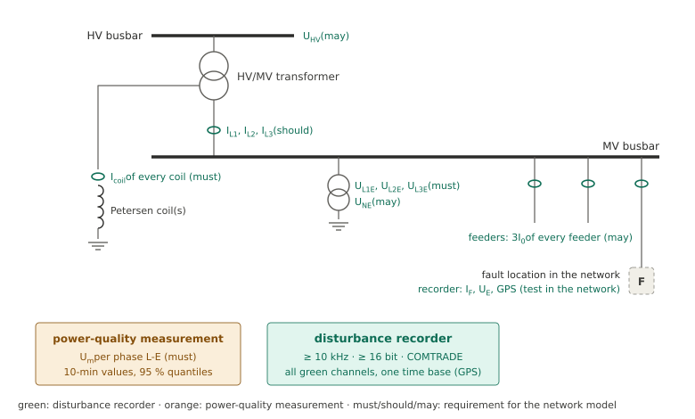

# Measurements for the model

The network model learns from three kinds of measurements: staged fault tests with the fault current measured
(calibration), earth faults of the network recorded at the busbar during operation (update) and the harmonic voltages
of the busbar in normal operation (the input of a forecast). Without an earth fault, undisturbed recordings of the
transformer node measure the MV network (V3, [Without an earth fault](without-fault.md)). This page lists what each of
them has to contain and why – a basis for specifying a disturbance recorder that is installed permanently in a
substation.

## Channels

**Must** – the model does not work without it. **Should** – used by the package; extends what the model can do.
**May** – not used by the model itself; helps to interpret or check it.

| Channel | Requirement | Used for |
|---|---|---|
| Line-to-earth voltages U_L1E, U_L2E, U_L3E of the MV busbar | must | the sequence voltages before and during every earth fault: calibration (ΔU_k), update (ratios of the sequence impedances), the pre-fault source U_q, the zero-sequence voltage U_0 of the node rule; line-to-line voltages alone contain no zero sequence |
| Fault current I_F at the fault location | must for staged tests | calibration: Z_k = 3·p_k·ΔU_k/I_F |
| Current of every Petersen coil of the busbar | must for recorded earth faults | [node rule](model.md#node-rule-with-the-coil-currents): the fault current of a recorded earth fault at every order, including the orders of the source that arises with the fault; the nonlinear part of the coils. In the tests as well (Y_0,net) |
| Line currents I_L1, I_L2, I_L3 of every transformer, MV side | should | [transformer node](../methods/transformer-node.md): upstream impedance Z_up per order, split of Z_1 and Z_2 into Z_up and the MV network, forecast for another upstream impedance, parallel resonance of the HV network |
| Line-to-earth voltages of the HV busbar (inductive voltage transformers) | may; must for V3 | the instrument of V3: the MV network from undisturbed operation ([below](#undisturbed-recordings-of-the-transformer-node-v3)); split of Z_up into transformer and HV network – with the transformer currents by two methods (HV voltage and current, [voltage divider](../methods/transformer-node.md#upstream-impedance-from-the-fault-related-change)), without them the share k = Z_HV/(Z_T + Z_HV) from the voltages alone; parallel resonance of the HV network; background distortion of the HV network |
| Displacement voltage U_NE (coil or open delta) | may | second measurement of U_0 |
| Residual current 3I_0 of every feeder (core-balance or summation CT) | may | the faulted feeder of a recorded earth fault (its line for the checks); in a staged test in the network an estimate of the fault current from the substation |

**Coils behind an earthing transformer.** Where the coils are connected to the busbar through an earthing
transformer (neutral earthing transformer, zig-zag), the zero-sequence current of the network – the coil current –
closes through the earthing transformer and not through the power transformer: the transformer currents do not
contain it. The coil currents (or the neutral current of the earthing transformer, the sum of its coils) have to be
recorded as channels of their own; every coil of the busbar, also a coil inside a transformer.

**One recorder, one time base.** The busbar voltages, the coil currents and the transformer currents have to be in the
**same recorder**: the model combines their phasors window by window, and the harmonic currents change during a fault
– between two recorders whose windows differ by fractions of a second the higher orders scatter by tens of percent.
Further recorders (another busbar section, the fault location of a test) need an absolute time base (GPS) to select
the same time.

**Power-quality measurement.** The forecast is driven by the harmonic voltages of the same busbar in normal operation:
a power-quality instrument (IEC 61000-4-30 class A) with the line-to-earth harmonic voltages per phase up to the
40th order (line-to-line values miss the zero-sequence orders 3, 9, 15 …), 10-min values over at least one week – for
the variation over the year, longer –, as 95 % quantiles per order and phase and as a time series.

## Recorder settings

| Setting | Value | Reason |
|---|---|---|
| Sampling rate | ≥ 10 kHz | orders up to 40 with a margin for the anti-aliasing filter |
| Resolution | ≥ 16 bit, ranges for the displacement voltage | harmonic voltages of a few volts beside the line-to-line voltage of the healthy phases; harmonic coil currents of a few tenths of an ampere beside the rated coil current |
| Trigger | displacement voltage U_0 (or U_NE) above a threshold | every earth fault of the network |
| Pre-trigger | ≥ 5 s, better 10 s | the pre-fault interval: the pre-fault voltages are the mean over its 200-ms windows |
| Recording after the trigger | ≥ 10 s of the steady fault | the steady-state interval after the switching transient; disturbed states are left out |
| Time base | GPS (or PTP) | correlation with the power-quality measurement and with further recorders |
| Format | COMTRADE (IEEE C37.111) | read by groundfault; channel names that the evaluation recognises ([channel names](../user-guide/campaigns.md#channel-names)) or a [corrections file](../user-guide/corrections.md) |

**Instrument transformers at the harmonic frequencies.** Inductive voltage transformers are usable for the orders of
the model, but not error-free: measured medium-voltage transformers stay within a few percent and a few degrees up to
some kilohertz, with the largest deviations below 1 kHz, and at higher voltage levels the first resonance moves to
lower frequencies. For the higher orders – and for high-voltage transformers – check the frequency response
(IEC TR 61869-103). Capacitive voltage transformers are not suitable. The phase errors matter where a voltage change is
small (Z_1, Z_2 away from the resonance of the MV network). For the coil currents the
ratio and the polarity of every channel are documented – the package orients each coil by its 50-Hz current, but a
wrong ratio enters the node rule directly. Clamp-on current transformers that encircle only some of several parallel
conductors need the factor in the corrections file.

## Undisturbed recordings of the transformer node (V3)

The MV network measured in undisturbed operation ([V3](without-fault.md#v3-the-mv-network-measured-in-undisturbed-operation))
needs no earth fault, but recordings of their own:

* **Channels in one device:** the three HV voltages line-to-earth, the three MV busbar voltages line-to-earth and the
  three transformer currents on the MV side, with a common sampling (or two devices on a common time base better than
  about 10 µs, 1° at 250 Hz); the coil currents if available.
* **Sampling** ≥ 10 kHz, 16 bit, COMTRADE; the current ranges resolve the variation of the harmonic currents (a few
  percent of a few amperes).
* **Recording plan:** undisturbed operation, at least 2 minutes per recording, better 10; several recordings over the
  day including the night – who drives the variation changes with inverters, loads and the HV background. A permanent
  recorder that stores 10 minutes every hour (about 110 MB per recording with nine channels at 10 kHz and 16 bit)
  gives the variation over the year.
* **Angle error of the current transformers:** at the start, 5–10 minutes of a reference clamp with a small known
  angle error parallel to one transformer current, in the same device
  ([`ct_angle_from_reference`][groundfault.transformer.ct_angle_from_reference]) – the correction at the orders of
  interest. Note the CT ratios and the polarity of the current channels.
* **Write down** the switching state and the settings of the coil controller (I_C, detuning, damping) at the start and
  at the end, the times, and the harmonic voltages of the busbar of the same day (power-quality measurement).

## Staged fault tests

* **At least two additional impedances**, e.g. 0 Ω and a few ohms: only tests of different fault impedance separate
  the [source that arises with the fault](model.md#source-that-arises-with-the-fault) from the network at the orders
  of the zero sequence. With a single impedance these orders keep the measured current.
* **The same network state** during the series – switching state, coil tuning, network extent – and the state written
  down with each test (metadata of the model).
* **The fault current** measured at the fault location, with the measured additional impedance; the busbar voltages and
  the coil currents in the substation recorder.
* **A steady fault of several seconds**, with at least 5 s of undisturbed operation before it.

### A staged test in the network

A test at a fault location behind a line checks how the model of the busbar carries to the network – the
[line model](model.md#fault-behind-a-line) and the source at the busbar:

* the substation recorder as above (busbar voltages, coils, transformer currents, if possible the residual current of
  the faulted feeder),
* a second recorder at the fault location with the fault current (and the voltages there, if available), both on GPS
  time,
* the line from the busbar to the fault location per segment: length, type (cable, overhead line) and the per-length
  values R'_1, X'_1, R'_0, X'_0 and C'_1 at 50 Hz – and at the orders of interest (250 Hz first) the values of that
  frequency from a line-parameter calculation (sheath bonding, soil resistivity), since the 50-Hz values with X ∝ m
  are not on the safe side.

The package compares the measured fault current per order with the forecast from the busbar voltages before the test
and the line ([`verify`][groundfault.forecast.model.NetworkModel.verify]; [`check_data`][groundfault.forecast.campaigns.check_data]
reads both recordings). The comparison uses magnitudes, so the two recorders need no common time base for it. To use
such a test for the calibration (`TESTS` with `line=`), the phasor of the fault current is needed in the time base of
the busbar voltages: the fault current has to be in the result file of the substation recording – measured there or
merged from the second recorder on a common time base better than about 10 µs (1° at 250 Hz).

A recorded fault behind a line also shows the line: the voltage of the faulted phase at the busbar is the voltage drop
of the fault current along the line and the fault impedance, U_L,busbar = −(Z_qL + Z_F)·I_F, so that
Z_qL + Z_F = −U_L,busbar·Z_0/(3·ΔU_0) follows from the busbar voltages and Z_0 of the tests – at the orders where the
fault current dominates ΔU_0, with coil currents (node rule) at every order
([`line_from_fault`][groundfault.forecast.model.NetworkModel.line_from_fault]). This measures the line at every
harmonic order from the substation alone; the result goes into the line as its loop contribution per order (`loop`).

## Earth faults recorded in operation

Every earth fault of the network that the substation recorder captures adds to the model: the busbar voltages update
Z_1, Z_2 and Z_q, the coil currents give its fault current per order. A fault behind a line changes nothing for the
update – the busbar sees the sequence currents that flow into the line –, but its fault current is usually smaller than
that of a fault at the busbar (a short line can also raise single orders, see
[fault behind a line](model.md#fault-behind-a-line)); name the line in the entry if the fault location is known. The
estimate 3·|ΔU_0|/|Z_0| is the current that enters the busbar from the faulted line; it describes the fault current
where the fault current dominates ΔU_0, not at orders with a source arising in the fault. Note with every recorded earth fault
what is known about it: faulted feeder and location, switching state, coil tuning, load – the model keeps them as
metadata, and a selection by them gives the model of one state.
