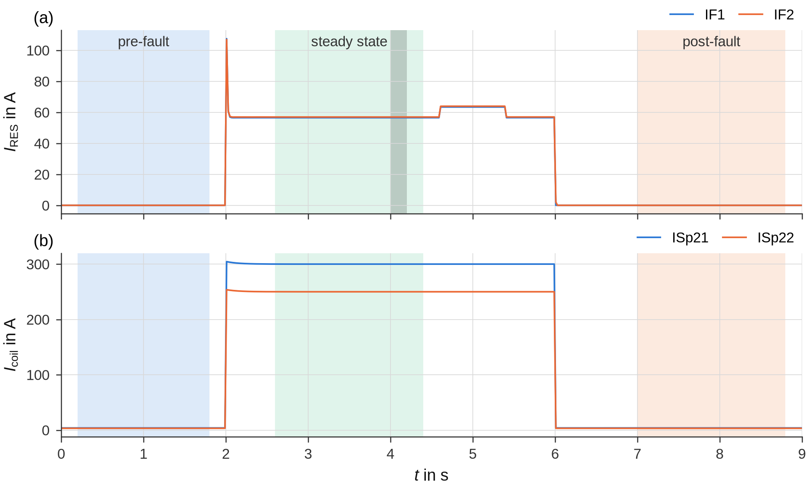

# Quickstart

This page goes once through the whole workflow – from the raw recordings to the reduction factor and the exported
figures – with the **demo campaign** of `groundfault.demo`: synthetic COMTRADE recordings with a known solution, no
measurement data. Every code block continues the previous ones; run them one after the other in a Python session (with
the `all` extra installed) or in a Jupyter notebook (with the `notebook` extra), see [Installation](installation.md).
The same steps exist as
[notebooks](#the-same-with-the-notebooks); the [user guide](../user-guide/index.md) explains every step in detail.

## 1 · Create the demo campaign

```python
import os
import tempfile

import groundfault as gf
from groundfault import corrections, demo

base = tempfile.mkdtemp()                         # work folder
d = demo.make_campaign(base, layout="en")         # campaign 2026-01-15_Demo and demo_groundmeas.db
campaign = d["campaign"]
print(os.path.relpath(campaign, base))
for w in d["substation"]:
    print(w["cfg"], "– Z_F =", w["Z_F"], "Ω")
print(d["station"]["cfg"], "and", d["station"]["rms_cfg"])
print(os.path.relpath(d["db"], base))
```

```text
campaigns/2026-01-15_Demo
raw/SUB/SUB_0_10_000kHz.cfg – Z_F = 0.0 Ω
raw/SUB/SUB_2_5_10_000kHz.cfg – Z_F = 2.5 Ω
raw/SUB/SUB_5_10_000kHz.cfg – Z_F = 5.0 Ω
raw/Station_Elm_Road/Station_Elm_Road_10_000kHz.cfg and raw/Station_Elm_Road/Station_Elm_Road_10_000Hz.cfg
demo_groundmeas.db
```

The work folder now contains a campaign in the English [folder layout](../user-guide/campaigns.md#the-work-folder):
three substation tests with the additional impedances 0, 2.5 and 5 Ω in the fault branch, one test at the secondary
substation `Station_Elm_Road` (probes, shield and PEN currents, line-to-earth voltages, plus the RMS export of the
recorder), the notes folder with the corrections and sites files, the register – and a small groundmeas database with
an earthing measurement (current injection) of that station. Next to every recording lies `<name>_truth.json` with
the true values.

## 2 · Evaluate a substation recording

```python
rec = gf.open_recording(os.path.join(campaign, "raw/SUB/SUB_0_10_000kHz.cfg"))
corr = corrections.load(campaign)                 # notes/corrections.csv of the campaign
corr.apply(rec)                                   # applies the lines that match this recording
roles = gf.detect_roles(rec.channel_names, rec.units, corr.role_overrides(rec), corr.main_channel(rec),
                        corr.distances(rec))
print(roles.table()[["short", "role", "main_channel"]].to_string(index=False))

intervals = gf.Intervals(steady_state=(2.6, 4.4), pre_fault=(0.2, 1.8), post_fault=(7.0, 8.8))
res = gf.evaluate(rec, intervals, gf.Settings(), roles, z_fault_ohm=0.0)
print(res.summary())
```

```text
short   role main_channel
   V1  u_l1e            ✓
   V2  u_l2e            ✓
   V3  u_l3e            ✓
  IF1  i_res            ✓
  IF2  i_res
ISp21 i_coil            ✓
ISp22 i_coil
Measurement: SUB_0_10_000kHz  (SUB_0_10_000kHz.cfg)
Max window: 4.300 s  | f1 = 50.0200 Hz (phase)
IRES = 56.53 A | IG = 32.01 A | Iw = 20.00 A | Iv = 25.00 A | IH = 46.59 A
```

The channel roles follow from the channel names (line-to-earth voltages, two fault-current CTs, two coil currents);
the corrections file of the campaign could fix roles, ratios, polarities and probe distances
([Corrections](../user-guide/corrections.md)). The three **analysis intervals** are read off the RMS trend by hand –
the steady-state fault after the transient and before the active residual current increase at 4.6 s, and a section
without fault before and after it:



`evaluate` divides the steady-state interval into 200-ms windows, computes RMS values and harmonic phasors of all
channels and assesses the window with the largest residual current, the *max window* (here centred at 4.3 s); see
[Signal processing](../methods/signal-processing.md).

## 3 · Read the result

```python
aq = res.table("assessment_quantities")
print(aq[["quantity", "measured_value", "assessment", "unit"]].round(2).to_string(index=False))
truth = d["substation"][0]                        # the known solution of this recording
print("true: IRES %.2f A | IG %.2f A | Iw %.2f A | Iv %.2f A | IH %.2f A"
      % tuple(truth[k] for k in ("IRES", "IG", "Iw", "Iv", "IH")))
print(res.table("plausibility")[["check", "status", "value"]].to_string(index=False))
```

```text
quantity  measured_value  assessment unit
    IRES           56.53       56.53    A
      Iw           20.00       20.00    A
      Iv           25.00       25.00    A
     IH1           32.01       32.01    A
     IH3            4.04        4.04    A
     IH5           42.74       42.74    A
     IH7           14.06       14.06    A
IH_total           46.59       46.59    A
  IH_sum           46.58       46.58    A
    UH1n        11547.07    11547.07    V
true: IRES 56.52 A | IG 32.02 A | Iw 20.00 A | Iv 25.00 A | IH 46.58 A
                                        check status                                         value
         Windows in the steady-state interval     OK                                             9
Disturbed states in the steady-state interval     OK              none detected (threshold 1.60 A)
                         Network frequency f1     OK            50.0200 Hz (comparison 50.0200 Hz)
…
                Polarity of the fault current     OK Iw = 20.00 A (margin 38.7° to the ±90° limit)
                   Fault-current CT IF2 ↔ IF1     OK                 RMS ratio 1.008, Δφ(H1) -0.5°
                                Faulted phase     OK                       L3: 0 V (0.0 % of max.)
…
```

* **Assessment quantities** – the residual current `IRES` (true RMS value of the max window), the active and
  detuning components `Iw`/`Iv` (angle method; Iv > 0 means over-compensation), the harmonics, the harmonic content
  `IH_total` = √(I_RES² − I_G²) with its cross-check `IH_sum`, and the neutral displacement voltage `UH1n`. The column
  `assessment` adds your measurement-uncertainty margins (currents increased by `Settings.uncertainty_I`, voltages
  decreased by `uncertainty_U`); groundfault has no default margin, so here it equals the measured value. Background:
  [Assessment quantities](../methods/assessment.md).
* **Plausibility checks** – each row is `OK` or says what to check (frequency estimate, stationarity, decaying DC
  component, polarity, second CT, faulted phase …); read them, and the hints in `res.hints`, after every evaluation.
  The table is explained in [Evaluating a recording](../user-guide/evaluation.md#plausibility-checks).

The evaluation reproduces the true values of the synthetic recording.

## 4 · The substation series and the equivalent-source method

The harmonic content falls with the additional impedance: seen from the fault, the network acts per harmonic order
as an active two-terminal equivalent. Evaluate all three substation recordings, save their result files and fit the
equivalent sources:

```python
from groundfault import equivalent_source
from groundfault.layout import ENGLISH

entries = []
for w in d["substation"]:                                   # SUB_0, SUB_2_5, SUB_5
    rec_k = gf.open_recording(os.path.join(campaign, w["cfg"]))
    corr.apply(rec_k)
    roles_k = gf.detect_roles(rec_k.channel_names, rec_k.units, corr.role_overrides(rec_k),
                              corr.main_channel(rec_k), corr.distances(rec_k))
    res_k = gf.evaluate(rec_k, intervals, roles=roles_k, z_fault_ohm=w["Z_F"])
    path = res_k.save_json(ENGLISH.result_path(campaign, res_k.name))
    entries.append(dict(file=path, Z=w["Z_F"], name="%g Ω" % w["Z_F"]))
    print("%-18s Z_F = %3.1f Ω  IRES = %5.2f A  IH = %5.2f A" % (res_k.name, w["Z_F"], res_k.values["IRES"],
                                                               res_k.values["IH_total"]))

series = equivalent_source.fit_equivalent_source(equivalent_source.load_series(entries))
print(series.source_table()[["order", "f_Hz", "Uq_V", "Rq_Ohm", "Xq_Ohm", "residual_pct"]].round(3)
      .to_string(index=False))
r = equivalent_source.ires_at_impedance(series, 2.5)       # residual current at Z_E = 2.5 Ω
print("I_RES(2.5 Ω) = %.2f A, within the tested range: %s" % (r["IRES"], r["interpolation"]))
```

```text
SUB_0_10_000kHz    Z_F = 0.0 Ω  IRES = 56.53 A  IH = 46.59 A
SUB_2_5_10_000kHz  Z_F = 2.5 Ω  IRES = 47.97 A  IH = 35.72 A
SUB_5_10_000kHz    Z_F = 5.0 Ω  IRES = 39.69 A  IH = 23.45 A
 order   f_Hz    Uq_V  Rq_Ohm  Xq_Ohm  residual_pct
     3 150.06  18.470   3.638  -1.886        16.563
     5 250.10 219.971   4.499  -2.501         0.006
     7 350.14 109.997   7.001  -3.498         0.011
    11 550.22  35.056   2.507  -2.199         0.023
    13 650.26  24.994   4.999  -2.793         0.080
I_RES(2.5 Ω) = 45.59 A, within the tested range: True
```

Per order the fit gives the source voltage U_q and the source impedance Z_q = R_q + jX_q; the demo sources
(4.5 − j2.5 Ω at 250 Hz, 7 − j3.5 Ω at 350 Hz …) are found although their level drifts between the tests – the
currents are normalised to the harmonic level measured before and after each test. The 3rd harmonic belongs to the
zero sequence and is not normalised, hence its larger residual. From the equivalents follows the residual current at
any earthing impedance. Background: [Equivalent-source method](../methods/equivalent-source.md); checks and
settings: [Campaign evaluation](../user-guide/campaign.md#equivalent-source-method).

## 5 · Evaluate the station

At the secondary substation the corrections file matters: the touch-voltage probe `UT` carries no distance in its
name, the demo corrections give it 1 m.

```python
rec_st = gf.open_recording(os.path.join(campaign, "raw/Station_Elm_Road/Station_Elm_Road_10_000kHz.cfg"))
print(corr.apply(rec_st)[["channel", "distance_m", "remark"]].to_string(index=False))
roles_st = gf.detect_roles(rec_st.channel_names, rec_st.units, corr.role_overrides(rec_st),
                           corr.main_channel(rec_st), corr.distances(rec_st))
res_st = gf.evaluate(rec_st, gf.Intervals((2.5, 5.3), (0.2, 1.8), (5.8, 7.8)), roles=roles_st)
print(res_st.summary())
sf = res_st.table("station_frequency")
print(sf[sf["channel"] == "UE_70m"][["order", "f_Hz", "I_F_A", "Z_direct_Ohm", "Z_fault_Ohm",
                                     "Z_fault_angle_deg", "uncertain"]].round(3).to_string(index=False))
lv = res_st.table("station_lv_network_eff")
print(lv[["channel", "probe", "I_LV_eff_A", "Z_E_LV_eff_Ohm", "parallel_check"]].round(3).to_string(index=False))
```

```text
channel  distance_m                            remark
     UT         1.0 touch-voltage probe at 1 m (demo)
Measurement: Station_Elm_Road_10_000kHz  (Station_Elm_Road_10_000kHz.cfg)
Max window: 2.600 s  | f1 = 49.9800 Hz (phase)
IRES = 46.66 A | IG = 35.00 A | Iw = 33.21 A | Iv = 11.07 A | IH = 30.85 A
⚠ No extrapolation of the station voltages to limits of the residual current: Settings.ires_limits is empty (the limits are defined by the user).
 order   f_Hz  I_F_A  Z_direct_Ohm  Z_fault_Ohm  Z_fault_angle_deg  uncertain
     1  49.98 35.001         0.466        0.466             -5.428      False
     5 249.90 30.000         0.401        0.401              1.799      False
     7 349.86  6.001         0.373        0.373              4.245      False
    11 549.78  3.999         0.372        0.372             11.339      False
channel  probe  I_LV_eff_A  Z_E_LV_eff_Ohm parallel_check
max(UE) UE_70m       5.268           3.883      satisfied
 UE_70m UE_70m       5.268           3.883      satisfied
  UE_5m  UE_5m       5.268           2.505      satisfied
```

`station_frequency` gives, per probe and harmonic order, the earth potential rise per ampere of fault current – as
measured (`Z_direct_Ohm`) and as the **fault-related component** (`Z_fault_Ohm`) obtained by superposition, which
removes the background present before the fault. The demo station has almost no background, so both agree; the
methods are explained in [Superposition at the station](../methods/superposition.md). From the PEN currents follow
the current into the LV network and the earthing impedance of the LV network ([Stations and the LV
network](../user-guide/station.md)). The hint says that no limits of the residual current were given: groundfault
contains none – with `gf.Settings(ires_limits=…)` the station voltages are also extrapolated to your limits.

## 6 · Earthing measurement and reduction factor

```python
from groundfault import earthing

with earthing.Database(d["db"]) as db:            # opened read-only
    ids = db.measurements(location="Station Elm Road")["measurement_id"]
    response = earthing.frequency_response(db, ids)
spectrum, effective = earthing.reduction_factor(res_st, response, r_typical=(0.3, 0.8), reference_current_A=100.0,
                                                U_Tp=100.0, F=2.5)        # illustrative values – define your own
mx = spectrum[spectrum["channel"] == "max(UE)"]
print(mx[["order", "f_Hz", "rZE_fault_Ohm", "Z_E_injection_Ohm", "r"]].round(3).to_string(index=False))
print(effective[["channel", "probe", "r_eff", "classification_r_50Hz", "trend_r_vs_f",
                 "assessment_relevance"]].round(3).to_string(index=False))
print("true r:", {m: round(abs(v["r"]), 2) for m, v in d["station"]["orders"].items()})
```

```text
 order   f_Hz  rZE_fault_Ohm  Z_E_injection_Ohm    r
     1  49.98          0.466              0.933 0.50
     5 249.90          0.401              1.002 0.40
     7 349.86          0.373              1.066 0.35
    11 549.78          0.372              1.239 0.30
channel  probe  r_eff classification_r_50Hz trend_r_vs_f assessment_relevance
max(UE) UE_70m  0.453               typical      falling            unchanged
 UE_70m UE_70m  0.453               typical      falling            unchanged
  UE_5m  UE_5m  0.293               typical      falling            unchanged
true r: {1: 0.5, 5: 0.4, 7: 0.35, 11: 0.3}
```

The earthing measurement gives the earthing impedance per frequency; the fault test the fault-related earth potential
rise per ampere. Their ratio is the reduction factor – per order (`r`) and as an RMS value over the harmonics weighted
with the fault current (`r_eff`) – here exactly the factors the demo station was generated with. The rows `max(UE)`
compare the highest probe of the fault test with the farthest probe of the earthing measurement; the classification
columns rate r at 50 Hz against the range you expect (`r_typical`), its trend over the frequency and whether the
difference matters for the assessment at your reference current against F·U_Tp – without these parameters (groundfault
has no defaults for them) the columns show `–`. See
[Reduction factor and LV network](../methods/reduction-factor.md) and
[Earthing measurements](../user-guide/earthing.md).

## 7 · Export figures and tables

```python
from groundfault import report

name = res_st.name
figure_folder = os.path.join(campaign, ENGLISH.figures, name)
figures = report.all_figures(res_st, figure_folder, rec=rec_st, prefix=name + "_", formats=("png",))
figures += report.save(report.reduction_factor(spectrum, effective),
                       os.path.join(figure_folder, name + "_reduction_factor"), ("png",), close=True)
tables = dict(res_st.tables, reduction_factor=spectrum, reduction_factor_eff=effective)
files = report.export_tables(tables, os.path.join(campaign, ENGLISH.results, name, "tables"), prefix=name + "_")
res_st.save_json(ENGLISH.result_path(campaign, name))
print("\n".join(os.path.relpath(p, campaign) for p in figures))
print(len(files), "table files, e.g.", os.path.relpath(files[-1], campaign))
```

```text
figures/Station_Elm_Road_10_000kHz/Station_Elm_Road_10_000kHz_instantaneous.png
figures/Station_Elm_Road_10_000kHz/Station_Elm_Road_10_000kHz_rms_trend.png
…
figures/Station_Elm_Road_10_000kHz/Station_Elm_Road_10_000kHz_station_frequency.png
figures/Station_Elm_Road_10_000kHz/Station_Elm_Road_10_000kHz_station_background.png
figures/Station_Elm_Road_10_000kHz/Station_Elm_Road_10_000kHz_station_lv_network.png
figures/Station_Elm_Road_10_000kHz/Station_Elm_Road_10_000kHz_reduction_factor.png
38 table files, e.g. results/Station_Elm_Road_10_000kHz/tables/Station_Elm_Road_10_000kHz_tables.docx
```

The figures have their final size for an A4 page and no titles; the tables are written as CSV and Markdown files plus
one Excel workbook and one Word file. The result file (`results/<measurement>/<measurement>_result.json`) is the input
of the campaign evaluation. See [Reports and exports](../user-guide/report.md).

## 8 · The signal explorer as an HTML file

```python
from groundfault import explorer

html = explorer.explorer_html(rec_st, os.path.join(figure_folder, name + "_explorer.html"), res_st)
print(os.path.relpath(html, campaign), "%.1f MB" % (os.path.getsize(html) / 1e6))
```

```text
figures/Station_Elm_Road_10_000kHz/Station_Elm_Road_10_000kHz_explorer.html 8.0 MB
```

The file opens in any browser, also without Python and offline: the RMS trend of all channels with harmonics, THD and
DC component on hover, and excerpts with instantaneous values, spectrum and characteristic values – computed as in
the evaluation. In a notebook, `explorer.explorer(rec, res)` shows the same interactively ([Signal
explorer](../user-guide/explorer.md)).

## The same with the notebooks

The repository contains the two notebooks that serve as the user interface, configured for the demo campaign:
`notebooks/en/evaluate_measurement.ipynb` and `notebooks/en/evaluate_campaign.ipynb` (German:
`notebooks/de/Messung_auswerten.ipynb`, `Kampagne_auswerten.ipynb`; same code, same variable names), and the
notebook of the optional [forecast](../forecast/index.md), `notebooks/en/forecast/network_model_forecast.ipynb`
(German `notebooks/de/Prognose/Netzmodell_Prognose.ipynb`). They are generated by a script – the example
configuration with `--example`, the forecast notebook with `--forecast`:

```bash
python tools/make_notebooks.py --lang en --out notebooks/en --example --forecast
```

To try them, put the example notebooks into an empty folder – copy them, or generate them there with
`--out <folder>` – start JupyterLab in that folder with the kernel of your environment
([Installation](installation.md#jupyter-kernel-jupyterlab-and-vs-code)) and run them one after the other with
*Run → Run All Cells*:

| Notebook | What happens (with `DEMO = True`) | Steps above |
|---|---|---|
| `evaluate_measurement.ipynb` | creates `campaigns/2026-01-15_Demo` and `demo_groundmeas.db` in the folder, opens `SUB_0_10_000kHz.cfg`, shows roles, diagnostics and RMS trend, evaluates the intervals entered in section 1, shows the signal explorer and exports result file, tables, figures and the explorer HTML | 1–3, 7, 8 |
| `evaluate_campaign.ipynb` | evaluates the other demo recordings with their known intervals and the corrections of the campaign, then overview and consistency, equivalent-source method, I_RES at Z_E = 2.5 Ω (45.59 A, as above), the station with the earthing measurement and the reduction factor, report tables and figures, groundmeas dry run | 4–7 |
| `forecast/network_model_forecast.ipynb` (optional) | adds a recording of the busbar voltages and coil currents as a recorded earth fault, calibrates the network model with the three substation tests from the register, checks it, updates it with the recorded earth fault and forecasts I_H and I_RES from demo harmonic voltages at the busbar and behind a demo feeder; saves the model file | – |

The first cell prints the version, the work folder it found and the detected folder layout:

```text
groundfault 3.2.0 · work folder: /home/user/groundfault-demo · layout: en · font of the figures: Liberation Sans
```

For your own campaigns use the reference copies in `notebooks/en/templates/` (placeholders instead of the demo
configuration); how to work with them is described in [Notebooks](../user-guide/notebooks.md).
