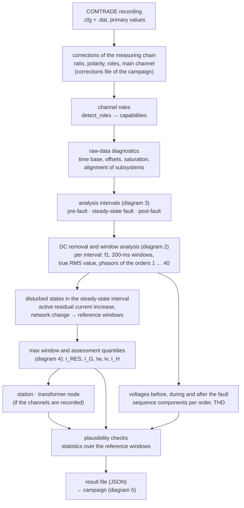
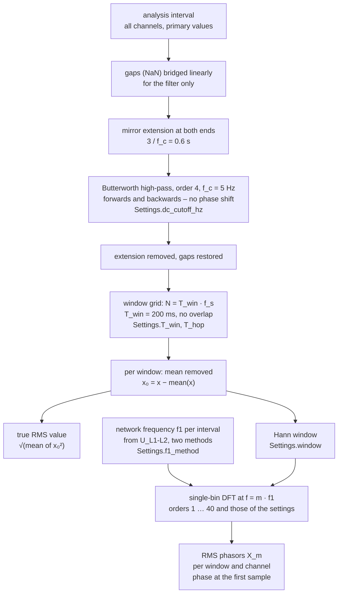
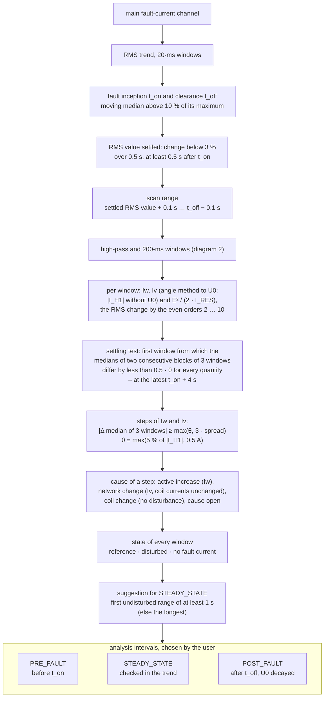
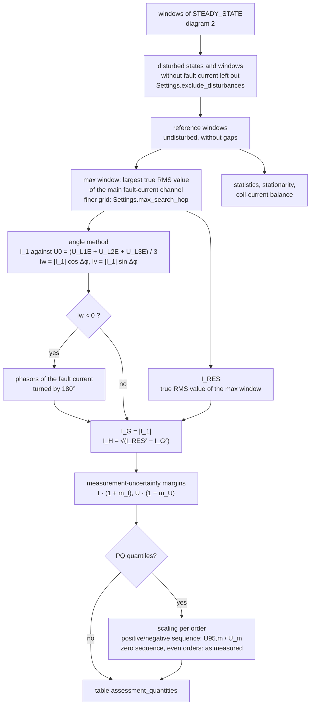
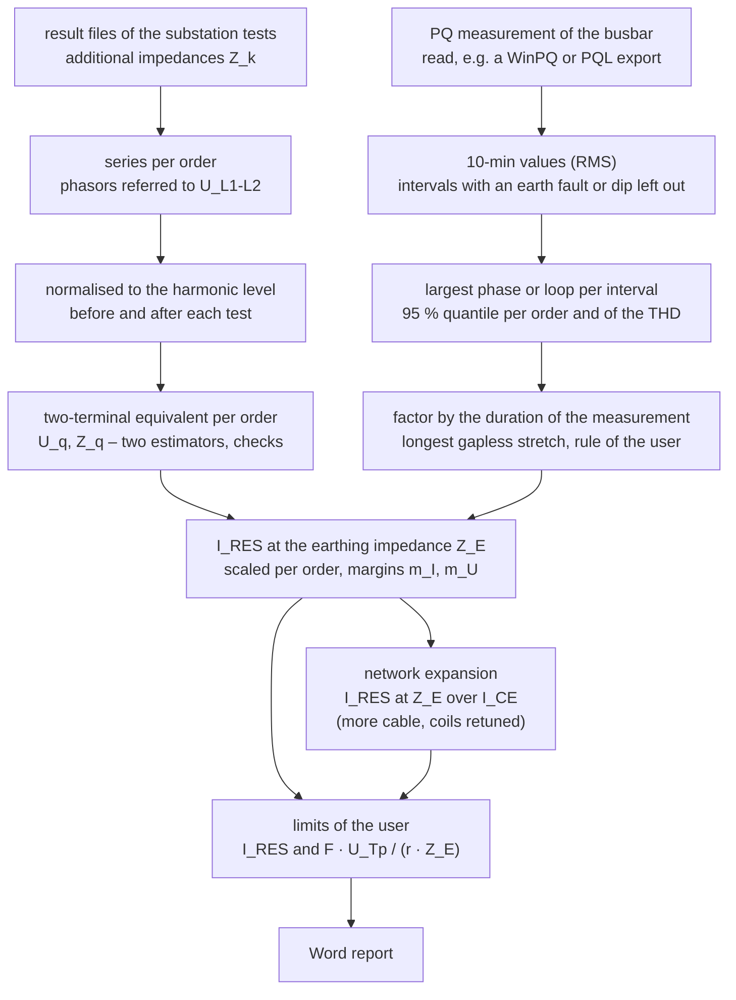

# Evaluation chain

The block diagrams on this page show the order of the steps – from the COMTRADE file to the result file of a
recording and on to the campaign – and where the settings act. They are a map: the formulas and the reasons behind
every step are on the pages the blocks refer to, mainly [Signal processing](signal-processing.md),
[Assessment quantities](assessment.md) and [Equivalent-source method](equivalent-source.md). Numbers in the blocks are
the defaults; the names in `code` are the settings or functions that change them.

| Diagram | Steps |
|---|---|
| [1 · Recording](#1-recording) | the whole evaluation of one recording ([`evaluate`](../reference/evaluation.md)) |
| [2 · DC removal and window analysis](#2-dc-removal-and-window-analysis) | high-pass, windows, mean, true RMS value, DFT |
| [3 · Analysis intervals](#3-analysis-intervals) | fault inception and clearance, settling, disturbed states, the suggestion of the steady-state interval, pre-fault and post-fault |
| [4 · Max window and assessment quantities](#4-max-window-and-assessment-quantities) | reference windows, max window, angle method, harmonic content, margins, scaling |
| [5 · Campaign](#5-campaign) | equivalent sources, power-quality measurement, residual current at the earthing impedance, network expansion, report |

## 1 · Recording

Corrections, roles and diagnostics are described in [Evaluating a recording](../user-guide/evaluation.md); the
station and the transformer node have pages of their own ([Superposition at the station](superposition.md),
[Transformer node](transformer-node.md)). All quantities of the assessment come from **one** window, the max window,
so that magnitudes and phase angles of all channels belong to the same instant.

## 2 · DC removal and window analysis

Every analysis interval is read for all channels at once and passes the same steps; the high-pass acts on the whole
interval, the rest on each window.

The high-pass removes the DC component of a clamp and a slowly decaying offset – the transient of the coil current
after the fault inception – before the windows are cut. Running forwards and backwards, it shifts no phase, and its
magnitude at 50 Hz differs from 1 by less than 10⁻⁸; the mirror extension avoids a step at the ends of the interval,
and no sample outside the interval (a fault inception just after it) acts on it. Only the first and last 0.2 s of
an interval keep a small error of the RMS value (about 0.1 %); the harmonics are unchanged.

After the high-pass the mean of a window is its remaining DC component. The **mean** is removed rather than the
median: for a waveform with even harmonics – a saturating clamp, the transient after a metallic fault – the median
differs from the mean, and the true RMS value would come out too high. 30 A at 50 Hz with 12 A of the 2nd and 8 A of
the 4th harmonic have a true RMS value of 33.29 A; the median per window gives 34.48 A (+3.6 %), the high-pass with
the mean 33.29 A.

| `Settings.dc` | On the interval | Per window | Use |
|---|---|---|---|
| `"highpass"` (default) | zero-phase high-pass | mean | exact true RMS value, also with even harmonics and a decaying offset |
| `"highpass_median"` | zero-phase high-pass | median | the high-pass of groundfault 3.4 |
| `"median"` | – | median | the default up to groundfault 3.4: robust against single spikes, too high with even harmonics |
| `"mean"` | – | mean | a constant offset only |
| `"none"` | – | – | signals without DC component |

The choice changes neither the window grid nor the phasors of the orders m ≥ 1 – only the DC and the low-frequency
part of a window, and with it the true RMS value. Formulas: [Signal processing](signal-processing.md#dc-removal).

## 3 · Analysis intervals

The three analysis intervals are chosen by the person who knows the test sequence. groundfault proposes the
steady-state interval ([`disturbances.scan`](../reference/disturbances.md)) and, inside the interval that is chosen,
leaves the disturbed windows out again with the same detection.

* **Fault inception and clearance** come from the RMS trend of the fault current; the RMS value counts as settled once
  it stays within 3 % for 0.5 s ([`station.settled_from`](../reference/station.md)).
* **Settling of the fault state** ([`settled_index`](../reference/disturbances.md)): the RMS value may settle before the
  fault state does. After a metallic fault Iw and Iv can need seconds – a clamp or transformer that saturates and
  recovers, the DC component of the coil current –, and the even harmonics decay with them. The test compares the
  medians of two consecutive blocks of three windows (0.6 s each) and starts the scan at the first window from which
  every quantity drifts by less than half the step threshold; the odd harmonics follow the harmonic voltage of the
  network and take no part. A state that has not settled 4 s after the inception is scanned from the settled RMS value
  on, with a note.
* **Disturbed states** are abrupt steps of Iw (an active residual current increase) or Iv (a network change; with
  measured coil currents that follow the step: a coil change, which is no disturbance). A ramp – a motor-driven coil
  adjustment – is no step. The start of the scanned range is the reference of the network state; that is why the scan
  must not start in the transient. The rules are in [Signal processing](signal-processing.md#disturbed-states).
* **Pre-fault and post-fault** are chosen from the RMS trend in the operation without fault: a few seconds before the
  inception, and after the clearance once the neutral displacement voltage has decayed. They give the voltage levels
  and harmonics without fault, the background at a station and the levels the equivalent-source method normalises
  with.

The scan text names the fault, the scanned range, the threshold, a shifted start with the quantity that settled
last, the disturbed ranges and the suggestion
([Evaluating a recording](../user-guide/evaluation.md#disturbed-states)).

## 4 · Max window and assessment quantities

The max window is the conservative choice: of the reference windows the one with the largest residual current. With
`correct_polarity=False` a negative Iw is only reported. Without the three line-to-earth voltages the measured
neutral displacement voltage serves as U0. The scaling rules – with the THD for an order without its own quantile –
are in [Assessment quantities](assessment.md#scaling-to-the-95-quantile-of-a-power-quality-measurement).

## 5 · Campaign

The fundamental component is not part of the model of the equivalent sources; it is taken from the measurements. A
power-quality measurement shorter than every duration of the rule is not valid for the assessment
([Power-quality measurements](../user-guide/pq.md#quantile-and-factor)). The network expansion converts the
equivalent sources of today to a network with more cable
([Equivalent-source method](equivalent-source.md#network-expansion)); the report puts all of it together
([Word report of a campaign](../user-guide/document.md)).
