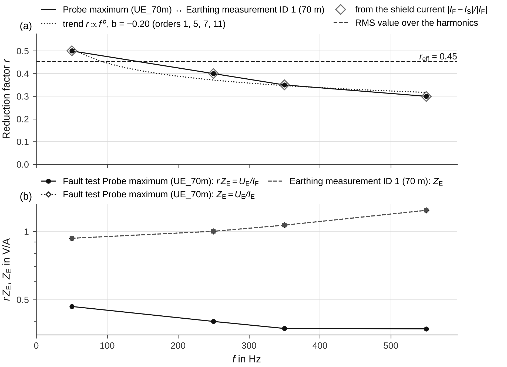

# Reduction factor and LV network

During an earth fault at a secondary substation, only part of the fault current flows through the station earth
electrode into the soil; the rest returns through cable shields, PEN conductors and other return conductors. The
**reduction factor** r is the share that flows through the earth: the earth potential rise is U_E = r·Z_E·I_F. A
staged fault test measures the product r·Z_E – the fault-related earth potential rise per ampere of fault current –,
an earthing measurement with current injection measures the earthing impedance Z_E. groundfault therefore calls the
ratio U_E/I_F of the fault test **r·Z_E** (columns `rZE_…`), never Z_E: it contains the reduction factor. Only with
the earth current I_E = I_F − I_S (shield currents measured) does the fault test give Z_E itself
(`Z_E_earth_current_Ohm`). The ratio r·Z_E / Z_E is the reduction factor of the station, per harmonic order. This page describes how groundfault forms it from the
[station evaluation](superposition.md) and the earthing measurements of a groundmeas database, how it rates the
result, and how the earthing impedance of the LV network is compared with the earthing measurement. The functions are
[`earthing.reduction_factor`](../reference/earthing.md#groundfault.earthing.reduction_factor) and
[`earthing.check_lv_network`](../reference/earthing.md#groundfault.earthing.check_lv_network); reading the database,
choosing the location and the tables are described in [Earthing measurements](../user-guide/earthing.md).

## Voltage per ampere from both measurements

Both measurements are normalised to 1 A, per harmonic order m:

| Measurement | Voltage per ampere | Source |
|---|---|---|
| staged fault test | \( \lvert r\,\underline{Z}_{\text{E},m}\rvert = \lvert\Delta\underline{U}_{\text{E},m}/\underline{I}_{\text{F},m}\rvert \) – the fault-related component | table `station_frequency` (`Z_fault_Ohm`), in the reduction factor table `rZE_fault_Ohm` (as measured: `rZE_direct_Ohm`) |
| earthing measurement | \( \lvert\underline{U}_{\text{E},m}/\underline{I}_{\text{test},m}\rvert = \lvert\underline{Z}_{\text{E},m}\rvert \) at the probe | groundmeas, `earthing_impedance` per probe distance ([`frequency_response`](../reference/earthing.md#groundfault.earthing.frequency_response)); `Z_E_injection_Ohm` |

The fault-related component is used, not the value as measured: the background present before the fault does not
exist at the injection. Uncertain fault-test values (column `uncertain`, see
[Superposition](superposition.md#how-reliable-is-the-fault-related-component)) are carried along.

## Reduction factor per order and as RMS value

Per order the reduction factor is the ratio of the magnitudes,

\[
r_m = \frac{\lvert r\,\underline{Z}_{\text{E},m}\rvert}{\lvert\underline{Z}_{\text{E},m}\rvert}
    = \frac{\lvert\Delta\underline{U}_{\text{E},m}/\underline{I}_{\text{F},m}\rvert}{\lvert\underline{Z}_{\text{E},m}\rvert}
\]

(column `r`; `r_to_r_50Hz` = r_m/r_1 shows the trend referred to 50 Hz). The angles of both impedances do not enter.
`r_min` and `r_max` are the same ratio with the smallest and the largest of the single superposition methods
(inception, clearance, voltage reference) – the span drawn as a bar in the figure of r over the frequency, in the same
way as for the impedances. `r_direct` uses the value as measured (with the background).
Over all orders with both values, weighted with the spectrum of the fault current, the RMS value is

\[
r_\text{eff} = \frac{\sqrt{\sum_m \lvert\Delta U_{\text{E},m}\rvert^2}}{\sqrt{\sum_m \big(\lvert Z_{\text{E},m}\rvert\,\lvert I_{\text{F},m}\rvert\big)^2}}
\]

– the RMS earth potential rise of the fault test divided by the RMS earth potential rise that the same fault current
(same spectrum) would cause at the earthing impedance of the earthing measurement. `I_F_coverage_pct` gives the share
of \( \sum_m \lvert I_{\text{F},m}\rvert^2 \) covered by these orders.

The demo station was generated with r = 0.5 at 50 Hz, falling to 0.3 at 550 Hz. The block below reproduces r_eff, the
trend exponent and the voltages at the reference current from the columns of the spectrum table; the parameters of
the classification and the relevance are illustrative values of a user:

```python
import os
import tempfile

import numpy as np
import groundfault as gf
from groundfault import corrections, demo, earthing

d = demo.make_campaign(tempfile.mkdtemp(), layout="en")
campaign = d["campaign"]
rec = gf.open_recording(os.path.join(campaign, d["station"]["cfg"]))
corr = corrections.load(campaign)
corr.apply(rec)
roles = gf.detect_roles(rec.channel_names, rec.units, corr.role_overrides(rec), corr.main_channel(rec),
                        corr.distances(rec))
res = gf.evaluate(rec, gf.Intervals((2.5, 5.3), (0.2, 1.8), (5.8, 7.8)), roles=roles)
with earthing.Database(d["db"]) as db:
    response = earthing.frequency_response(db, [1])
spectrum, effective = earthing.reduction_factor(res, response, reference_current_A=100.0, U_Tp=100.0, F=2.5,
                                                r_typical=(0.3, 0.8))   # illustrative values – define your own

s = spectrum[spectrum["channel"] == "max(UE)"]                  # probe maximum ↔ farthest probe
e = effective[effective["channel"] == "max(UE)"].iloc[0]
u_fault = s["rZE_fault_Ohm"] * s["I_F_A"]                        # |ΔU_E,m|
u_inj = s["Z_E_injection_Ohm"] * s["I_F_A"]                      # |Z_E,m|·|I_F,m|
r_eff = np.sqrt((u_fault ** 2).sum() / (u_inj ** 2).sum())
b = np.polyfit(np.log(s["f_Hz"]), np.log(s["r"]), 1)[0]          # r ∝ f^b
print("r_eff  = %.4f (table %.4f)" % (r_eff, e["r_eff"]))
print("b      = %.3f (table %.3f, %s)" % (b, e["exponent_r_vs_f"], e["trend_r_vs_f"]))
i_ref, limit = e["reference_current_A"], e["F_times_U_Tp_V"]
u_f = np.sqrt((u_fault ** 2).sum() / (s["I_F_A"] ** 2).sum()) * i_ref
u_m = np.sqrt((u_inj ** 2).sum() / (s["I_F_A"] ** 2).sum()) * i_ref
print("at %.0f A: U_E fault test %.1f V, earthing measurement %.1f V, deviation %.1f %% of F·U_Tp = %.0f V → %s"
      % (i_ref, u_f, u_m, 100 * abs(u_m - u_f) / limit, limit, e["assessment_relevance"]))
print("coverage of I_F²: %.1f %%" % e["I_F_coverage_pct"])
print(e[["r_eff", "r_eff_direct", "r_eff_rms", "r_eff_shield", "Z_E_earth_current_to_injection_eff", "r_50Hz",
         "classification_r_50Hz"]].to_string())
```

```text
r_eff  = 0.4534 (table 0.4534)
b      = -0.201 (table -0.201, falling)
at 100 A: U_E fault test 43.8 V, earthing measurement 96.7 V, deviation 21.1 % of F·U_Tp = 250 V → unchanged
coverage of I_F²: 100.0 %
r_eff                                 0.453392
r_eff_direct                          0.453374
r_eff_rms                             0.469794
r_eff_shield                          0.453371
Z_E_earth_current_to_injection_eff    1.000048
r_50Hz                                 0.50001
classification_r_50Hz                  typical
```

## Interpolation, never extrapolation

An earthing measurement is usually made at a few frequencies only. For every order of the fault test, the earthing
impedance is taken as measured if a measured frequency lies within ±5 Hz (`tolerance_hz`), otherwise it is
**interpolated linearly** between the neighbouring measured frequencies – never extrapolated. The column
`injection_frequency` says which (“measured at 250 Hz”, “interpolated 150–350 Hz”); `interpolate=False` uses measured
values only. Orders outside the measured range drop out of r_eff, and the coverage shows how much of the fault
current is left out. With an earthing measurement at 50, 150 and 350 Hz only:

```python
path = demo.make_groundmeas_db(os.path.join(d["base"], "sparse.db"), orders=(1, 3, 7))   # 50, 150, 350 Hz only
with earthing.Database(path) as db:
    sparse = earthing.frequency_response(db, [1])
sp2, eff2 = earthing.reduction_factor(res, sparse)
print(sp2[sp2["channel"] == "max(UE)"][["order", "f_Hz", "Z_E_injection_Ohm", "injection_frequency", "r"]]
      .round(3).to_string(index=False))
print(eff2[eff2["channel"] == "max(UE)"][["orders", "I_F_coverage_pct", "r_eff", "trend_orders", "trend_r_vs_f"]]
      .round(3).to_string(index=False))
```

```text
 order   f_Hz  Z_E_injection_Ohm     injection_frequency     r
     1  49.98              0.933       measured at 50 Hz 0.500
     5 249.90              1.011 interpolated 150–350 Hz 0.396
     7 349.86              1.066      measured at 350 Hz 0.350
    11 549.78                NaN                           NaN
 orders  I_F_coverage_pct  r_eff trend_orders trend_r_vs_f
1, 5, 7            99.265  0.453         1, 7      falling
```

The value at 250 Hz is interpolated (true: 1.002 V/A), the one at 550 Hz is not extrapolated, so the 11th harmonic is
missing from r_eff (coverage 99.3 %), and the trend uses only the orders 1 and 7, where the earthing measurement was
measured.

## Which probes are compared

The result rows compare the **probe maximum** of the fault test (`channel` = `max(UE)`: per order the highest
fault-related voltage of all probes against the station earth, in the RMS table the probe with the highest RMS value –
see [Probe maximum](superposition.md#probe-maximum)) with the **farthest probe** of each earthing measurement
(`distance_match` = `maximum`): every probe measures at most the full earth potential rise, and at the injection the
farthest probe comes closest to it. In addition every earth-potential probe of the fault test is compared with the
probe of the earthing measurement whose distance is nearest (logarithmically) – `equal` up to a factor of 1.25,
`similar` up to 2, otherwise `different` (not to be read as a reduction factor); a probe without a known distance is
compared with the farthest probe (`unknown`). The touch voltage is compared in
[`earthing.compare`](../user-guide/earthing.md#comparing-with-the-fault-test) (`touch`); its ratio alone is not a
reduction factor.

## Comparison methods

The effective table contains the RMS value obtained in four ways:

| Column | Method |
|---|---|
| `r_eff` | spectral, fault-related component – **the result** |
| `r_eff_direct` | spectral, with the values as measured (including the background) |
| `r_eff_rms` | the simple method: RMS value U_E/I_F in the max window divided by \(\lvert Z_\text{E}\rvert\) at 50 Hz – contains the background and assumes a frequency-independent earthing impedance |
| `r_eff_shield` | from the shield current: \( r_{\text{S},m} = \lvert\underline{I}_{\text{F},m} - \Delta\underline{I}_{\text{S},m}\rvert/\lvert\underline{I}_{\text{F},m}\rvert \), weighted like r_eff |

The cross-check from the **shield current** is independent of both voltage measurements: the earth current is what
does not return through the shields, \( \underline{I}_\text{E} = \underline{I}_\text{F} - \sum\Delta\underline{I}_\text{S} \)
(all shield-current channels, fault-related, each turned into the direction of I_F). It is valid only if the
shield-current channels capture all return conductors. With it, the fault test also gives the earthing impedance
\( \lvert\Delta U_\text{E}\rvert/\lvert I_\text{E}\rvert \) (`Z_E_earth_current_Ohm`), and
`Z_E_earth_current_to_injection` = r/r_S compares it with the earthing measurement: 1 means that both measure the same earthing
impedance, a smaller value that the earthing measurement is higher than the shield current explains. `share_shield`
is \( \lvert\Delta I_\text{S}\rvert/\lvert I_\text{F}\rvert \). (The max-window table `station_currents` also gives
r = |I_F − I_S|/|I_F| per order and, for comparison, 1 − |I_S|/|I_F|, which ignores the angle between the two currents
and is never larger.)

In the demo all four agree except the simple method, which is too high because the earthing impedance rises with the
frequency while it divides by the value at 50 Hz.

## Rating the result

**Classification at 50 Hz** (`classification_r_50Hz`): r at 50 Hz against the range the user expects (`r_typical`,
e.g. from their own experience with comparable installations – it depends on cable type and length, shield earthing and
network): `below`, `typical` or `above`. groundfault has no default range: without one the column is `–`. Above 1.1 r
is `implausible` with or without a range – the fault test would then measure more than the full earth potential rise
of the earthing measurement.

**Trend over the frequency** (`trend_r_vs_f`): a power law r ∝ f^b, the exponent b (`exponent_r_vs_f`) fitted as a
regression line of log r over log f at the reliable orders (`trend_orders`: the earthing measurement was measured at
that frequency and the fault-test value is not uncertain; with fewer than two such orders, all orders with an r).
`falling` for b ≤ −0.1 – the expected case –, `rising` for b ≥ 0.1, otherwise `constant`. The same exponent of r·Z_E
and Z_E (`exponent_rZE_fault`, `exponent_Z_E_injection`; b = b(r·Z_E) − b(Z_E)) shows whether a deviation grows with
the frequency. The figures of the reduction factor draw r over the frequency like the impedances – per order with the
span of the superposition methods, ⊗ for uncertain fault-test values – together with the fitted trend
\( r = c\,f^{\,b} \) over the reliable orders ([`earthing.power_fit`](../reference/earthing.md#groundfault.earthing.power_fit)):



**Relevance for the assessment** (`assessment_relevance`): with small earthing impedances relative deviations look
large, while the assessment of an earthing system depends on the voltage. Both quantities (r·Z_E and Z_E) are therefore converted to a
**reference current** of the user – the argument `reference_current_A`, otherwise the largest limit of the residual
current in the settings of the evaluation (`Settings.ires_limits`) – with the measured spectrum of the fault current:
U_E = Z_eff·I_ref, with
\( Z_\text{eff} = \sqrt{\sum_m \lvert Z_m\rvert^2\lvert I_{\text{F},m}\rvert^2}/\sqrt{\sum_m\lvert I_{\text{F},m}\rvert^2} \)
for the fault test and the earthing measurement. Their difference is referred to F·U_Tp, with U_Tp and F of the user
(arguments `U_Tp` and `F`, otherwise `Settings.u_tp` and `Settings.f_factor` of the evaluation): `negligible` below 10 %
(`relevance_threshold_pct`), `unchanged` if both earth potential rises lie on the same side of F·U_Tp, `relevant` if
one lies above and one below – then the assessment of the earthing system depends on the method. The effective table
records the parameters used (`reference_current_A`, `U_Tp_V`, `F_factor`, `F_times_U_Tp_V`); without them the
relevance is `–` and [`reduction_hints`](../reference/earthing.md#groundfault.earthing.reduction_hints) names the
missing parameters.

## LV network and earthing measurement

The station evaluation checks the earthing impedance of the LV network against the fault test itself
([parallel checks](superposition.md#the-two-parallel-checks)). `check_lv_network` adds the comparison with the
earthing measurement: as a parallel branch of the total earthing, |Z_E,LV| ≥ |Z_E| must hold if both methods measure
the same earthing system correctly (column `injection_comparison`): `satisfied` if Z_E,LV/Z_E ≥ 1, `borderline` if it
is below 1 by less than the uncertainty (the uncertainty of Z_E,LV and 5 % for the earthing measurement,
`injection_uncertainty_pct`, added in quadrature), otherwise `below`. The RMS values use the spectrum of the current
into the LV network:

\[
Z_\text{E,LV,eff} = \frac{\sqrt{\sum_m \lvert\Delta U_{\text{E},m}\rvert^2}}{\sqrt{\sum_m \lvert I_{\text{LV},m}\rvert^2}}
\quad\text{against}\quad
Z_\text{E,eff} = \frac{\sqrt{\sum_m \big(\lvert Z_{\text{E},m}\rvert\,\lvert I_{\text{LV},m}\rvert\big)^2}}{\sqrt{\sum_m \lvert I_{\text{LV},m}\rvert^2}}
\]

The plausibility check of the LV-network evaluation is the one against the fault test. If it is satisfied but the
comparison with the earthing measurement is `below`, the contradiction lies with the earthing measurement – a value
that is too high, or a different switching state (PEN conductors or cable shields disconnected) – a finding to record,
not an error of the LV-network evaluation.

## Physical interpretation

The fault current reaches the faulted station through a cable whose shield – and further return conductors such as
PEN connections to neighbouring stations or earth wires – is magnetically coupled with the faulted conductor. The
voltage induced along the return conductors drives part of the fault current back to the substation without passing
through the station earth electrode. The coupling grows with the frequency, as the inductive coupling impedance gains
on the resistance of the return path, so **r falls with the frequency** (f → ∞: r → 0) and a falling trend is
expected.

| Finding | Possible causes |
|---|---|
| r below the typical range | further return paths (shields of other cables, PEN connections) – or an earthing measurement that is too high: the fall-of-potential method tends to give values that are too high, e.g. through inductive coupling of the measuring leads, especially at higher frequencies and low-impedance installations, or through the position of probe and auxiliary electrode; or a different switching state during the earthing measurement |
| r above the typical range | little current returns through the return conductors: shield interrupted, a high-impedance shield termination (e.g. a poorly earthed pole), an overhead line without earth wire – or an earthing measurement that is too low |
| r above 1.1 | implausible: check ratio and polarity of the channels, the probe position and the earthing measurement |
| r rises with the frequency | unexpected: an earthing measurement too small at higher frequencies, or uncertain harmonics of the fault test |
| shield current almost zero (below 10 % of I_F) | shield interrupted or terminated with a high impedance, or the channel does not capture the feeding cable |
| r from the earth potential rise and from the shield current differ by more than a factor of 2 | further return paths that the shield-current channel does not capture, or an earthing measurement that is too high |

[`earthing.reduction_hints`](../user-guide/earthing.md#hints) turns these findings into hints, each with the relevance
of the deviation for the assessment. Deviations between the two methods are findings about the measuring methods –
they show how strongly an earthing measurement can be distorted, and they can be reproduced with a simulation of the
earthing system.
