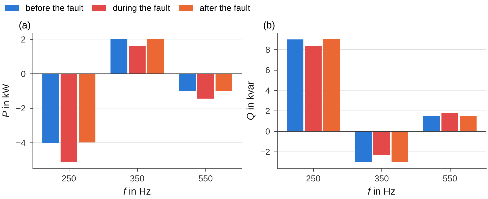
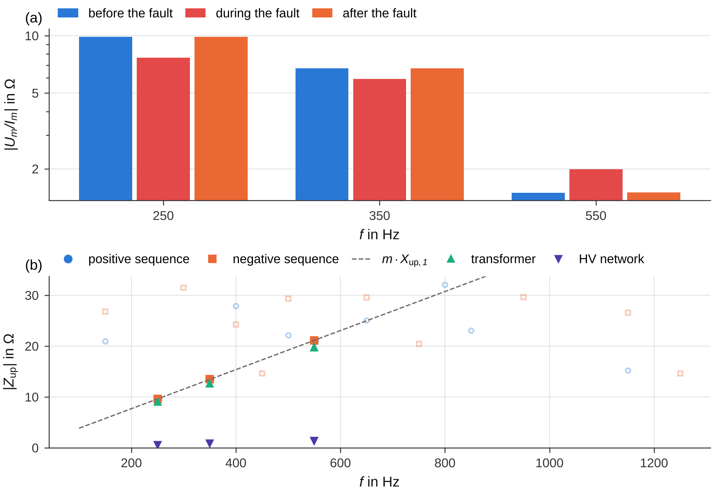

# Transformer node

At the HV/MV transformer of the substation all harmonic sources of the MV network are bundled: the loads and
generators of the MV network on one side, the background distortion of the HV network on the other. A recording with
the three line currents of the transformer (MV side, roles `i_l1` … `i_l3`, channel names such as `I1` … `I3` or
`IL1` … `IL3`) and the line-to-earth voltages of the MV busbar shows how these sources behave before, during and after
the earth fault: how the power of every order changes and which impedance the network presents at the transformer.
With the line-to-earth voltages of the HV side as well (`V1HS` …, roles `u_hv_l1e` …) the impedance seen from the MV
busbar is split into the transformer and the HV network.

[`evaluate`](../reference/evaluation.md#groundfault.evaluation.evaluate) runs this analysis
([`transformer.node_analysis`](../reference/transformer.md#groundfault.transformer.node_analysis)) for every recording
with the transformer capability. It needs at least a pre-fault or a post-fault interval besides the steady-state
interval for the changes; with both, the post-fault interval also serves as the null test.

## States

| State | Windows |
|---|---|
| `pre_fault` | all windows of the pre-fault interval |
| `fault` | the reference windows of the steady-state interval: undisturbed, see [Signal processing](signal-processing.md) – an active residual current increase or a network change is left out |
| `post_fault` | all windows of the post-fault interval |

Every quantity of a state is the mean over its windows. Without a fault-current channel – the usual case for a
transformer recording – the fault current for the detection of the disturbed states is estimated from the transformer
currents (see [below](#fault-current-estimated-from-the-transformer-currents)).

## Sequence components, power and apparent impedance

Per window, order m and sequence s (zero, positive, negative) the busbar voltages and the transformer currents are
decomposed into symmetrical components and referred to the fundamental of U_L1-L2 of the window
([common angle reference](index.md#angle-reference)):

\[
\hat{\underline{U}}_{s,m} = \underline{U}_{s,m}\,e^{-j m \varphi_\text{LL1}},\qquad
\hat{\underline{I}}_{s,m} = \underline{I}_{s,m}\,e^{-j m \varphi_\text{LL1}}
\]

so that phasors of different windows and states can be averaged and subtracted. The complex power of a sequence and
the apparent impedance are

\[
\underline{S}_{s,m} = 3\,\hat{\underline{U}}_{s,m}\,\hat{\underline{I}}_{s,m}^{*} = P_{s,m} + jQ_{s,m},
\qquad
\underline{Z}_{s,m} = \hat{\underline{U}}_{s,m}/\hat{\underline{I}}_{s,m}
\]

The sum over the three sequences equals the sum over the phases, \( \sum_s \underline{S}_{s,m} = \sum_x
\underline{U}_{x,m}\underline{I}^{*}_{x,m} \) (sequence `total`). P and Q are means of the powers of the windows (exact
also when the phase of a harmonic drifts), U and I are RMS values over the windows, the apparent impedance comes from
the complex means.

**Reference arrow system.** P and Q are given in the consumer reference arrow system of the MV network: P > 0 flows
through the transformer from the HV into the MV network. At a harmonic order, P_m < 0 means that the MV network as a
whole feeds power of this order into the HV network – the dominant source of the order lies in the MV network –,
P_m > 0 that it comes from the HV network. The sign of a harmonic power is an indicator, not a proof: with sources on
both sides the power flows from the stronger one.

**Apparent impedance.** U_m/I_m is not a physical impedance when there are sources on both sides; it is the ratio the
node presents and changes as soon as the fault adds its own currents. The upstream impedance below is the physical
quantity behind the change.

## Upstream impedance from the fault-related change

At the fault location the earth fault draws I1 = I2 = I0 = I_F/3 of every order (fault in L1; for L2 and L3 the
phase factors a, a² enter). The zero-sequence part closes through the earth capacitances and the coils; the positive-
and negative-sequence parts flow – mostly – through the transformer. As long as the harmonic voltages of the HV
network stay unchanged, the busbar voltage changes by

\[
\Delta\hat{\underline{U}}_{s,m} = -\underline{Z}_{\text{up},s,m}\,\Delta\hat{\underline{I}}_{s,m}
\quad\Rightarrow\quad
\underline{Z}_{\text{up},s,m} = -\frac{\Delta\hat{\underline{U}}_{s,m}}{\Delta\hat{\underline{I}}_{s,m}}
\]

Z_up is the impedance of the transformer and the HV network seen from the MV busbar – a quantity that is hard to
measure otherwise. It is inductive, and X_up/m is about constant as long as the transformer dominates
(`X_up_per_order_Ohm`). The earth fault is a convenient excitation: it changes the current at every order by a known
mechanism, without switching anything in the HV network.

| Column | Meaning |
|---|---|
| `dU_V`, `dI_A` | magnitude of the change fault − pre-fault (without a pre-fault interval: fault − post-fault) |
| `Z_up_Ohm`, `Z_up_angle_deg`, `R_up_Ohm`, `X_up_Ohm` | upstream impedance from fault − pre-fault |
| `Z_up_post_Ohm`, `Z_up_post_angle_deg`, `deviation_pct` | second estimate from fault − post-fault and the deviation of both |
| `dU_null_V`, `dI_null_A` | null test: change post-fault − pre-fault – the drift of the background during the fault |
| `uncertainty_pct` | \( \sqrt{(\delta U/\lvert\Delta U\rvert)^2 + (\delta I/\lvert\Delta I\rvert)^2} \), δ = the larger of the standard error of the difference (spread of the windows) and the null test |
| `significant` | uncertainty at most 20 % ([`SIGNIFICANCE`](../reference/transformer.md#groundfault.transformer.SIGNIFICANCE)) |
| `pos_neg_deviation_pct` | deviation between positive and negative sequence of the order – equal for a symmetrical, passive upstream network |

**HV network and transformer.** With the HV voltages, the ratio t and the phase shift of the vector group are taken
from the fundamental of the positive sequence (`hv_ratio`, `hv_group`: the phase shift rounded to k·30°). The change of
the HV voltage referred to the MV side – positive sequence divided by t·e^{+jk·30°}, negative sequence by
t·e^{−jk·30°} – gives the share of the HV network, the rest is the transformer:

\[
\underline{Z}_{\text{HV},s,m} = -\frac{\Delta\hat{\underline{U}}_{\text{HV},s,m}/(t\,e^{\pm jk\cdot 30^\circ})}{\Delta\hat{\underline{I}}_{s,m}},
\qquad
\underline{Z}_{\text{T},s,m} = \underline{Z}_{\text{up},s,m} - \underline{Z}_{\text{HV},s,m}
\]

The measured ratio contains the voltage drop of the transformer under load (about 1 %), which scales Z_HV by the same
amount.

**Summary value.** `X1_up_Ohm` in `res.values["transformer"]` is the mean of X_up/m over the significant positive- and
negative-sequence orders ≥ 2 not divisible by 3, weighted with 1/uncertainty² – the reactance of transformer and HV
network at the fundamental; with HV voltages also `X1_transformer_Ohm` and `X1_hv_Ohm`. The plausibility table shows
it with the spread of the single orders.

## Polarity of the current transformers

Z_up of transformer and HV network is inductive (0° < φ < 180°). If the angle lies between −180° and 0° at the
significant orders, the currents were measured in the generator reference arrow system (current from the MV busbar
into the transformer). The decision uses the |ΔI|-weighted mean angle over the significant positive- and
negative-sequence orders ≥ 2 that are not divisible by 3. With `Settings.transformer_sign = None` (default) the currents
are then reversed for P, Q and the impedances; a hint and the plausibility row
“Polarity of the transformer currents” (status `CORRECTED`) say so. `transformer_sign = +1` or `−1` fixes the sign; if
it contradicts the angle of Z_up, a hint and a `WARNING` point to the current transformers. Without a significant
order the currents are taken as measured. A polarity reversed in the measuring chain can also be corrected for the
whole campaign in the [corrections file](../user-guide/corrections.md) (factor −1 for `I1` … `I3`).

## Fault current estimated from the transformer currents

A transformer recording usually has no fault-current channel. For the detection of disturbed states
([`disturbances.detect`](../reference/disturbances.md#groundfault.disturbances.detect)) the fault current is then
estimated from the change of the negative-sequence fundamental of the transformer current against the pre-fault (or
post-fault) state:

\[
\underline{I}_\text{F} \approx 3\,c\,(\hat{\underline{I}}_{2,1} - \bar{\hat{\underline{I}}}_{2,1,\text{pre}}),
\qquad c = 1,\ a,\ a^2 \text{ for a fault in L1, L2, L3}
\]

oriented with the polarity found from Z_up. The negative sequence is used because the load hardly changes it; the
positive sequence is dominated by the load. The estimate fluctuates with the load unbalance from window to window, so
a step counts only if it is also at least [`NOISE_FACTOR`](../reference/transformer.md#groundfault.transformer.NOISE_FACTOR)
= 4 times this noise ([`estimate_noise`](../reference/transformer.md#groundfault.transformer.estimate_noise): robust
standard deviation of the differences of successive windows of the active and the reactive component). The steps of
this estimate – an active residual current increase, a network change – are reliable; its level is only an estimate: loads, generators and a parallel transformer take part
of the negative-sequence current as well, and the change of other negative-sequence currents at the fault inception
enters the level. A hint names the estimate and the faulted phase.

[`disturbances.scan`](../reference/disturbances.md#groundfault.disturbances.scan) uses the same estimate for a
transformer recording before the intervals are chosen: the fault from the RMS trend of the zero-sequence voltage
([`fault_times`](../reference/transformer.md#groundfault.transformer.fault_times)), the reference of the estimate up to
10 s before the inception (else after the clearance), the start of the scan once the estimate has settled – a straight
line through the next eight windows changes by at most 10 % ([`settled_index`](../reference/transformer.md#groundfault.transformer.settled_index)),
at least [`T_SETTLE_S`](../reference/transformer.md#groundfault.transformer.T_SETTLE_S) = 1.5 s after the inception –
and its end before the windows that straddle the clearance
([`fault_end_index`](../reference/transformer.md#groundfault.transformer.fault_end_index)). The zero-sequence voltage
decays more slowly than the fault current, so the clearance found from it is a little late.

## Example

The demo recording has a known upstream impedance (transformer 0.05 + j1.8 Ω, HV network 0.03 + j0.12 Ω at 50 Hz, both
R + j·m·X), currents recorded in the generator reference arrow system and an active residual current increase from 3.0
to 3.8 s:

```python
import os
import tempfile

import groundfault as gf
from groundfault import demo, transformer

path = os.path.join(tempfile.mkdtemp(), "TR_0_10_000kHz.cfg")
truth = demo.make_transformer_recording(path, generator_reference=True, active_step=(3.0, 3.8, 12.0),
                                        duration=7.0, t_off=5.5)
b = truth["intervals"]
res = gf.evaluate(gf.open_recording(path), gf.Intervals(b["steady_state"], b["pre_fault"], b["post_fault"]))
for h in res.hints:
    print("⚠", h)
print(transformer.summary_text(res))
print("truth: X_up,1 = %.3f Ω, transformer %.3f Ω, HV network %.3f Ω" % (truth["X1_up"], truth["X1_transformer"],
                                                                        truth["X1_hv"]))
```

```text
⚠ No fault-current channel: for the detection of disturbed states the fault current is estimated from the change of the negative-sequence current of the transformer (3·ΔI₂, fault in L3, reference pre-fault); its steps are reliable, its level is an estimate.
⚠ Disturbed states excluded: active residual current increase 3.0–3.8 s (ΔIw +10.8 A). Max window, statistics and checks use the undisturbed state (2.0–3.0 s, 3.8–5.2 s).
⚠ Transformer currents measured in the generator reference arrow system (upstream impedance capacitive, mean angle -90° over 6 orders/sequences) – reversed for P, Q and the impedances.
currents: generator reference arrow system (reversed) · X_up/m = 1.920 Ω (6 orders/sequences) · transformer 1.801 Ω, HV network 0.119 Ω (ratio 5.558, group 5) · fault − pre-fault at 50 Hz: ΔP = +207 kW, ΔQ = +3503 kvar
truth: X_up,1 = 1.920 Ω, transformer 1.800 Ω, HV network 0.120 Ω
```

The step of the estimated fault current is 0.9 × 12 A: the demo transformer carries 90 % of the negative-sequence fault
current. The power per order before, during and after the fault (sum of the sequences,
[`power_overview`](../reference/transformer.md#groundfault.transformer.power_overview)):

```python
p = transformer.power_overview(res)
print(p[p["order"].isin([1, 5, 7, 11])].round(2).to_string(index=False))
```

```text
 order  f_Hz  P_pre_fault_kW  P_fault_kW  P_post_fault_kW  Q_pre_fault_kvar  Q_fault_kvar  Q_post_fault_kvar
     1  50.0         8000.03     8207.46          7999.98           1999.99       5503.13            2000.01
     5 250.0           -4.00       -5.12            -4.00              9.00          8.39               9.00
     7 350.0            2.00        1.61             2.00             -3.00         -2.33              -3.00
    11 550.0           -1.00       -1.44            -1.00              1.50          1.81               1.50
```

At 50 Hz the fault adds its active power (the transformer supplies the losses of the earth-fault circuit) and – the
coil of the demo is connected to the star point of this transformer – the reactive power of the coil. The upstream
impedance per order:

```python
z = res.table("transformer_impedance")
cols = ["order", "sequence", "dI_A", "Z_up_Ohm", "Z_up_angle_deg", "X_up_per_order_Ohm", "Z_up_post_Ohm",
        "uncertainty_pct", "significant", "Z_transformer_Ohm", "Z_hv_Ohm"]
print(z[z["order"].isin([5, 7, 11])][cols].round(3).to_string(index=False))
```

```text
 order sequence  dI_A  Z_up_Ohm  Z_up_angle_deg  X_up_per_order_Ohm  Z_up_post_Ohm  uncertainty_pct  significant  Z_transformer_Ohm  Z_hv_Ohm
     5      pos 2.700     9.614          89.587               1.923          9.615            0.229         True              9.024     0.590
     5      neg 2.700     9.595          89.487               1.919          9.615            0.220         True              9.012     0.583
     7      pos 1.201    13.436          89.555               1.919         13.419            0.357         True             12.575     0.860
     7      neg 1.201    13.461          89.522               1.923         13.446            0.370         True             12.618     0.843
    11      pos 0.450    21.041          89.883               1.913         21.103            0.390         True             19.673     1.369
    11      neg 0.450    21.085          89.644               1.917         20.982            0.665         True             19.730     1.355
```

True values: |Z_up| = 9.600, 13.440 and 21.120 Ω, transformer 9.000, 12.600 and 19.800 Ω, HV network 0.601, 0.841
and 1.321 Ω.

[`report.transformer_power`](../reference/report.md#groundfault.report.transformer_power) shows P and Q per order and
state, [`report.transformer_impedance`](../reference/report.md#groundfault.report.transformer_impedance) the apparent
impedance per state and Z_up over the frequency with the line m·X_up,1:





In (a) the apparent impedance |U_m/I_m| changes during the fault although nothing changed in the HV network: the fault
adds its own currents at the node. In (b) the upstream impedance lies on the line m·X_up,1 – an inductive impedance –
and the transformer takes almost all of it.

## Limits

* **Fundamental.** At 50 Hz the change of the positive-sequence current is dominated by load changes, and voltage
  transformers with slightly different ratios let a little of the large zero-sequence voltage into the positive and
  negative sequence. Z_up at m = 1 is listed but does not enter the polarity decision or X1_up.
* **Orders divisible by 3.** During the fault the zero sequence is strongly excited at these orders, and the healthy
  phases carry √3 times their voltage, at which voltage transformers distort more. Their positive- and
  negative-sequence values can deviate; `pos_neg_deviation_pct` shows it.
* **Small changes.** At orders where the fault changes the current only a little, the background drift dominates – the
  uncertainty grows and `significant` turns False. Positive and negative sequence of the same order should agree.
* **Parallel transformers and generators.** With a parallel transformer on the same busbar, −ΔU/ΔI of the measured
  transformer is the impedance of its own path: its transformer impedance plus the impedance of the HV network divided
  by its share of the current. The estimated fault current scales with this share as well.
* **Stable HV background.** The method assumes that the harmonic voltages of the HV network do not change between the
  states; the null test and the two estimates show how well this holds.
