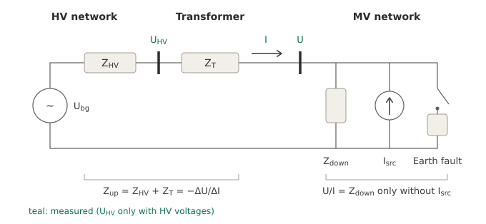

# Transformer node

At the HV/MV transformer of the substation all harmonic sources of the MV network are bundled: the loads and
generators of the MV network on one side, the background distortion of the HV network on the other. A recording with
the three line currents of the transformer (MV side, roles `i_l1` … `i_l3`, channel names such as `I1` … `I3` or
`IL1` … `IL3`) and the line-to-earth voltages of the MV busbar shows how these sources behave before, during and after
the earth fault: how the power of every order changes and which impedance the network presents at the transformer.
With the line-to-earth voltages of the HV side as well (`V1HS` …, roles `u_hv_l1e` …) the impedance seen from the MV
busbar is split into the transformer and the HV network.

[`evaluate`](../reference/evaluation.md#groundfault.evaluation.evaluate) runs this analysis
([`transformer.node_analysis`](../reference/transformer.md#groundfault.transformer.node_analysis)) for every recording
with the transformer capability. It needs at least a pre-fault or a post-fault interval besides the steady-state
interval for the changes; with both, the post-fault interval also serves as the null test.

## States

| State | Windows |
|---|---|
| `pre_fault` | all windows of the pre-fault interval |
| `fault` | the reference windows of the steady-state interval: undisturbed, see [Signal processing](signal-processing.md) – an active residual current increase or a network change is left out |
| `post_fault` | all windows of the post-fault interval |

Every quantity of a state is the mean over its windows. Without a fault-current channel – the usual case for a
transformer recording – the fault current for the detection of the disturbed states is estimated from the transformer
currents (see [below](#fault-current-estimated-from-the-transformer-currents)).

## Sequence components, power and apparent impedance

Per window, order m and sequence s (zero, positive, negative) the busbar voltages and the transformer currents are
decomposed into symmetrical components and referred to the fundamental of U_L1-L2 of the window
([common angle reference](index.md#angle-reference)):

\[
\hat{\underline{U}}_{s,m} = \underline{U}_{s,m}\,e^{-j m \varphi_\text{LL1}},\qquad
\hat{\underline{I}}_{s,m} = \underline{I}_{s,m}\,e^{-j m \varphi_\text{LL1}}
\]

so that phasors of different windows and states can be averaged and subtracted. The complex power of a sequence and
the apparent impedance are

\[
\underline{S}_{s,m} = 3\,\hat{\underline{U}}_{s,m}\,\hat{\underline{I}}_{s,m}^{*} = P_{s,m} + jQ_{s,m},
\qquad
\underline{Z}_{s,m} = \hat{\underline{U}}_{s,m}/\hat{\underline{I}}_{s,m}
\]

The sum over the three sequences equals the sum over the phases, \( \sum_s \underline{S}_{s,m} = \sum_x
\underline{U}_{x,m}\underline{I}^{*}_{x,m} \) (sequence `total`). P and Q are means of the powers of the windows (exact
also when the phase of a harmonic drifts), U and I are RMS values over the windows, the apparent impedance comes from
the complex means.

**Reference arrow system.** P and Q are given in the consumer reference arrow system of the MV network: P > 0 flows
through the transformer from the HV into the MV network. At a harmonic order, P_m < 0 means that the MV network as a
whole feeds power of this order into the HV network – the dominant source of the order lies in the MV network –,
P_m > 0 that it comes from the HV network. The sign of a harmonic power is an indicator, not a proof: with sources on
both sides the power flows from the stronger one.

**Apparent impedance.** U_m/I_m is not a physical impedance when there are sources on both sides; it is the ratio the
node presents and changes as soon as the fault adds its own currents. The upstream impedance below is the physical
quantity behind the change; [Interpreting the results](#interpreting-the-results) shows what the apparent impedance
says about the sources of an order.

## Upstream impedance from the fault-related change

At the fault location the earth fault draws I1 = I2 = I0 = I_F/3 of every order (fault in L1; for L2 and L3 the
phase factors a, a² enter). The zero-sequence part closes through the earth capacitances and the coils; the positive-
and negative-sequence parts flow – mostly – through the transformer. As long as the harmonic voltages of the HV
network stay unchanged, the busbar voltage changes by

\[
\Delta\hat{\underline{U}}_{s,m} = -\underline{Z}_{\text{up},s,m}\,\Delta\hat{\underline{I}}_{s,m}
\quad\Rightarrow\quad
\underline{Z}_{\text{up},s,m} = -\frac{\Delta\hat{\underline{U}}_{s,m}}{\Delta\hat{\underline{I}}_{s,m}}
\]

Z_up is the impedance of the transformer and the HV network seen from the MV busbar – a quantity that is hard to
measure otherwise. It is inductive, and X_up/m is about constant as long as the transformer dominates
(`X_up_per_order_Ohm`). The earth fault is a convenient excitation: it changes the current at every order by a known
mechanism, without switching anything in the HV network.

| Column | Meaning |
|---|---|
| `natural_sequence` | True for the natural sequence of the order (m = 5, 11 …: negative, m = 7, 13 …: positive sequence) – the sequence that carries the pre-fault harmonic of the network |
| `dU_V`, `dI_A` | magnitude of the change fault − pre-fault (without a pre-fault interval: fault − post-fault) |
| `Z_up_Ohm`, `Z_up_angle_deg`, `R_up_Ohm`, `X_up_Ohm` | upstream impedance from fault − pre-fault |
| `Z_up_post_Ohm`, `Z_up_post_angle_deg`, `deviation_pct` | second estimate from fault − post-fault and the deviation of both |
| `dU_null_V`, `dI_null_A` | null test: change post-fault − pre-fault – the drift of the background during the fault |
| `uncertainty_pct` | \( \sqrt{(\delta U/\lvert\Delta U\rvert)^2 + (\delta I/\lvert\Delta I\rvert)^2} \), δ = the larger of the standard error of the difference (spread of the windows) and the null test |
| `significant` | uncertainty at most 20 % ([`SIGNIFICANCE`](../reference/transformer.md#groundfault.transformer.SIGNIFICANCE)) |
| `pos_neg_deviation_pct` | deviation between positive and negative sequence of the order – equal for a symmetrical, passive upstream network |

**HV network and transformer.** With the HV voltages, the ratio t and the phase shift of the vector group are taken
from the fundamental of the positive sequence (`hv_ratio`, `hv_group`: the phase shift rounded to k·30°). The change of
the HV voltage referred to the MV side – positive sequence divided by t·e^{+jk·30°}, negative sequence by
t·e^{−jk·30°} – gives the share of the HV network, the rest is the transformer:

\[
\underline{Z}_{\text{HV},s,m} = -\frac{\Delta\hat{\underline{U}}_{\text{HV},s,m}/(t\,e^{\pm jk\cdot 30^\circ})}{\Delta\hat{\underline{I}}_{s,m}},
\qquad
\underline{Z}_{\text{T},s,m} = \underline{Z}_{\text{up},s,m} - \underline{Z}_{\text{HV},s,m}
\]

The measured ratio contains the voltage drop of the transformer under load (about 1 %), which scales Z_HV by the same
amount.

**Voltage divider – the HV share without transformer currents.** The fault-related changes of the HV voltage
(referred to the MV side) and of the MV voltage are the voltage drops of the same current on Z_HV and on
Z_T + Z_HV. Their ratio is the share of the HV network,

\[
k_{s,m} = \frac{\Delta\hat{\underline{U}}_{\text{HV},s,m}/(t\,e^{\pm jk\cdot 30^\circ})}{\Delta\hat{\underline{U}}_{s,m}}
        = \frac{\underline{Z}_{\text{HV},m}}{\underline{Z}_{\text{T},m} + \underline{Z}_{\text{HV},m}},
\qquad
\underline{Z}_{\text{HV},m} = k_{s,m}\,\underline{Z}_{\text{up},s,m},
\quad
\underline{Z}_{\text{T},m} = (1 - k_{s,m})\,\underline{Z}_{\text{up},s,m}
\]

[`voltage_divider`](../reference/transformer.md#groundfault.transformer.voltage_divider) computes it for every
recording with the line-to-earth voltages of both sides – also without transformer currents, e.g. a substation
recorder with the HV voltages, or the busbar recorder of a staged test while the transformer currents are in a second
instrument (its Z_up then completes the split). The table `transformer_divider` lists per order and sequence
`dU_V`, `dU_hv_V`, `k`, `k_angle_deg`, `uncertainty_pct` (spread of the windows, with pre- and post-fault interval
also the null test of both voltages), `significant` and – with the transformer currents – `Z_hv_Ohm`,
`Z_transformer_Ohm` and X/m of both; `res.values["transformer_divider"]` holds the ratio, the vector group, the
summary value `k` and with Z_up `X1_hv_Ohm` and `X1_transformer_Ohm` (sequence other than the natural one, weighted as
X_up/m). With the transformer currents the divider is a second method beside Z_HV from HV voltage and current: both
use the same HV voltage, but the divider replaces the current by the MV voltage, so phase errors of the current
transformers drop out and those of the two voltage transformers enter instead. A deviation between the two beyond
their uncertainty points to the instrument transformers.

**Summary value.** `X1_up_Ohm` in `res.values["transformer"]` is the mean of X_up/m over the significant orders ≥ 2
not divisible by 3 in the sequence **other than the natural one** (m = 5, 11 …: positive, m = 7, 13 …: negative
sequence), weighted with 1/uncertainty² – the reactance of transformer and HV network at the fundamental; with HV
voltages also `X1_transformer_Ohm` and `X1_hv_Ohm`. Without a significant order in that sequence both sequences are
used (`X1_up_other_sequence` = False). The plausibility table shows it with the spread of the single orders.

Z_up is the same in both sequences, but the two estimates are not equally good. The natural sequence carries the
harmonic voltage of the network before the fault – in measurements ten to a hundred times that of the other
sequence – while the fault changes both sequences by about the same
amount, I_1 = I_2 = I_F/3. A drift of the pre-fault harmonic of a few percent between the pre-fault and the fault
windows is then a sizeable part of ΔU and ΔI of the natural sequence: angles above 90° (not passive) and
deviations of tens of percent at orders that look significant – above all without a post-fault interval, when the
null test is missing. The other sequence changes almost only by the fault.

## Polarity of the current transformers

Z_up of transformer and HV network is inductive (0° < φ < 180°). If the angle lies between −180° and 0° at the
significant orders, the currents were measured in the generator reference arrow system (current from the MV busbar
into the transformer). The decision uses the |ΔI|-weighted mean angle over the significant positive- and
negative-sequence orders ≥ 2 that are not divisible by 3. With `Settings.transformer_sign = None` (default) the currents
are then reversed for P, Q and the impedances; a hint and the plausibility row
“Polarity of the transformer currents” (status `CORRECTED`) say so. `transformer_sign = +1` or `−1` fixes the sign; if
it contradicts the angle of Z_up, a hint and a `WARNING` point to the current transformers. Without a significant
order the currents are taken as measured. A polarity reversed in the measuring chain can also be corrected for the
whole campaign in the [corrections file](../user-guide/corrections.md) (factor −1 for `I1` … `I3`).

## Fault current estimated from the transformer currents

A transformer recording usually has no fault-current channel. For the detection of disturbed states
([`disturbances.detect`](../reference/disturbances.md#groundfault.disturbances.detect)) the fault current is then
estimated from the change of the negative-sequence fundamental of the transformer current against the pre-fault (or
post-fault) state:

\[
\underline{I}_\text{F} \approx 3\,c\,(\hat{\underline{I}}_{2,1} - \bar{\hat{\underline{I}}}_{2,1,\text{pre}}),
\qquad c = 1,\ a,\ a^2 \text{ for a fault in L1, L2, L3}
\]

oriented with the polarity found from Z_up. The negative sequence is used because the load hardly changes it; the
positive sequence is dominated by the load. The estimate fluctuates with the load unbalance from window to window, so
a step counts only if it is also at least [`NOISE_FACTOR`](../reference/transformer.md#groundfault.transformer.NOISE_FACTOR)
= 4 times this noise ([`estimate_noise`](../reference/transformer.md#groundfault.transformer.estimate_noise): robust
standard deviation of the differences of successive windows of the active and the reactive component). The steps of
this estimate – an active residual current increase, a network change – are reliable; its level is only an estimate: loads, generators and a parallel transformer take part
of the negative-sequence current as well, and the change of other negative-sequence currents at the fault inception
enters the level. A hint names the estimate and the faulted phase.

[`disturbances.scan`](../reference/disturbances.md#groundfault.disturbances.scan) uses the same estimate for a
transformer recording before the intervals are chosen: the fault from the RMS trend of the zero-sequence voltage
([`fault_times`](../reference/transformer.md#groundfault.transformer.fault_times)), the reference of the estimate up to
10 s before the inception (else after the clearance), the start of the scan once the estimate has settled – a straight
line through the next eight windows changes by at most 10 % ([`settled_index`](../reference/transformer.md#groundfault.transformer.settled_index)),
at least [`T_SETTLE_S`](../reference/transformer.md#groundfault.transformer.T_SETTLE_S) = 1.5 s after the inception –
and its end before the windows that straddle the clearance
([`fault_end_index`](../reference/transformer.md#groundfault.transformer.fault_end_index)). The zero-sequence voltage
decays more slowly than the fault current, so the clearance found from it is a little late.

## Example

The demo recording has a known upstream impedance (transformer 0.05 + j1.8 Ω, HV network 0.03 + j0.12 Ω at 50 Hz, both
R + j·m·X), currents recorded in the generator reference arrow system and an active residual current increase from 3.0
to 3.8 s:

```python
import os
import tempfile

import groundfault as gf
from groundfault import demo, transformer

path = os.path.join(tempfile.mkdtemp(), "TR_0_10_000kHz.cfg")
truth = demo.make_transformer_recording(path, generator_reference=True, active_step=(3.0, 3.8, 12.0),
                                        duration=7.0, t_off=5.5)
b = truth["intervals"]
res = gf.evaluate(gf.open_recording(path), gf.Intervals(b["steady_state"], b["pre_fault"], b["post_fault"]))
for h in res.hints:
    print("⚠", h)
print(transformer.summary_text(res))
print("truth: X_up,1 = %.3f Ω, transformer %.3f Ω, HV network %.3f Ω" % (truth["X1_up"], truth["X1_transformer"],
                                                                        truth["X1_hv"]))
```

```text
⚠ No fault-current channel: for the detection of disturbed states the fault current is estimated from the change of the negative-sequence current of the transformer (3·ΔI₂, fault in L3, reference pre-fault); its steps are reliable, its level is an estimate.
⚠ Disturbed states excluded: active residual current increase 3.0–3.8 s (ΔIw +10.8 A). Max window, statistics and checks use the undisturbed state (2.0–3.0 s, 3.8–5.2 s).
⚠ Transformer currents measured in the generator reference arrow system (upstream impedance capacitive, mean angle -90° over 6 orders/sequences) – reversed for P, Q and the impedances.
currents: generator reference arrow system (reversed) · X_up/m = 1.921 Ω (3 orders/sequences) · transformer 1.801 Ω, HV network 0.120 Ω (ratio 5.558, group 5) · fault − pre-fault at 50 Hz: ΔP = +207 kW, ΔQ = +3503 kvar
truth: X_up,1 = 1.920 Ω, transformer 1.800 Ω, HV network 0.120 Ω
```

The step of the estimated fault current is 0.9 × 12 A: the demo transformer carries 90 % of the negative-sequence fault
current. The power per order before, during and after the fault (sum of the sequences,
[`power_overview`](../reference/transformer.md#groundfault.transformer.power_overview)):

```python
p = transformer.power_overview(res)
print(p[p["order"].isin([1, 5, 7, 11])].round(2).to_string(index=False))
```

```text
 order  f_Hz  P_pre_fault_kW  P_fault_kW  P_post_fault_kW  Q_pre_fault_kvar  Q_fault_kvar  Q_post_fault_kvar
     1  50.0         8000.03     8207.46          7999.98           1999.99       5503.13            2000.01
     5 250.0           -4.00       -5.12            -4.00              9.00          8.39               9.00
     7 350.0            2.00        1.61             2.00             -3.00         -2.33              -3.00
    11 550.0           -1.00       -1.44            -1.00              1.50          1.81               1.50
```

At 50 Hz the fault adds its active power (the transformer supplies the losses of the earth-fault circuit) and – the
coil of the demo is connected to the star point of this transformer – the reactive power of the coil. The upstream
impedance per order:

```python
z = res.table("transformer_impedance")
cols = ["order", "sequence", "dI_A", "Z_up_Ohm", "Z_up_angle_deg", "X_up_per_order_Ohm", "Z_up_post_Ohm",
        "uncertainty_pct", "significant", "Z_transformer_Ohm", "Z_hv_Ohm"]
print(z[z["order"].isin([5, 7, 11])][cols].round(3).to_string(index=False))
```

```text
 order sequence  dI_A  Z_up_Ohm  Z_up_angle_deg  X_up_per_order_Ohm  Z_up_post_Ohm  uncertainty_pct  significant  Z_transformer_Ohm  Z_hv_Ohm
     5      pos 2.700     9.614          89.587               1.923          9.615            0.229         True              9.024     0.590
     5      neg 2.700     9.595          89.487               1.919          9.615            0.220         True              9.012     0.583
     7      pos 1.201    13.436          89.555               1.919         13.419            0.357         True             12.575     0.860
     7      neg 1.201    13.461          89.522               1.923         13.446            0.370         True             12.618     0.843
    11      pos 0.450    21.041          89.883               1.913         21.103            0.390         True             19.673     1.369
    11      neg 0.450    21.085          89.644               1.917         20.982            0.665         True             19.730     1.355
```

True values: |Z_up| = 9.600, 13.440 and 21.120 Ω, transformer 9.000, 12.600 and 19.800 Ω, HV network 0.601, 0.841
and 1.321 Ω.

[`report.transformer_power`](../reference/report.md#groundfault.report.transformer_power) shows P and Q per order and
state, [`report.transformer_impedance`](../reference/report.md#groundfault.report.transformer_impedance) the apparent
impedance per state and Z_up over the frequency with the line m·X_up,1:


In (a) the apparent impedance |U_m/I_m| changes during the fault although nothing changed in the HV network: the fault
adds its own currents at the node. In (b) the upstream impedance lies on the line m·X_up,1 – an inductive impedance –
and the transformer takes almost all of it.

## Interpreting the results



Per order and sequence, the node is a circuit with sources on both sides. Seen from the MV busbar, the HV network is a
source U_bg – its harmonic voltage, referred to the MV side – behind the upstream impedance Z_up = Z_T + Z_HV. The MV
network is its impedance Z_down (cable capacitances, loads) in parallel with its own harmonic sources I_src
(converters, rectifiers). The node measures the busbar voltage U and the transformer current I, with HV voltages also
U_HV:

\[
\underline{U} = \underline{U}_\text{bg} - \underline{Z}_\text{up}\,\underline{I},
\qquad
\underline{I} = \underline{U}/\underline{Z}_\text{down} - \underline{I}_\text{src}
\]

Two quite different impedances follow from it.

### Apparent impedance: who drives an order

The apparent impedance U/I (`Z_Ohm`, `Z_angle_deg` of `transformer_node`, panel (a)) belongs to the operating state,
not to the transformer:

| Situation | U/I | Recognisable by |
|---|---|---|
| only the HV network drives the order (I_src = 0) | Z_down, the MV network | P_m > 0, angle between −90° and +90° |
| only the MV network drives it (U_bg = 0) | −Z_up | P_m ≤ 0, \|U/I\| ≈ m·X_up,1, angle about −90° |
| both sides are comparable | no impedance | \|U/I\| very large, small current |

A cable network looks capacitive at the harmonic orders: an order imported from the HV network shows a negative angle
above −90°, an order generated in the MV network about |Z_up| at −90°. The other side usually takes part as well, so
U/I is only an approximation of Z_down even when P_m > 0. At the fundamental U/I is the load flow of the operating
point, and during the fault it changes although nothing changes in the HV network – the fault is an additional branch
of the MV network.

### Upstream impedance: the physical result

Between two states with the same U_bg the source drops out, ΔU = −Z_up·ΔI, whatever changes in the MV network – the
fault only supplies the change of the current. Z_up is inductive, |Z_up| grows with the order, and as long as the HV
network acts as an inductance X_up/m is constant: the reactance of transformer and HV network at the fundamental. That
is the first check of a result – the significant orders lie on the line m·X_up,1 in panel (b), positive and negative
sequence agree, and so do the two estimates (fault − pre-fault, fault − post-fault). Near a parallel resonance of the
HV network (below) the orders leave this line systematically, in both estimates alike.

X_up,1 is the short-circuit reactance at the MV busbar. It can be compared with

* the short-circuit power at the MV busbar, S_k ≈ U_n²/X_up,1 (e.g. from the network calculation),
* the rating plate of the transformer, X_T,1 = u_k·U_r²/S_r, or its inductance L_T = X_T,1/ω,
* the short-circuit power of the HV network, X_HV,1 ≈ U_n²/S_k,HV (referred to the MV side). The HV network is usually
  a small part of Z_up and therefore much less certain than the transformer. At the harmonic orders it is damped by
  the loads it supplies, and its capacitance – lines, cables, compensation – forms with the short-circuit inductance
  a parallel resonance at m_p ≈ √(X_C,HV,1/X_HV,1): below m_p, X_HV/m rises above U_n²/S_k,HV, above m_p the HV
  network turns capacitive and partly compensates the transformer. Near m_p, |Z_up,m|/m then deviates from
  X_T,1 + X_HV,1 by tens of percent although the transformer is unchanged. Compare |Z_up,m|/m with X_T,1 + X_HV,1 at
  the orders well below m_p; with HV voltages the split shows the transformer on its line m·X_T,1 and the resonance in
  Z_HV. The model of the HV network is described in the
  [forecast](../forecast/model.md#what-the-sequence-impedances-contain).

Read |Z_up| and X_up rather than R_up: an angle error of 1–2° – phase errors of the instrument transformers at the
harmonic frequencies – changes R_up by 2–4 % of |Z_up|, about as much as R_up itself.

### Resonance of the MV network

The upstream inductance and the operating capacitance of the MV network form a resonant circuit of the order

\[
m_\text{r} = \sqrt{X_{C,1}/X_{\text{up},1}} = \sqrt{S_\text{k}/Q_C}
\]

with the capacitive reactance X_C,1 at the fundamental and its reactive power Q_C. In a network of single-core cables
the operating capacitance equals the earth capacitance, so the capacitive earth-fault current gives it,
Q_C ≈ U_ph·I_C with the line-to-earth voltage U_ph. For example, X_up,1 = 2.0 Ω and Q_C = 8 Mvar at 20 kV
(X_C,1 = 50 Ω) give m_r = 5: the 5th harmonic is in resonance. Near a parallel resonance of the HV network X_up,m/m
differs from X_up,1, and the resonance order shifts accordingly. Near m_r the background of the HV network is
amplified at the MV busbar,

\[
\frac{\underline{U}}{\underline{U}_\text{HV}'} = \frac{\underline{Z}_\text{down}}{\underline{Z}_\text{T} + \underline{Z}_\text{down}}
\]

(U_HV' the HV voltage referred to the MV side, without sources in the MV network) – an order imported from the HV
network can be several times larger at the MV busbar than at the HV busbar. During the fault the fault branch changes
the circuit and usually damps the resonance: the harmonic voltages of the busbar drop and return after the
clearance.

### Harmonic residual current

The harmonic currents of the earth fault follow from the same circuit. A single-line-to-earth fault connects the
positive-, negative- and zero-sequence networks in series; per order

\[
\underline{I}_{\text{F},m} = \frac{3\,\underline{U}_{\text{pre},m}}{\underline{Z}_{1,m} + \underline{Z}_{2,m}
  + \underline{Z}_{0,m} + 3Z_\text{F}},
\qquad
\underline{Z}_{1,m} = \underline{Z}_{2,m} = \underline{Z}_{\text{up},m} \parallel \underline{Z}_{\text{down},m}
\]

with the pre-fault voltage U_pre,m of the faulted phase and the impedance Z_F of the fault branch – the two-terminal
equivalent of the [equivalent-source method](equivalent-source.md) with Z_q = (Z_1 + Z_2 + Z_0)/3. The node provides
U_pre, Z_up and the attribution of every order to the HV or the MV network. Z_down does not follow from U/I – U/I is
Z_down only without sources in the MV network –, but with the HV voltages in the same recording it follows from the
variations of undisturbed operation ([below](#mv-network-impedance-from-undisturbed-operation)). The zero-sequence
impedance Z_0 comes from the capacitive earth-fault current or, calibrated, from an earth fault – the network model of
the optional [forecast](../forecast/model.md) adds the busbar voltages of the earth faults. What the node shows:

* which orders of the residual current are imported from the HV network and which arise in the MV network,
* how an imported order scales with the background of the HV network – the amplification above, a basis for the
  [scaling to the 95 % quantile](equivalent-source.md#scaling-to-the-95-quantile) with a power-quality measurement,
* the resonance order of the MV network, which decides how strongly the HV background shows in the residual current.

**At the resonance the damping decides.** At the resonance order Z_1 is resistive, Z_1 ≈ 1/G with the damping G of
the MV network at that frequency (loads, series resistance of the cables). 2·Z_1 is then usually the largest term of
the denominator, and the classical estimate with Z_1 = Z_2 = 0 and a capacitive Z_0 from the capacitive earth-fault
current I_C,

\[
\lvert\underline{I}_{\text{F},m}\rvert_\text{classical} = \frac{3\,U_{\text{pre},m}}{\lvert\underline{Z}_{0,m} + 3Z_\text{F}\rvert}
\approx \frac{m\,I_C\,U_{\text{pre},m}}{U_\text{LE}}
\]

overestimates the current at the resonance several times. Transformer reactance and network capacitance fix the
resonance order, not the size of the current. With an upper limit G_max of the damping,
\( 3U_{\text{pre},m}/\lvert 2/G_\text{max} + \underline{Z}_{0,m} + 3Z_\text{F}\rvert \) is a closer estimate on the safe
side for the resonant order. Above the resonance Z_1 is small and capacitive, and the classical estimate is the safe
side. **Below the resonance** Z_1 is inductive and partly cancels the capacitive Z_0: the fault loop has a series
resonance of its own – for a cable network with m_r ≈ 5 near m ≈ 3
([limit cases of the forecast](../forecast/model.md#limit-cases-and-plausibility)) –, and the current can exceed the
classical estimate severalfold. The same can happen at higher orders, where further resonances (HV network, long
feeders) make Z_1 inductive again. There neither estimate holds.

**Learning from recorded earth faults.** All three sequence networks carry the same fault current. The changes of the
busbar voltages during an earth fault therefore give the ratios of the sequence impedances directly,
Z_1 : Z_2 : Z_0 = ΔU_1 : ΔU_2 : ΔU_0 (fault in L1; for L2 and L3 the phase factors a and a² enter), and the
zero-sequence voltage gives the harmonic fault current, |I_F,m| = 3·|ΔU_0,m|/|Z_0,m| – with Z_0 from I_C, or calibrated
once with a test that measures the fault current. With Z_up from the node, Z_1 splits into Z_up and Z_down,
1/Z_down = 1/Z_1 − 1/Z_up: the MV network with its damping, which the apparent impedance of the undisturbed state does
not show. A recorder at the transformer node can thus calibrate the equivalent with every earth fault and estimate the
harmonic residual current from the harmonic voltages of the undisturbed state – the optional
[forecast](../forecast/index.md) does this; with the coil currents it also gives the fault current at the orders where
saturating coils add harmonic currents ([node rule](../forecast/model.md#node-rule-with-the-coil-currents)).

### MV network impedance from undisturbed operation

In undisturbed operation the harmonic voltages vary all the time, because the sources on both sides vary. A variation
driven from the HV side changes busbar voltage and transformer current by ΔU = Z_down·ΔI (current from the HV into the
MV network), one driven from the MV side by ΔU = −Z_up·ΔI. U/I and its regression mix both. The HV voltage follows
the HV sources and hardly the MV sources – these reach it only through the small HV share of Z_up. As an
**instrumental variable** it separates the HV-driven part: with the deviations of the 200-ms windows from the mean of
their interval

\[
\underline{Z}_\text{down} = \frac{\sum \Delta\underline{U}\,\Delta\underline{U}_\text{HV}^{*}}
  {\sum \Delta\underline{I}\,\Delta\underline{U}_\text{HV}^{*}}
\]

per order and sequence – the MV network with its damping, without an earth fault.
[`transformer.mv_network_impedance`](../reference/transformer.md#groundfault.transformer.mv_network_impedance) computes it
from one or several recordings (undisturbed ranges, e.g. pre- and post-fault intervals or recordings without a fault),
with a bootstrap range, the correlation between current and HV voltage as the strength of the instrument and the
polarity of the current transformers from the passivity of the result:

```python
from groundfault import demo, transformer

truth = demo.make_undisturbed_transformer_recording("TRU_10_000kHz.cfg")   # 60 s, sources on both sides
z = transformer.mv_network_impedance("TRU_10_000kHz.cfg", orders=(5, 7))
print(z[["order", "sequence", "Z_Ohm", "Z_angle_deg", "Z_low_Ohm", "Z_high_Ohm", "corr_I_hv", "reliable"]]
      .round(2).to_string(index=False))
print("truth: m = 5: 8.00 Ω ∠-55°, m = 7: 6.00 Ω ∠-40°")
```

```text
 order sequence  Z_Ohm  Z_angle_deg  Z_low_Ohm  Z_high_Ohm  corr_I_hv  reliable
     5      pos   8.65       -48.84       8.16        9.29       0.63      True
     7      pos   6.44       -33.42       5.56        7.41       0.78      True
     5      neg   8.24       -55.44       7.82        8.74       0.77      True
     7      neg   5.88       -31.95       5.10        6.52       0.75      True
truth: m = 5: 8.00 Ω ∠-55°, m = 7: 6.00 Ω ∠-40°
```

The HV and MV sources of the demo vary equally strongly; the estimates lie within 8 % and 8° of the truth – the MV
variations that reach the instrument through the HV network bias them a little (with `Z_hv=complex(0.03, 0.12)`:
within 5 %).

What to watch:

* **HV-driven variation.** The estimate needs a fair share of variation from the HV side. If the MV side drives
  nearly everything, the HV voltage only follows the current through the HV network and the estimate becomes the
  upstream impedance −Z_up – inductive instead of capacitive. Such rows are marked as not reliable (`max_angle_deg`),
  and the polarity is best taken from the evaluation of an earth fault of the same recorder (`sign`). Between these
  limits neither `corr_I_hv` nor the angle shows a dominant MV side; the **share of the HV-driven variation** does:
  with the upstream impedance `Z_up`, `hv_share` = |Z_down/(Z_up + Z_down)|²·Σ|ΔU + Z_up·ΔI|²/Σ|ΔU|² is the share of
  the HV-driven variation in the variance of the busbar voltage, and `min_hv_share` (a value you define; it needs
  `Z_hv` and `Z_up`) marks recordings below it as not reliable. The direction of the harmonic power flow through the
  transformer does not show the share – see [Without an earth fault](../forecast/without-fault.md#who-drives-the-variation-the-share-of-the-hv-side).
* **Duration.** The precision grows with the number of independent fluctuations: about (MV-driven/HV-driven
  variation)/√N. Minutes of undisturbed operation give about ±10 % at the dominant order; seconds are not enough.
  In a measured network about two minutes of undisturbed operation gave Z_down at the resonant order within 2–20 % of
  the values from three staged fault tests (1/Z_1 − 1/Z_up), and the fault current computed from it within 2 A.
* **HV network.** The MV variations reach the instrument through Z_HV. With `Z_hv` (from S″_k or from the split of
  Z_up in an earth fault of the same transformer) the instrument becomes the voltage of the HV source,
  U_HV/(t·e^{±jk·30°}) + Z_HV·I, which they do not change. An inaccurate Z_HV can do more harm than good – compare both
  results.
* **Angle error of the current transformers.** Near the resonance a few degrees of angle error of the transformer
  current shift the damping of Z_down noticeably. A reference clamp recorded for a few minutes parallel to a
  transformer current gives the error per order
  ([`ct_angle_from_reference`](../reference/transformer.md#groundfault.transformer.ct_angle_from_reference));
  `ct_angle_deg` corrects it.
* **Several recordings.** Who drives the variation changes over the day.
  [`mv_network_series`](../reference/transformer.md#groundfault.transformer.mv_network_series) evaluates a series of
  recordings – e.g. one every hour of a measuring day – one by one and pools the reliable ones.
* **Sensors.** The interharmonic content of undisturbed operation is no substitute: the voltage carries a genuine
  network signal, but the interharmonic currents are of the order of the noise of clip-on current transformers.

With Z_down, Z_up and Z_0 from I_C, [`forecast.network_estimate`](../reference/forecast.md#groundfault.forecast.bounds.network_estimate)
gives the harmonic fault current without a staged test – method V3 of the forecast, with an example of a measuring
day: [Without an earth fault](../forecast/without-fault.md).

**Earth capacitance at the harmonic orders.** Z_0 from I_C assumes that the earth capacitance acts at the harmonic
orders as it does at 50 Hz. Where it sits behind the series impedance of long feeders – an overhead line in front of a
cable section, for example – each such branch is a series resonant circuit: below its resonance it adds capacitance,
above it removes some. In measured networks the effective earth capacitance at 250–350 Hz differed from the value at
50 Hz by a factor of about 0.5–1.7, and the factor changed with the order; a wrong I_C would shift all orders alike.
Calibrate Z_0,m once with a test that measures the fault current. With the coil currents recorded, the node rule at the
neutral point separates the network from the coils, even when these saturate at the full displacement voltage and
carry several times their linear harmonic current: Y_0,network = 1/Z_0 − ΣΔI_coil,m/(3·ΔU_0,m), with the coil
currents counted from the neutral point to earth.

**Forecast with a margin.** For an estimate on the safe side, take U_pre,m as the 95 % quantile of the line-to-earth
harmonic voltage at the MV busbar – the largest of the three phases; phase-to-phase values of the 5th and 7th divided
by √3. For a fault at the busbar this voltage is the source of the equivalent circuit: it already contains the
amplification of the HV background and the MV sources. With Z_q,m from an earth fault of the same network, add a fixed
margin per order rather than a factor – the spread of Z_q between earth faults causes errors of a few amperes,
regardless of the size of the current. The [forecast](../forecast/model.md#checks) derives such margins from checks
between the tests.

## Limits

* **Fundamental.** At 50 Hz the change of the positive-sequence current is dominated by load changes, and voltage
  transformers with slightly different ratios let a little of the large zero-sequence voltage into the positive and
  negative sequence. Z_up at m = 1 is listed but does not enter the polarity decision or X1_up.
* **Orders divisible by 3.** During the fault the zero sequence is strongly excited at these orders, and the healthy
  phases carry √3 times their voltage, at which voltage transformers distort more. Their positive- and
  negative-sequence values can deviate; `pos_neg_deviation_pct` shows it.
* **Small changes.** At orders where the fault changes the current only a little, the background drift dominates – the
  uncertainty grows and `significant` turns False. Positive and negative sequence of the same order should agree.
* **Parallel transformers and generators.** With a parallel transformer on the same busbar, −ΔU/ΔI of the measured
  transformer is the impedance of its own path: its transformer impedance plus the impedance of the HV network divided
  by its share of the current. The estimated fault current scales with this share as well.
* **Stable HV background.** The method assumes that the harmonic voltages of the HV network do not change between the
  states; the null test and the two estimates show how well this holds. The natural sequence of an order is affected
  most (see the summary value): read the other sequence – column `natural_sequence` = False.
* **Harmonics created by the fault.** Saturating coils add harmonic currents that exist only during the fault. The
  equivalent circuit with pre-fault sources does not contain them; methods that use the measured fault current do,
  and the [forecast](../forecast/model.md#source-that-arises-with-the-fault) separates them with tests of different
  additional impedances.
