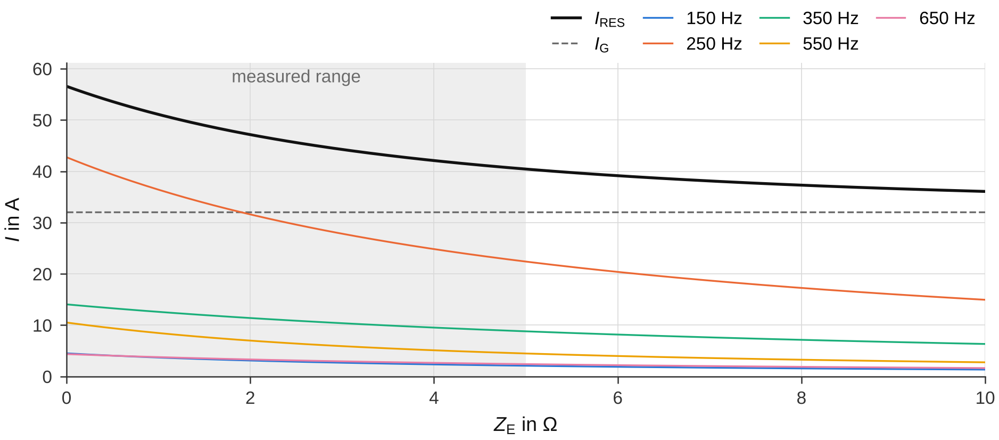
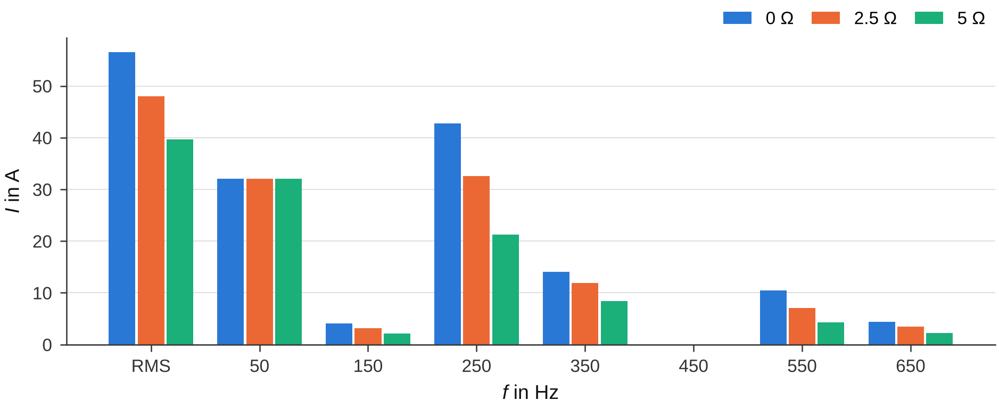

# Campaign evaluation

A campaign consists of several staged fault tests: at the substation usually a series with different additional
impedances in the fault branch, at stations single tests. The campaign evaluation puts them side by side, checks
them against each other and derives what a single test cannot give: the **active two-terminal equivalent** of the
network per harmonic order (equivalent-source method), the **residual earth-fault current at a given earthing
impedance** – also scaled to the harmonic level of a power-quality measurement – and the **resistive approach**. It
works only with the **result files** of the single evaluations; the raw data are not read again.

In the notebooks this is `evaluate_campaign.ipynb` ([Notebooks](notebooks.md#the-campaign-notebook)). The
functions are in [`groundfault.campaign`](../reference/campaign.md) and
[`groundfault.equivalent_source`](../reference/equivalent_source.md); the theory of the equivalent-source method is in
[Equivalent-source method](../methods/equivalent-source.md).

## Loading the result files

Evaluate every recording with the measurement notebook first; each evaluation writes
`results/<measurement>/<measurement>_result.json` ([The result file](evaluation.md#the-result-file)). The campaign
notebook lists the measurements in `MEASUREMENTS` – a name for tables and figures, the measurement (= name of the
result file) and the additional impedance `Z` (`None` for a station) – and loads them with `gf.load_result`. The
example below evaluates the four demo recordings as the measurement notebook would and loads their result files:

```python
import os
import tempfile

import groundfault as gf
from groundfault import campaign, corrections, demo, equivalent_source
from groundfault.layout import ENGLISH

base = tempfile.mkdtemp()
d = demo.make_campaign(base, layout="en")
folder = d["campaign"]

MEASUREMENTS = [
    dict(name="M1 (SUB 2.5 Ω)", measurement="SUB_2_5_10_000kHz", Z=2.5),
    dict(name="M2 (SUB 5 Ω)", measurement="SUB_5_10_000kHz", Z=5.0),
    dict(name="M3 (SUB 0 Ω)", measurement="SUB_0_10_000kHz", Z=0.0),
    dict(name="M4 (Station)", measurement="Station_Elm_Road_10_000kHz", Z=None),
]
# what the measurement notebook does per recording (intervals read off the RMS trend)
SUB = ((2.6, 4.4), (0.2, 1.8), (7.0, 8.8))
INTERVALS = {"SUB_2_5_10_000kHz": SUB, "SUB_5_10_000kHz": SUB, "SUB_0_10_000kHz": SUB,
             "Station_Elm_Road_10_000kHz": ((2.5, 5.3), (0.2, 1.8), (5.8, 7.8))}
corr = corrections.load(folder)
for m in MEASUREMENTS:
    site = "SUB" if m["measurement"].startswith("SUB") else "Station_Elm_Road"
    rec = gf.open_recording(os.path.join(folder, "raw", site, m["measurement"] + ".cfg"))
    corr.apply(rec)
    roles = gf.detect_roles(rec.channel_names, rec.units, corr.role_overrides(rec), corr.main_channel(rec),
                            corr.distances(rec))
    res = gf.evaluate(rec, gf.Intervals(*INTERVALS[m["measurement"]]), roles=roles, z_fault_ohm=m["Z"])
    res.save_json(ENGLISH.result_path(folder, m["measurement"]))

# the campaign evaluation: result files only
results = {m["name"]: gf.load_result(ENGLISH.result_path(folder, m["measurement"]), m["name"])
           for m in MEASUREMENTS}
print(list(results.values()))
```

```text
[<ResultFile M1 (SUB 2.5 Ω)>, <ResultFile M2 (SUB 5 Ω)>, <ResultFile M3 (SUB 0 Ω)>, <ResultFile M4 (Station)>]
```

`load_result` returns a `ResultFile` with the tables, values, hints and settings of the evaluation. Result files of
the predecessor tool (German keys) are translated when they are read, and the notebook also accepts a result file
with the file-name ending of the other [folder layout](language.md#folder-layouts) (`_result.json` or
`_ergebnis.json`). With `DEMO = True` the campaign notebook creates the demo campaign and evaluates the recordings
whose result files are missing – with their known intervals and the corrections of the campaign, as the measurement
notebook would.

## Overview and consistency

`campaign.overview(results)` gives one row per measurement with the main values:

```python
overview = campaign.overview(results)
print(overview[["measurement", "Z_F in Ω", "IRES in A", "IG in A", "Iw in A", "Iv in A", "IH in A", "U0 in V",
                "THD pre-fault (max) in %", "faulted_phase", "notes"]].round(2).to_string(index=False))
```

```text
   measurement  Z_F in Ω  IRES in A  IG in A  Iw in A  Iv in A  IH in A  U0 in V  THD pre-fault (max) in % faulted_phase  notes
M1 (SUB 2.5 Ω)       2.5      47.97    32.02    20.00    25.00    35.72 11496.85                      2.38            L3      0
  M2 (SUB 5 Ω)       5.0      39.69    32.02    20.00    25.00    23.45 11446.36                      2.05            L3      0
  M3 (SUB 0 Ω)       0.0      56.53    32.01    20.00    25.00    46.59 11547.07                      2.16            L3      0
  M4 (Station)       NaN      46.66    35.00    33.21    11.07    30.85 11547.05                      0.00            L3      1
```

Further columns: `IH3 in A`, `IH5 in A`, `IH7 in A`, `UH5g pre-fault in V`, `UH7m pre-fault in V`, `Σ coils H1 in A`
and `Corrections` (the total correction factor per channel). `notes` is the number of hints of the measurement; the
notebook prints all hints below the table (here the station evaluation notes that no limits of the residual current
were set).

`campaign.consistency(results)` checks physical relations **between** the measurements of a series – in the notebook
for the substation measurements (`Z` not `None`):

```python
substation = {m["name"]: results[m["name"]] for m in MEASUREMENTS if m["Z"] is not None}
print(campaign.consistency(substation)[["check", "status", "value"]].to_string(index=False))
```

```text
                        check status                                         value
I_G equal in all measurements     OK                      32.0 … 32.0 (span 0.0 %)
 U0 equal in all measurements     OK                    11446 … 11547 (span 0.9 %)
           Coil current ISp21     OK                                   297 … 300 A
           Coil current ISp22     OK                                   248 … 250 A
       I_H decreases with Z_F     OK 0 Ω: 46.6 A → 2.50 Ω: 35.7 A → 5.00 Ω: 23.5 A
                Faulted phase     OK                                            L3
```

| Check | Expected | Not `OK` |
|---|---|---|
| I_G equal in all measurements, U0 equal in all measurements | the fundamental component and the neutral displacement voltage hardly depend on the additional impedance | span of 10 % or more (`WARNING`): network state or detuning changed between the tests |
| Coil current … | the coil currents are proportional to U0, so equal per coil; a current of 0 A (coil switched off, clamp not connected) or a missing one is left out | a deviation of 10 % or more from the median (`WARNING`); about a factor of 10: wrong measuring range or CT ratio, otherwise coil position or network state changed |
| I_H decreases with Z_F | the harmonic content falls with increasing additional impedance (active two-terminal equivalent) | `NOTE`: drift of the harmonic sources between the tests |
| Faulted phase | the same phase in all tests | `NOTE`: different faulted phases (the equivalent-source method can take this into account, see below) |

The tolerance is an argument (`tolerance=0.10`). With fewer than two measurements the table has one `INFO` row.

## Equivalent-source method

Seen from the fault, the network acts per harmonic order m as an **active two-terminal (Thevenin) equivalent**: a
source voltage U_q,m behind a source impedance Z_q,m. A series of fault tests with different additional impedances
Z_k gives the currents I_m,k = U_q,m/(Z_q,m + Z_k), from which U_q,m and Z_q,m are fitted. The fitted equivalent then
gives the harmonic current – and the residual current – for any earthing impedance, not only for the tested ones.

**What the series needs:** at least two substation tests with different additional impedances (three or more for a
goodness of fit and the jackknife), the line-to-earth voltages and pre- and post-fault intervals in every recording
(they provide the angle reference and the harmonic level of the network), and the evaluated orders in every result
file (the result file stores the orders 1 to 25).

```python
entries = [dict(file=ENGLISH.result_path(folder, m["measurement"]), Z=m["Z"], name=m["name"])
           for m in MEASUREMENTS if m["Z"] is not None]
series = equivalent_source.fit_equivalent_source(equivalent_source.load_series(entries), orders="auto",
                                                 normalization="complex", reference="mean",
                                                 method="equation_error")
print(series.source_table()[["order", "f_Hz", "sequence", "Uq_V", "Rq_Ohm", "Xq_Ohm", "residual_pct",
                             "dZq_rel_per_1pct", "normalization", "Uq_ref_faulted_phase",
                             "Uq_angle_ref_faulted_phase_deg"]].round(3).to_string(index=False))
for h in series.hints:
    print("ℹ", h)
for m, fit in series.fits.items():
    for h in fit.hints:
        print("ℹ harmonic %d: %s" % (m, h))
```

```text
 order   f_Hz sequence    Uq_V  Rq_Ohm  Xq_Ohm  residual_pct  dZq_rel_per_1pct normalization  Uq_ref_faulted_phase  Uq_angle_ref_faulted_phase_deg
     3 150.06     zero  18.470   3.638  -1.886        16.563             0.022          none                   NaN                             NaN
     5 250.10      neg 219.971   4.499  -2.501         0.006             0.021       complex                 1.000                          -0.009
     7 350.14      pos 109.997   7.001  -3.498         0.011             0.027       complex                 1.000                           0.015
    11 550.22      neg  35.056   2.507  -2.199         0.023             0.017       complex                 1.001                           0.065
    13 650.26      pos  24.994   4.999  -2.793         0.080             0.022       complex                 0.999                           0.072
ℹ harmonic 3: zero-sequence order → without level normalization
ℹ harmonic 3: Estimators disagree on Z_q (3.64 − j1.89 Ω and 6.11 − j1.5 Ω) → U_q/Z_q individually uncertain; current at Z = 2.5 Ω: 2.88 and 2.94 A (prediction within the measured range is stable)
```

The demo network has source impedances of 4.5 − j2.5 Ω (250 Hz), 7 − j3.5 Ω (350 Hz), 2.5 − j2.2 Ω (550 Hz) and
5 − j2.8 Ω (650 Hz), and its sources drift between the tests; the normalised fit finds the impedances. The 3rd
harmonic belongs to the zero sequence and is not normalised by default, so the drift stays in its currents: the
residual is larger and the two estimators disagree – the hints say so. (The demo gives the 150-Hz source a pre-fault
level as well, so `normalize_zero=True` would find its 6 − j1.5 Ω; in a real network the zero-sequence harmonic
current usually arises only during the earth fault.)

### Settings

| Notebook | Python (`fit_equivalent_source`) | Default | Meaning |
|---|---|---|---|
| `ORDERS` | `orders` | `"auto"` | `"auto"`: odd orders whose current is at least `min_current_A` (0.5 A) in at least two measurements; or a list such as `[3, 5, 7, 11, 13]` |
| `NORMALIZATION` | `normalization` | `"complex"` | reference of the currents to the harmonic level of the network: `"complex"` (magnitude and phase, recommended), `"magnitude"` or `None` |
| `LEVEL` | `reference` | `"mean"` | level used for the normalisation: `"pre_fault"`, `"post_fault"` or the `"mean"` of both |
| `METHOD` | `method` | `"equation_error"` | estimator of the result: `"equation_error"` (linear least squares) or `"output_error"` (nonlinear, minimises the current deviation); both are always computed |
| – | `rq_non_negative` | `True` | if the free fit gives R_q < 0 (impossible for a passive network), use the boundary solution R_q = 0 |
| – | `min_current_A`, `min_level_V` | `0.5`, `1.0` | current threshold of the automatic selection; smallest usable level (below: no normalisation for this order) |
| – | `normalize_zero` | `False` | also normalise the zero-sequence orders (3, 9 …) |
| – | `polarity_brute_force` | `False` | with three or more measurements, try all sign combinations of the currents if some orders give R_q < 0 |
| – | `sequence` | `"natural"` | sequence of each order: `"natural"` (m mod 3: 1 positive, 2 negative, 0 zero), `"legacy"` (the simplified assignment of earlier evaluations, `equivalent_source.SEQUENCE_LEGACY`: 3 zero, 5 negative, 7 positive, all other orders negative – for comparisons with old results) or a mapping order → `"pos"`/`"neg"`/`"zero"` |

`load_series(entries, reference="L1L2", polarity="auto")` reads the result files: every phasor is referred to the
fundamental of the line-to-line voltage (X_m·e^(−j·m·φ_LL1)), so recordings with different time origins can be
compared, and the current is rotated by 180° if its active component is negative (`polarity` 1 or −1 fixes it, per
entry as a list).

**Why normalise?** The harmonic level of the network changes between tests that are minutes apart, and a two-terminal
fit over currents of different source levels gives wrong parameters. Each current is therefore referred to the
level measured before and after the same test – complex (magnitude and phase) or magnitude only – at the faulted
phase (for L2 and L3 the sequence voltage is rotated by ±120°). The zero-sequence orders are not normalised by
default: their current arises only during the earth fault, and the tiny pre-fault level is no reference for it.

### Tables

| Method of the series | Content |
|---|---|
| `measurements_table()` | per measurement: `Z_Ohm`, `file`, `format` (`v3` result file of groundfault, `v2` of the predecessor tool, `legacy_notebook` or `legacy_complex` for legacy JSON exports of earlier evaluation notebooks), `f1_Hz`, `phi_LL1_deg`, `I_H1_A`, `Iw_A`, `IRES_A`, `polarity` (`as measured` or `rotated`), `level_complex` |
| `level_table()` | source level before and after every test per order (`U_pre_V`, `U_post_V`) and its drift within the test – the quality of the normalisation |
| `source_table()` | per order: `Uq_V`, `Uq_angle_deg`, `Rq_Ohm`, `Xq_Ohm`, `Zq_Ohm`, `I_short_circuit_A`, `residual_pct`, `condition_number`, `dZq_rel_per_1pct`, `Rq_fixed`, `normalization`, `level_reference_V`, the Thevenin check `Uq_ref_faulted_phase`/`Uq_angle_ref_faulted_phase_deg` and per estimator `Zq_<method>`, `Uq_<method>_V` |
| `pairwise_table()` | the exact solution of every pair of measurements (`Rq_Ohm`, `Xq_Ohm`, `Uq_V`, `assessment` `ok` or `R_q < 0`) – consistency of the model assumption |
| `forecast_table()` | per order and measurement: model current against the (normalised) measured current, `deviation_pct`, power in the additional impedance |
| `jackknife_table(Z_E)` | current at Z_E per order with one measurement left out at a time (`min_A`, `max_A`, `span_pct`; needs three measurements) |
| `check_table()` | residual current of the model at the tested impedances against the measured true RMS value (`deviation_pct`, `IH_rest_A`, `I_low_frequency_A`) |

### Checks and hints

How to judge the fit:

* **Thevenin check** – physically, U_q is the pre-fault voltage of the faulted phase. With complex normalisation
  `Uq_ref_faulted_phase` should be close to 1 and `Uq_angle_ref_faulted_phase_deg` close to 0°; outside 0.5…2 or ±45°
  a hint asks to check the normalisation, the polarity or the series.
* **Sensitivity** – `dZq_rel_per_1pct` is the largest relative change of Z_q for an error of 1 % (or 0.5°) in one
  current; above 0.1 the order is ill-conditioned (additional impedances small compared with |Z_q|).
* **Residual and forecast** – `residual_pct` and `forecast_table()` show how well the model reproduces the measured
  currents; `pairwise_table()` shows whether every pair of tests gives the same equivalent.
* **Completeness** – `check_table()` rebuilds the measured I_RES from the fitted orders, the fundamental and the
  remainder; a negative deviation together with a large `I_low_frequency_A` comes from a decaying DC component in the
  max window, not from the model.

```python
print(series.check_table()[["measurement", "Z_Ohm", "IRES_measured_A", "IRES_sources_A", "deviation_pct",
                            "IH_rest_A"]].round(3).to_string(index=False))
print(series.jackknife_table(2.5).round(3).to_string(index=False))
mc = equivalent_source.monte_carlo(series, 2.5, n=2000)
print("Monte Carlo I_RES(2.5 Ω): P5 %.2f A, P50 %.2f A, P95 %.2f A" % (mc["IRES"][5], mc["IRES"][50], mc["IRES"][95]))
```

```text
   measurement Z_Ohm  IRES_measured_A  IRES_sources_A  deviation_pct  IH_rest_A
M1 (SUB 2.5 Ω)   2.5           47.971          47.933         -0.077      0.012
  M2 (SUB 5 Ω)     5           39.686          39.690          0.008      0.011
  M3 (SUB 0 Ω)     0           56.526          56.558          0.056      0.011
 order  I_at_ZE_A  min_A  max_A  span_pct
     3      2.877  2.815  3.186     6.436
     5     29.597 29.597 29.597     0.001
     7     10.864 10.863 10.865     0.013
    11      6.410  6.410  6.411     0.013
    13      3.123  3.121  3.127     0.084
Monte Carlo I_RES(2.5 Ω): P5 45.33 A, P50 45.58 A, P95 45.81 A
```

`monte_carlo(series, Z_E, n=2000, sigma_magnitude=0.01, sigma_phase_deg=0.5, sigma_Z=0.02, sigma_level=0.0,
model_error=True)` repeats the fit with random errors of the currents (1 %, 0.5°), the additional impedances (2 %) and
– with `model_error` – the residual of each order; it returns the quantiles P5/P50/P95 of I_RES and I_H (`mc["IRES"]`,
`mc["IH"]`) and the spread of Z_q per order (`mc["Zq"]`: `Rq_P5`, `Rq_P95`, `Xq_P5`, `Xq_P95`). The campaign
notebook keeps the result as `MC` and draws this spread in the figure of the source impedances.

| Hint | Meaning – what to do |
|---|---|
| `Automatic selection: orders … skipped (even order or ≥ … A in only one measurement) …` | these orders are not fitted; give `orders` explicitly if one of them matters |
| `Orders not in all files: …` | an order of the list is missing in a result file |
| `Faulted phases differ (…): the normalization … takes this into account.` | information: complex normalisation handles different faulted phases |
| `WARNING: faulted phases differ (…) – without complex level normalization …` | the equivalent is not reliable; use `normalization="complex"` |
| `Faulted phase not recognisable in … – same phase as the others assumed.` | check the line-to-earth voltages of that recording |
| `Polarity fallback: additionally rotated → …` | only with `polarity_brute_force`: these currents were rotated by 180° |
| `Only 2 measurements → two-terminal equivalent exactly determined, no goodness of fit/jackknife possible.` | add a third test if possible |
| `zero-sequence order → without level normalization` | information (see above) |
| `no complex levels in the export → magnitude normalization only` | a result file without complex levels (older files) |
| `level missing/too small (< … V) → without normalization` | the order has no usable level in the pre- or post-fault interval |
| `Estimators disagree on Z_q (… Ω and … Ω) → U_q/Z_q individually uncertain; current at Z = … Ω: … (…)` | U_q and Z_q scale together; the verdict says whether the current within the tested range is stable nevertheless |
| `R_q < 0 (not possible for a passive network) → boundary solution R_q = 0; …` | the boundary solution is used; it is not necessarily conservative – compare the two currents given |
| `ill-conditioned: …` | the additional impedances are too small compared with \|Z_q\|; U_q and Z_q of limited reliability |
| `Thevenin check: −U_q/level = …` | see above |


`report.source_fit(series, Z_E=…)` draws, per order, the measured currents and the model over the additional
impedance; `report.source_plane(series, mc)` the source impedances in the complex plane (●) with the solutions of
every pair of measurements (×) and, given the Monte Carlo result `mc`, a shaded box per order over the 5–95 % range of
R_q and X_q; `interactive.source_fit(series, Z_E)` is the interactive version in the notebook.

## Residual current at the earthing impedance

With the fitted equivalents the residual earth-fault current at an earthing impedance Z_E is

\[
I_\text{RES}(Z_\text{E}) = \sqrt{I_\text{G}^2
  + \sum_m \left|\frac{k_m\,\underline{U}_{q,m}}{\underline{Z}_{q,m} + Z_\text{E}}\right|^2 + I_\text{rest}^2}
\]

with the fundamental component I_G (`IG="max"`: the largest measured value – conservative; `"median"` or a number
in A, e.g. from network data), the scaling factors k_m (1 without scaling) and the harmonic content not covered by
the fitted orders I_rest (largest value of the series, independent of Z_E – conservative; `rest=False` leaves it
out).

```python
r = equivalent_source.ires_at_impedance(series, 2.5, uncertainty_I=0.03)  # margin: illustrative value – define your own
print("I_G = %.1f A | I_H = %.1f A (rest %.3f A) | I_RES = %.2f A | with uncertainty %.2f A | interpolation: %s"
      % (r["IG"], r["IH"], r["IH_rest"], r["IRES"], r["IRES_assessed"], r["interpolation"]))
print({m: round(i, 2) for m, i in r["parts"].items()})
```

```text
I_G = 32.0 A | I_H = 32.5 A (rest 0.012 A) | I_RES = 45.59 A | with uncertainty 46.95 A | interpolation: True
{3: 2.88, 5: 29.6, 7: 10.86, 11: 6.41, 13: 3.12}
```

The result contains `Z_E`, `IG`, `IH`, `IRES`, `parts` (current per order), `factors`, `IH_rest`, `IH_scaled`,
`IRES_scaled`, `IRES_assessed` and `IRES_scaled_assessed` (× (1 + m_I) with the measurement-uncertainty margin
`uncertainty_I` of the user – default 0, no margin; the notebook passes `UNCERTAINTY_I`), `interpolation` (`True` if
|Z_E| lies within the range of the tested additional impedances – outside, the value is an extrapolation) and `hints`.
In the notebook `Z_E` sets the earthing impedance – a value of your network, not set in the templates (the notebook
then skips the values at Z_E with a note) –; the figure shows I_RES over Z_E up to `Z_E_MAX`, with lines at the limits
of the residual current if you set them (`LIMITS`; groundfault contains none):



`report.ires_over_ze(series, Z_E_max, limits, IG, scaling)` and `interactive.ires_ze(series, Z_E_max, limits,
scaling)` draw it.

### Scaling to a power-quality measurement

The harmonic level during the tests is a snapshot. To assess the residual current at the level that is not exceeded
95 % of the time, the source voltages are scaled to the 95 % quantile of a power-quality measurement:

* **per order** – `u95={5: …, 7: …}`: 95 % quantiles of the harmonic voltages in V, either as sequence voltages
  line-to-earth (`u95_reference="seq"`, the default in Python) or line-to-line as a power-quality instrument
  reports them (`"LL"`, divided by √3; the default `U95_REFERENCE` of the notebook). k_m = safety factor × U95,m /
  level of the order during the tests;
* **flat** – `thd95_percent`: 95 % quantile of the line-to-line THD in %, referred to the THD of the test series
  (`thd_measured_percent`); one factor safety factor × THD95/THD_measured for all orders;
* `safety_factor` (`PQ_SAFETY_FACTOR`) – an additional factor of the user on all scaling factors (default 1: none).

Orders that cannot be scaled per order – no `u95` value, no level (zero sequence without normalisation) or a
zero-sequence order with line-to-line values – get the flat THD factor if `thd95_percent` is given as well, otherwise
they stay unscaled (with a hint). The remainder I_rest is scaled with the largest factor.

```python
k_s = 1.2                                                                 # illustrative value – define your own
level = {m: series.fits[m].level_reference for m in (5, 7, 11, 13)}      # levels of the demo tests (sequence, V)
u95 = {m: round(q * level[m] * 3 ** 0.5) for m, q in zip(level, (1.25, 1.05, 1.4, 1.6))}   # invented quantiles (L-L)
r = equivalent_source.ires_at_impedance(series, 2.5, u95=u95, u95_reference="LL", safety_factor=k_s)
print(u95)
print({m: round(k, 3) for m, k in r["factors"].items()})
print("I_H scaled %.2f A → I_RES scaled %.2f A" % (r["IH_scaled"], r["IRES_scaled"]))
print(r["hints"])

import pandas as pd

metrics = pd.concat([results[n].table("voltage_metrics") for n in substation])
thd_series = metrics[metrics["interval"] != "fault"][["UTHD12_pct", "UTHD23_pct", "UTHD31_pct"]].max(axis=1).mean()
r = equivalent_source.ires_at_impedance(series, 2.5, u95=u95, u95_reference="LL", thd95_percent=3.0,
                                        thd_measured_percent=thd_series, safety_factor=k_s)
print("THD of the series %.2f %% → factor of the 3rd harmonic %.3f, I_RES scaled %.2f A"
      % (thd_series, r["factors"][3], r["IRES_scaled"]))
```

```text
{5: 476, 7: 200, 11: 85, 13: 69}
{3: 1.0, 5: 1.499, 7: 1.26, 11: 1.681, 13: 1.911}
I_H scaled 48.13 A → I_RES scaled 57.80 A
['Scaling per order not possible for [3] (no U95 value, no level – e.g. zero sequence without normalization – or zero sequence with line-to-line values): unscaled (factor 1) – specify thd95_percent as well if needed']
THD of the series 2.20 % → factor of the 3rd harmonic 1.637, I_RES scaled 57.92 A
```

The notebook does the same with `U95`, `U95_REFERENCE`, `THD95_PERCENT` and `PQ_SAFETY_FACTOR`: `U95` alone scales
per order, `THD95_PERCENT` alone all orders with one factor, and both together combine as in the second example. The
THD of the series is the mean over the pre- and post-fault intervals of the largest line-to-line THD of the
substation tests ([Notebooks](notebooks.md#the-campaign-notebook)).

### Fault behind a line

`equivalent_source.ires_over_line(series, Z_E, Z1L, Z0L)` gives the residual current for a fault behind a line, for
example at a secondary substation: I_m = 3·k_m·U_q,m/(3·Z_q,m + 2·Z_1L,m + Z_0L,m + 3·Z_E). `Z1L` and `Z0L` are the
positive- and zero-sequence impedances of the whole line in Ω – a number or a function of the order:

```python
line = equivalent_source.ires_over_line(series, 2.0, Z1L=lambda m: 3.0 * complex(0.2, 0.1 * m),    # invented
                                        Z0L=lambda m: 3.0 * complex(0.8, 0.4 * m))     # line data, 3 km
print("I_RES = %.2f A, I_H = %.2f A" % (line["IRES"], line["IH"]))
```

```text
I_RES = 44.63 A, I_H = 31.09 A
```

## Resistive approach

The resistive approach of the VDE Impuls on the residual earth-fault current – its assumptions and the points where
groundfault generalises it are described in [Assessment quantities](../methods/assessment.md#resistive-approach) –
estimates for a whole network, without a series of tests, up to which line length from the substation a fault can
exceed the permissible residual current. The harmonic voltage U (95 % quantile, sequence voltage) drives the harmonic
current through the fault circuit – three times the earthing resistance plus the line resistances. The **limiting
resistance** is the line resistance below which the residual current can exceed I_RES,max:

\[
R_\text{lim} = \frac{3\,U}{\sqrt{I_\text{RES,max}^2 - I_\text{G}^2}} - 3\,r\,R_\text{E,max},
\qquad
l_\text{lim} = \frac{R_\text{lim}}{R_1' + R_2' + R_0'} \quad (R_2' = R_1')
\]

The permissible residual current is given directly (`I_res_max`) or follows from the permissible touch voltage and the
factor F: I_RES,max = F·U_Tp/(r·R_E,max). groundfault contains no values for them – without `I_res_max` and without
`U_Tp` and `F` the function raises an error that names the missing parameters. With a reduction factor r < 1 only
r·R_E acts in the fault circuit, so r·R_E,max is used consistently.

```python
# invented network: harmonic voltage 450 V line-to-line, I_G = 32 A, R_E,max = 1.5 Ω, line resistances in Ω/km
ra = campaign.resistive_approach(450.0, 32.0, R_E_max=1.5, R1_km=0.25, R0_km=0.75, from_ll=True,
                                 U_Tp=100.0, F=2.5)                # illustrative values – define your own
for key in ("U_seq_V", "I_RES_max_A", "I_H_permissible_A", "R_limit_Ohm", "l_limit_km", "assessment_substation"):
    print("%-22s %s" % (key, round(ra[key], 3) if isinstance(ra[key], float) else ra[key]))
print(ra["comment"])
```

```text
U_seq_V                259.808
I_RES_max_A            166.667
I_H_permissible_A      163.566
R_limit_Ohm            0.265
l_limit_km             0.212
assessment_substation  countermeasures
stations with a line length to the substation below l_lim = 0.21 km can exceed the limit → individual verification (equivalent-source method) or countermeasures; uncritical further away
```

| Argument | Meaning |
|---|---|
| `U_thd95_V` | harmonic voltage (95 % quantile) in V; with `from_ll=True` a line-to-line value (divided by √3) |
| `I_G` | fundamental component of the residual current in A (the notebook takes it from the result files, `IG_CHOICE`) |
| `R_E_max` | largest earthing resistance of the stations in Ω |
| `R1_km`, `R0_km` | positive- and zero-sequence resistance per unit length at the dominant frequency in Ω/km |
| `I_res_max` | permissible residual current in A, defined by the user; `None`: F·U_Tp/(r·R_E,max), which needs `U_Tp` and `F` |
| `U_Tp`, `F` | permissible touch voltage in V and the ratio F of the permissible earth potential rise to it, defined by the user |
| `r` | reduction factor (default 1) |

The `comment` has three forms: R_lim ≤ 0 – uncritical in the whole network (even a fault at the substation stays
below the limit); R_lim > 0 – stations closer than l_lim need an individual verification (equivalent-source method) or
countermeasures; I_G ≥ I_RES,max – the fundamental component alone reaches the limit, countermeasures regardless of
the distance. In the notebook the approach runs when `RESISTIVE` holds the harmonic voltage and the network data and
either `RESISTIVE["I_res_max"]` or `U_TP` and `F_FACTOR` are set; otherwise it says which values are missing
([Notebooks](notebooks.md#the-campaign-notebook)).

## Stations

Section 5 of the campaign notebook goes through every result with a station evaluation (table `station_frequency`):
the table and figure per frequency, the LV-network tables and – if the location is found in groundmeas – the
comparison with the earthing measurement, the reduction factor, the LV-network check and their hints. The location
comes from the field `location` of `MEASUREMENTS`, otherwise from the sites file, otherwise from the folder name. All
functions accept a loaded result file; the reference current, U_Tp and F then come from the settings stored in it if
the evaluation had them (arguments take precedence – here illustrative values, since the demo evaluation above set no
limits):

```python
from groundfault import earthing

station = results["M4 (Station)"]
with earthing.Database(d["db"]) as db:
    measurements = earthing.exclude_own(db.measurements(location="Station Elm Road"), "2026-01-15_Demo",
                                        "Station_Elm_Road_10_000kHz")
    response = earthing.frequency_response(db, measurements["measurement_id"])
spectrum, effective = earthing.reduction_factor(station, response, reference_current_A=100.0, U_Tp=100.0, F=2.5,
                                                r_typical=(0.3, 0.8))     # illustrative values – define your own
print(effective[["channel", "probe", "r_eff", "r_50Hz", "classification_r_50Hz", "trend_r_vs_f",
                 "assessment_relevance"]].round(3).to_string(index=False))
```

```text
channel  probe  r_eff  r_50Hz classification_r_50Hz trend_r_vs_f assessment_relevance
max(UE) UE_70m  0.453   0.500               typical      falling            unchanged
 UE_70m UE_70m  0.453   0.500               typical      falling            unchanged
  UE_5m  UE_5m  0.293   0.323               typical      falling            unchanged
```

How to read these results is described in [Stations and the LV network](station.md) and
[Earthing measurements](earthing.md).

## Report tables and figures

Section 6 of the notebook exports the tables and figures of the campaign into `results/campaign/` and
`figures/campaign/` (German layout: `Kampagne`). `report.report_tables(results, series=…, Z_E=…)` builds the
tables in the layout of a test report – one column per measurement, in the order of `MEASUREMENTS`:

```python
from groundfault import report

tables = report.report_tables(results, series=series, Z_E=2.5)
for name in tables:
    print("%-28s %s" % (name, report.table_title(name, results)))
print(report.format_table(tables["residual_current"]).to_string(index=False))
```

```text
voltages                     Voltages
residual_current             Residual earth-fault current
split_50hz                   Split of the 50 Hz current
epr_m4_station               Earth potential rise – M4 (Station)
shield_current_m4_station    Shield current – M4 (Station)
assessment_quantities        Assessment quantities
equivalent_sources           Equivalent sources
   Quantity in A M1 (SUB 2.5 Ω) M2 (SUB 5 Ω) M3 (SUB 0 Ω) M4 (Station)
       RMS value           48.0         39.7         56.5         46.7
           50 Hz           32.0         32.0         32.0         35.0
          150 Hz           3.19         2.14         4.04     0.000623
          250 Hz           32.6         21.3         42.7         30.0
          350 Hz           12.0         8.36         14.1         6.00
Harmonic content           35.7         23.5         46.6         30.9
```

| Table | Content |
|---|---|
| `voltages` | positive- and negative-sequence voltage of the orders 1, 5, 7, 11, 13 and the largest line-to-line THD before and after each fault |
| `residual_current` | RMS value, the orders of `orders` (default 1, 3, 5, 7) and the harmonic content of the fault current |
| `split_50hz` | active and detuning current, coil currents |
| `epr_<measurement>` | stations: largest measured earth potential rise and r·Z_E per 100 A per order |
| `shield_current_<measurement>` | stations with a shield current: shield current and the reduction factor from it per order |
| `transformer` | with line currents: harmonic power and sequence currents at the transformer |
| `assessment_quantities` | measured and assessment value of every measurement |
| `equivalent_sources` | with `series`: R_q, X_q, U_q, residual and Thevenin check per order; with `Z_E` also the current per order at Z_E, the remainder and I_RES |

The notebook adds the `overview` and, per station, the tables `station_frequency_…`, `earthing_ratio_…`,
`station_lv_network_…`, `station_lv_network_eff_…`, `reduction_factor_…`, `reduction_factor_eff_…`,
`lv_network_check_…` and `lv_network_check_eff_…`, and writes everything with
`report.export_tables(tables, folder, prefix="campaign_", names=results)`: one CSV and Markdown file per table, one
Excel workbook and one Word file (`campaign_tables.xlsx`, `campaign_tables.docx`; they need the extra `export` and
are skipped with a warning without it).
Every table has a title in the output language – the heading in the Word file and above the table in the notebook
(`report.table_title`); a table of one measurement gets the name of the measurement as given in `MEASUREMENTS`, e.g.
“Reduction factor per harmonic – M4 (Station)” (German “Reduktionsfaktor je Harmonische – M4 (Station)”). The figures
are: per station `station_frequency_…`, `station_background_…`, `earthing_comparison_…`, `reduction_factor_…` and
`lv_network_…`; for the series `fault_current_spectrum_comparison`, `source_fit`, `source_impedance` (with the Monte
Carlo spread) and `ires_over_ZE`. In all names “…” is the name of the measurement as `report.slug` writes it – letters
and digits, everything else `_`, lower case, as in the report tables above: `"Measurement 4 (Station)"` →
`station_frequency_measurement_4_station`. Formats, fonts and the output language are described in
[Reports and exports](report.md).



## Entering all measurements in groundmeas

Section 7 of the campaign notebook enters every measurement of `MEASUREMENTS` in groundmeas – with the same rules as
the measurement notebook ([Entering a staged fault test](earthing.md#entering-a-staged-fault-test)). It first shows
the dry run of all measurements; `GROUNDMEAS_EXPORT = True` writes them after **one** backup copy for the whole run
(the path of the first copy is passed on as `backup`), `"replace"` renews own entries. The fields `location`,
`description` and `timestamp` of `MEASUREMENTS` apply per measurement.

```python
plans = {m["name"]: earthing.export_to_groundmeas(results[m["name"]], folder, d["db"], location=m.get("location"))
         for m in MEASUREMENTS}
print(earthing.plan_overview(plans)[["measurement", "kind", "location", "values", "status"]]
      .to_string(index=False))
```

```text
   measurement       kind         location  values                                                                                                         status
M1 (SUB 2.5 Ω) substation  Substation Demo       6 not possible: new location “Substation Demo” without coordinates (enter latitude/longitude in notes/sites.csv)
  M2 (SUB 5 Ω) substation  Substation Demo       6 not possible: new location “Substation Demo” without coordinates (enter latitude/longitude in notes/sites.csv)
  M3 (SUB 0 Ω) substation  Substation Demo       6 not possible: new location “Substation Demo” without coordinates (enter latitude/longitude in notes/sites.csv)
  M4 (Station)    station Station Elm Road      20                                                                                                          ready
```

The demo substation is new in groundmeas and has no coordinates in the sites file, so its three tests cannot be
entered until latitude and longitude are added to `notes/sites.csv` ([The sites file](campaigns.md#the-sites-file));
the station is ready.
