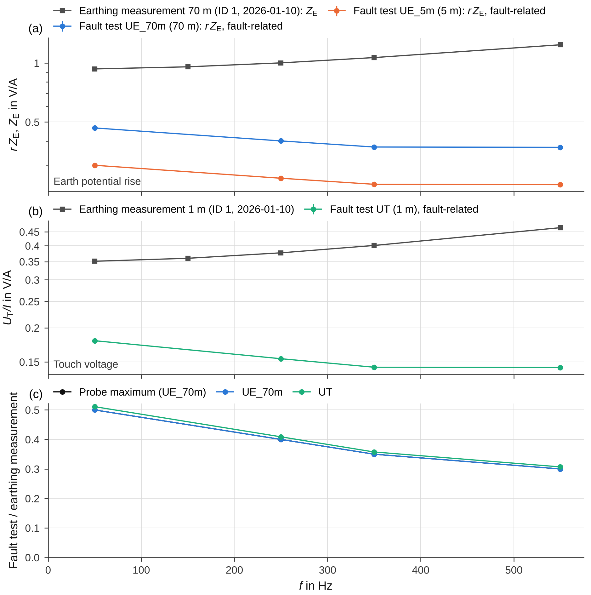

# Earthing measurements (groundmeas)

At a station the staged fault test measures the earth potential rise caused by the real fault current. An earthing
measurement with current injection at the same station measures the earthing impedance Z_E. groundfault brings both
together: it reads the earthing measurements from a [groundmeas](https://github.com/Ce1ectric/groundmeas) database,
compares them per frequency with the station evaluation, derives the **reduction factor** and checks the earthing
impedance of the LV network against them. It can also **enter** an evaluated fault test in groundmeas, so that all
measurements of a station are kept in one place.

In the measurement notebook the comparison is part of section 4 (station only) and the entry part of section 7; the
campaign notebook compares all stations in section 5 and enters all measurements in section 7
([Notebooks](notebooks.md)). The functions are in the module [`groundfault.earthing`](../reference/earthing.md); the
background of the reduction factor is explained in [Reduction factor and LV network](../methods/reduction-factor.md).

groundmeas keeps the measurements in an SQLite database:

```text
location  →  measurement (method, asset_type, timestamp, …)  →  measurementitem
                                                                 measurement_type, value, value_angle_deg, unit,
                                                                 frequency_hz, measurement_distance_m, …
```

groundfault reads this database with the Python standard library – groundmeas itself does not have to be installed.

## Where the database is

groundfault finds the database as groundmeas finds it:

1. the environment variable `GROUNDMEAS_DB`, for example

    ```bash
    export GROUNDMEAS_DB=~/groundmeas/groundmeas.db
    ```

2. otherwise the entry `db_path` in `~/.config/groundmeas/config.json`:

    ```json
    {"db_path": "~/groundmeas/groundmeas.db"}
    ```

`earthing.default_db_path()` returns this path (or `None`). In the notebooks `GROUNDMEAS_DB = None` means exactly
this; give a path to use another database – the example notebooks use the demo database `demo_groundmeas.db` of the
work folder.

**The comparison never changes the database.** `earthing.Database(path)` opens the file through an SQLite URI with
`mode=ro`; every write attempt would fail. A missing file raises `FileNotFoundError` (“groundmeas database not found:
… (GROUNDMEAS_DB or ~/.config/groundmeas/config.json)”), a file without the tables `location`, `measurement` and
`measurementitem` a `ValueError` (“… is not a groundmeas database (missing tables: …)”). Only
[entering a fault test](#entering-a-staged-fault-test) writes – after a backup copy and only on request.

```python
import os
import tempfile

import groundfault as gf
from groundfault import corrections, demo, earthing

base = tempfile.mkdtemp()
d = demo.make_campaign(base, layout="en")       # demo campaign and demo_groundmeas.db in the work folder
campaign = d["campaign"]

db = earthing.Database(d["db"])                 # read-only; also usable as a context manager
print(db.locations().to_string(index=False))
print(db.measurements()[["measurement_id", "location", "method", "date", "values", "frequencies_Hz"]]
      .to_string(index=False))
```

```text
 location_id         location  latitude  longitude  measurements                   methods
           1 Station Elm Road      51.1       10.2             1 injection_earth_electrode
 measurement_id         location                    method       date  values         frequencies_Hz
              1 Station Elm Road injection_earth_electrode 2026-01-10      15 50, 150, 250, 350, 550
```

| Method | Returns |
|---|---|
| `locations()` | all locations with `location_id`, `location`, `latitude`, `longitude`, the number of `measurements` and the `methods` |
| `measurements(location=None, method=None)` | one row per measurement: `measurement_id`, `location`, `method`, `asset_type`, `date`, `fault_resistance_Ohm`, `voltage_level_kV`, `description`, `values` (number), `measurement_types`, `frequencies_Hz`; `location` is the exact name or a name for the [fuzzy search](#choosing-the-location), `method` a part of the method (`"injection"`, `"staged_fault_test"`) |
| `values(ids)` | all values of the measurements in SI base units: `type`, `designation` (label in the output language), `magnitude`, `angle_deg`, `unit`, `unit_stored`, `unit_note`, `f_Hz`, `distance_m` (probe distance), `distance_injection_m`, … |
| `units()` | every stored unit per measurement type with `base_unit`, `factor` and a `note` if it cannot be converted |
| `find_location(name)`, `choose_location(name)` | see below |

Units are read as groundmeas (from version 1.6.1) reads them: a value is stored as entered (`250.0` with `mΩ`) and
converted to the base unit (Ω, A, V, Ωm) for computing. A unit that cannot be converted keeps the stored value and
is named in `unit_note`; `db.units()` lists all units of a database at a glance.

## Choosing the location

The location in groundmeas belongs to the site folder of the recording. groundfault takes it

1. from `GROUNDMEAS_LOCATION` (measurement notebook) or the field `location` of `MEASUREMENTS` (campaign notebook),
   or the argument `location` in Python – the exact name;
2. otherwise from the column `location_groundmeas` of the [sites file](campaigns.md#the-sites-file) – the exact name;
3. otherwise from the folder name: `earthing.location_from_site("Station_Elm_Road")` gives `"Elm Road"`
   (prefixes `Station`, `Substation`, `SUB`, `UW` and a sampling-rate suffix removed, underscores as spaces).

A name from 1 or 2 must exist as given (case is ignored, and umlauts may be written as ae/oe/ue). A name derived
from the folder is looked up with a **fuzzy search**: the words for the kind of installation (`Station`, `SSt`,
`Substation`, `SUB`, `UW` …) are ignored, small typing errors are tolerated, and a different kind of installation or
different numbers in the name lower the similarity considerably. `choose_location` accepts the best match if its
similarity is at least 0.85 and no other location matches about equally well (within 0.05):

```python
for name in [earthing.location_from_site("Station_Elm_Road"), "Station Elm Raod", "Elm Road 2"]:
    choice = db.choose_location(name)
    print("%-17s → %-17s exact=%-5s %s" % (name, choice["location"], choice["exact"], choice["note"]))
print(db.find_location("Elm Road 2", minimum=0.5).to_string(index=False))
```

```text
Elm Road          → Station Elm Road  exact=False Location “Station Elm Road” is similar to “Elm Road” (100 %) – used for the comparison; set it exactly with location="Station Elm Road".
Station Elm Raod  → Station Elm Road  exact=False Location “Station Elm Road” is similar to “Station Elm Raod” (88 %) – used for the comparison; set it exactly with location="Station Elm Road".
Elm Road 2        → None              exact=False No matching location for “Elm Road 2” – set location="…" to the name in the database.
 location_id         location  similarity
           1 Station Elm Road        0.76
```

The name derived from the demo folder, `"Elm Road"`, and a misspelt name both find the demo station. `"Elm Road 2"`
contains a number that the location name lacks, so the similarity drops below the threshold and no location is chosen – the candidates are shown instead (the notebook prints them as a table). A location found by
similarity is good enough for the read-only comparison, never for writing: an entry needs the exact name.

**Which measurements are compared:** all measurements of the chosen location, or only those listed in
`GROUNDMEAS_MEASUREMENTS` (measurement ids). An entry that groundfault itself made for the same recording is left out
(`earthing.exclude_own`) – otherwise the fault test would be compared with itself.

## Voltage per ampere over the frequency

The comparable quantity of both measurements is the **voltage per ampere** (V/A = Ω) at the same frequency:

* earthing measurement with current injection (methods `injection_…`): `earthing_impedance` per probe distance is
  already V/A; touch voltages (`prospective_touch_voltage`, `touch_voltage`) are divided by the test current
  (`earthing_current`) of the same frequency. At the injection the touch voltage per ampere is the same quantity as
  the earthing impedance at the 1-m probe, so it is taken only once;
* fault test stored in groundmeas (`staged_fault_test`): `earth_potential_rise` and `prospective_touch_voltage`
  divided by the `earth_fault_current` of the same frequency;
* fault test evaluated by groundfault: the table `station_frequency` ([Stations and the LV network](station.md)) –
  the fault-related component and the direct quotient.

`earthing.frequency_response(db, ids)` builds this table from groundmeas:

```python
response = earthing.frequency_response(db, [1])
print(response[["source", "quantity", "distance_m", "f_Hz", "Z_Ohm", "angle_deg"]].head(4).round(3)
      .to_string(index=False))
```

```text
        source             quantity  distance_m  f_Hz  Z_Ohm  angle_deg
injection test        touch_voltage         1.0  50.0  0.351      4.574
injection test earth_potential_rise        70.0  50.0  0.933      4.574
injection test        touch_voltage         1.0 150.0  0.360     13.496
injection test earth_potential_rise        70.0 150.0  0.956     13.496
```

Columns: `source` (`"injection test"`, `"fault test (groundmeas)"` or the method), `measurement_id`, `location`,
`method`, `date`, `quantity` (`"earth_potential_rise"`, or `"touch_voltage"` for a touch-voltage type and an earthing
impedance at a probe up to 1.5 m), `type` (groundmeas measurement type), `distance_m`, `f_Hz`, `Z_Ohm`, `angle_deg`
(NaN if not recorded), `reference_current_A`, `additional_resistance_Ohm` and `description`.

## Comparing with the fault test

`earthing.compare` joins the station evaluation with these values and forms the ratio per frequency:

```python
rec = gf.open_recording(os.path.join(campaign, "raw/Station_Elm_Road/Station_Elm_Road_10_000kHz.cfg"))
corr = corrections.load(campaign)
corr.apply(rec)
roles = gf.detect_roles(rec.channel_names, rec.units, corr.role_overrides(rec), corr.main_channel(rec),
                        corr.distances(rec))
res = gf.evaluate(rec, gf.Intervals((2.5, 5.3), (0.2, 1.8), (5.8, 7.8)), roles=roles)

long_df, ratio = earthing.compare(res.table("station_frequency"), response, measurement=res.name)
print(ratio[ratio["order"] == 1][["channel", "probe", "distance_fault_m", "distance_injection_m", "distance_match",
                                  "Z_fault_Ohm", "Z_E_injection_Ohm", "ratio_fault"]].round(3).to_string(index=False))
```

```text
channel  probe  distance_fault_m  distance_injection_m distance_match  Z_fault_Ohm  Z_E_injection_Ohm  ratio_fault
max(UE) UE_70m              70.0                  70.0        maximum        0.466              0.933        0.500
 UE_70m UE_70m              70.0                  70.0          equal        0.466              0.933        0.500
  UE_5m  UE_5m               5.0                  70.0      different        0.301              0.933        0.323
     UT     UT               1.0                   1.0          touch        0.179              0.351        0.511
```

* `long_df` has one row per source, probe and frequency: the rows of the fault test (`source` `"fault test"`, `type`
  `"fault"` for the fault-related component or `"direct"` for the value as measured, with `channel`, `order`, the range
  of the single superposition methods `Z_min_Ohm`/`Z_max_Ohm`, `method_spread_pct`, `uncertainty_pct` and
  `uncertain`), followed by the rows of `frequency_response`. It is the input of the figures.
* `ratio` divides, per probe and order, the fault-test value (`Z_fault_Ohm`, `Z_direct_Ohm`) by the earthing
  measurement at the same frequency (± 5 Hz, `tolerance_hz`) and a comparable probe: `ratio_fault`, `ratio_direct`.

Which probe of the earthing measurement is compared (column `distance_match`):

| `distance_match` | Fault-test probe | Probe of the earthing measurement |
|---|---|---|
| `maximum` | `max(UE)` – per order the probe with the highest fault-related voltage (column `probe`) | the farthest probe |
| `equal` / `similar` / `different` | an earth-potential probe | the probe with the nearest distance (logarithmically); equal: distances differ by a factor up to 1.25, similar: up to 2 |
| `unknown` | a probe without a distance | the farthest probe |
| `touch` | the touch voltage | the probes up to 1.5 m |

For the earth potential rise at a remote probe the ratio is the effective reduction factor; rows with `different`
must not be read that way (in the demo the 5-m probe against the 70-m probe of the injection). The rows of the probe
maximum come first – they are the result: the potentials spread differently in the fault test and at the injection,
and every probe measures at most the full earth potential rise. Add probe distances that are not part of the channel
name (`UE`, `UEr`) to the [corrections file](corrections.md) (column `distance_m`).



`report.earthing_comparison(long_df, ratio)` and `interactive.earthing_comparison(long_df, ratio)` draw one panel per
quantity (V/A, logarithmic): the earthing measurement per probe distance (grey squares; for the earth potential rise
Z_E), the fault test per probe (colour; for the earth potential rise r·Z_E = U_E/I_F – it contains the reduction factor;
the bar spans the superposition methods, ⊗ marks uncertain values), fault-test values stored in groundmeas (×), and
below the ratio – black for the probe maximum.

## Reduction factor

`earthing.reduction_factor(res, response)` computes the reduction factor from the earth potential rise per ampere of
both measurements – r·Z_E = U_E/I_F from the fault test, Z_E from the earthing measurement:

* per order m: \( r_m = |r Z_{\text{E},m}| \,/\, |Z_{\text{E},m}| = |\Delta U_{\text{E},m}/I_{\text{F},m}| \,/\, |Z_{\text{E},m}| \) – magnitudes only; the
  earthing measurement at the same frequency (± `tolerance_hz`) or interpolated linearly between two measured
  frequencies (`injection_frequency` says which), never extrapolated;
* as an RMS value over all orders with both values, weighted with the fault current:
  \( r_\text{eff} = \sqrt{\sum_m |\Delta U_{\text{E},m}|^2} \,/\, \sqrt{\sum_m (|Z_{\text{E},m}|\,|I_{\text{F},m}|)^2} \);
* for comparison `r_eff_direct` (with the values as measured) and `r_eff_rms` (the RMS ratio U_E/I_F of the max window
  divided by |Z_E| at 50 Hz – contains the background and assumes a frequency-independent earthing impedance);
* with a measured shield current the cross-check \( r_\text{S} = |I_\text{F} - I_\text{S}|/|I_\text{F}| \) (`r_shield`,
  `r_eff_shield`) – valid only if the shield-current channels capture all return conductors.

The derivation is in [Reduction factor and LV network](../methods/reduction-factor.md). The classification and the
relevance for the assessment need parameters that only the user can give – a typical range of r, a reference current,
U_Tp and F (see the table below); the example uses illustrative values:

```python
user = dict(r_typical=(0.3, 0.8), reference_current_A=100.0, U_Tp=100.0, F=2.5)  # illustrative values – define your own
spectrum, effective = earthing.reduction_factor(res, response, **user)
print(spectrum[spectrum["channel"] == "max(UE)"][["order", "f_Hz", "rZE_fault_Ohm", "Z_E_injection_Ohm",
                                                  "injection_frequency", "r", "r_to_r_50Hz", "r_shield"]]
      .round(3).to_string(index=False))
print(effective[["channel", "probe", "orders", "r_eff", "r_eff_direct", "r_eff_rms", "r_eff_shield",
                 "classification_r_50Hz", "trend_r_vs_f", "exponent_r_vs_f", "reference_current_A",
                 "U_E_fault_at_reference_current_V", "U_E_injection_at_reference_current_V", "U_Tp_V", "F_factor",
                 "F_times_U_Tp_V", "assessment_relevance"]].round(3).iloc[0].to_string())
```

```text
 order   f_Hz  rZE_fault_Ohm  Z_E_injection_Ohm injection_frequency    r  r_to_r_50Hz  r_shield
     1  49.98          0.466              0.933   measured at 50 Hz 0.50          1.0      0.50
     5 249.90          0.401              1.002  measured at 250 Hz 0.40          0.8      0.40
     7 349.86          0.373              1.066  measured at 350 Hz 0.35          0.7      0.35
    11 549.78          0.372              1.239  measured at 550 Hz 0.30          0.6      0.30
channel                                     max(UE)
probe                                        UE_70m
orders                                  1, 5, 7, 11
r_eff                                         0.453
r_eff_direct                                  0.453
r_eff_rms                                      0.47
r_eff_shield                                  0.453
classification_r_50Hz                       typical
trend_r_vs_f                                falling
exponent_r_vs_f                              -0.201
reference_current_A                           100.0
U_E_fault_at_reference_current_V             43.832
U_E_injection_at_reference_current_V         96.676
U_Tp_V                                        100.0
F_factor                                        2.5
F_times_U_Tp_V                                250.0
assessment_relevance                      unchanged
```

The demo station was generated with exactly these reduction factors (0.5 at 50 Hz, falling to 0.3 at 550 Hz), and
both earth potential rises at the reference current stay below F·U_Tp – the deviation does not change the assessment
(with these illustrative parameters).

The **spectrum** table has one row per probe, earthing measurement and order (`channel` `max(UE)` first, then every
earth-potential probe against the probe of comparable distance): `I_F_A`, `rZE_fault_Ohm` (r·Z_E = ΔU_E/I_F of the
fault test), `rZE_direct_Ohm` (the same as measured), `Z_E_injection_Ohm` (Z_E of the earthing measurement),
`injection_frequency`, `r`, `r_direct`, `r_min`/`r_max` (span of the superposition methods), `r_to_r_50Hz` (trend
referred to 50 Hz), `share_shield`, `r_shield`, `Z_E_earth_current_Ohm` (Z_E = ΔU_E/|I_F − I_S| from the fault test
with the earth current), `Z_E_earth_current_to_injection` (r/r_S: 1 = both methods agree, smaller = the earthing
measurement is higher), the voltages at the reference current, `uncertain` and the reliability columns of the station
evaluation. The **effective** table has one row per probe and earthing
measurement with the RMS values (`r_eff`, `r_eff_direct`, `r_eff_rms`, `r_eff_shield`, `share_shield_eff`,
`I_F_coverage_pct`, `uncertain_share_pct`) and three assessments:

| Column | Values | Meaning |
|---|---|---|
| `classification_r_50Hz` | `typical`, `below`, `above`, `implausible`, `–` | r at 50 Hz against the range the user expects (`r_typical`, stored in `r_typical_min`…`r_typical_max`; e.g. from their own experience – it depends on the conditions); without a range `–`. `implausible` above 1.1, also without a range |
| `trend_r_vs_f` | `falling`, `constant`, `rising`, `–` | exponent b of r ∝ f^b (`exponent_r_vs_f`, ±0.1 as limit), fitted over the reliable orders (`trend_orders`: earthing measurement measured there, fault-test value not uncertain). Falling is expected: the inductive coupling of the return conductors grows with the frequency |
| `assessment_relevance` | `negligible`, `unchanged`, `relevant`, `–` | r·Z_E and Z_E are converted to the reference current with the measured spectrum of the fault current; their difference is referred to F·U_Tp (`assessment_relevance_pct`): below 10 % negligible, both on the same side of F·U_Tp unchanged, otherwise relevant; `–` without a reference current, U_Tp or F |

The reference current, U_Tp and F are parameters of the user: the arguments `reference_current_A`, `U_Tp` and `F`,
otherwise the largest of `Settings.ires_limits`, `Settings.u_tp` and `Settings.f_factor` of the evaluation. groundfault
has no defaults for them, nor for `r_typical`; the effective table records the values used (`reference_current_A`,
`U_Tp_V`, `F_factor`, `F_times_U_Tp_V`). `relevance_threshold_pct` (10 %) sets the threshold of `negligible`;
`tolerance_hz` (5 Hz) and `interpolate` (`True`) control how the earthing measurement is matched. With small
impedances relative deviations look large – the relevance shows whether a deviation matters for the assessment of
the earthing system, which depends on the voltage.


`report.reduction_factor(spectrum, effective)` and `interactive.reduction_factor(spectrum, effective)` draw r over the
frequency in the same way as the impedances: per order (● measured, ○ interpolated, ⊗ uncertain) with the span of the
superposition methods as a bar, the trend \( r = c\,f^{\,b} \) fitted over the reliable orders (dotted, `trend=True`;
the exponent is `exponent_r_vs_f`), r_eff dashed, the shield-current cross-check (◆), with `direct=True` also r from
the values as measured (open circles), and – if a range is given (`r_typical`, otherwise the range stored in
`effective`) – the typical range at 50 Hz as a grey bar. Below, the two compared quantities: r·Z_E = U_E/I_F of the
fault test (●), Z_E = U_E/I_E of the fault test with the earth current (◇, with a shield current) and Z_E of the
earthing measurement (■).

### Hints

`earthing.reduction_hints(effective, per_order)` turns the tables of `reduction_factor` and
[`check_lv_network`](#lv-network-and-earthing-measurement) into hints – for the probe maximum, otherwise for the
probes of comparable distance. The demo database matches the demo station, so with the parameters above there are
none. A database whose earthing measurement is ten times too high shows them:

```python
path = demo.make_groundmeas_db(os.path.join(base, "too_high.db"), factor=10)   # impedances ten times too high
with earthing.Database(path) as db10:
    response10 = earthing.frequency_response(db10, [1])
spectrum10, effective10 = earthing.reduction_factor(res, response10, **user)
per_order10, effective_lv10 = earthing.check_lv_network(res, response10)
for h in earthing.reduction_hints(effective10, per_order10):
    print("⚠", h)
```

```text
⚠ Reduction factor probe maximum (UE_70m) ↔ earthing measurement ID 1 (70 m): r = 0.05 at 50 Hz is below the typical range 0.3–0.8 (r·Z_E from the fault test (max(U_E)/I_F) 0.466 Ω, Z_E from the earthing measurement 9.33 Ω). The fault test gives a much smaller earth potential rise than the earthing measurement suggests. If the return paths (cable shields, PEN connections to neighbouring stations) do not explain this, a methodological error of the earthing measurement is likely – the fall-of-potential method tends to give values that are too high, e.g. due to inductive coupling of the measuring leads or the position of probe and auxiliary electrode – or the earthing measurement was made in a different switching state. For the assessment: at the reference current 100 A the fault test gives U_E = 44 V, the earthing measurement 967 V – the deviation of 923 V is 369 % of F·U_Tp = 250 V; one is above and one below F·U_Tp – the assessment depends on the method.
⚠ Reduction factor probe maximum (UE_70m) ↔ earthing measurement ID 1 (70 m): from the earth potential rise r_eff = 0.0453, from the shield current 0.453 – Z_E from the fault test with the earth current I_E = I_F − I_S is 0.1 times the earthing measurement. Either further return paths carry current that the shield-current channel does not capture (shields of other cables, PEN connections), or the earthing measurement is too high (methodological error); the cross-check from the shield current then does not apply.
⚠ LV network probe maximum (UE_70m) ↔ earthing measurement ID 1 (70 m): Z_E,LV is below the earthing impedance of the earthing measurement at 50, 250, 350, 550 Hz (at 50 Hz 3.74 Ω against 9.33 Ω) – impossible for a parallel branch of the total earthing if both values are correct. Against the fault test itself (r·Z_E = max(U_E)/I_F) the parallel connection is satisfied – the contradiction lies with the earthing measurement (measured value too high, e.g. a methodological error of the fall-of-potential method, or a different switching state such as disconnected PEN conductors or cable shields). Record it as a finding.
```

| Hint | Meaning |
|---|---|
| r below the typical range | the fault test gives a much smaller earth potential rise than the earthing measurement suggests: further return paths, an earthing measurement that is too high (the fall-of-potential method tends to give values that are too high) or a different switching state |
| r above the typical range | little current returns through the return paths (shield interrupted, poorly earthed shield termination, overhead line without earth wire) or an earthing measurement that is too low |
| r greater than 1 | implausible: check ratio and polarity of the channels, the probe position and the earthing measurement |
| r rises with the frequency | a decrease is expected; earthing measurement too small at higher frequencies or uncertain harmonics of the fault test |
| shield current almost zero / r from the earth potential rise and from the shield current differ by more than a factor of 2 | shield interrupted or not captured; or further return paths, or an earthing measurement that is too high |
| Z_E,LV below the earthing measurement | see the next section |
| relevance not determined | the reference current, U_Tp or F was not given – the hint names the missing parameters |

The hints on r at 50 Hz end with the relevance of the deviation for the assessment; within the typical range such a
hint appears only if the deviation is relevant. Without a range of the user (`r_typical`) there is no hint about the
range.

## LV network and earthing measurement

The station evaluation checks the earthing impedance of the LV network Z_E,LV against the fault test itself
(`parallel_check` in `station_lv_network`, see [Stations and the LV network](station.md#pen-currents-and-the-lv-network)).
`earthing.check_lv_network(res, response)` adds the comparison with the earthing measurement: as one parallel branch
of the total earthing, |Z_E,LV| ≥ |Z_E| must hold if both methods measure the same earthing system correctly.

```python
per_order, effective_lv = earthing.check_lv_network(res, response)
print(effective_lv[["channel", "probe", "orders", "Z_E_LV_eff_Ohm", "Z_E_injection_eff_Ohm", "Z_LV_to_Z_E_eff",
                    "injection_comparison"]].round(3).to_string(index=False))
print(effective_lv10[["channel", "Z_E_LV_eff_Ohm", "Z_E_injection_eff_Ohm", "Z_LV_to_Z_E_eff",
                      "injection_comparison"]].round(3).to_string(index=False))
```

```text
channel  probe      orders  Z_E_LV_eff_Ohm  Z_E_injection_eff_Ohm  Z_LV_to_Z_E_eff injection_comparison
max(UE) UE_70m 1, 5, 7, 11           3.883                  0.956            4.060            satisfied
 UE_70m UE_70m 1, 5, 7, 11           3.883                  0.956            4.060            satisfied
  UE_5m  UE_5m 1, 5, 7, 11           2.505                  0.956            2.619            satisfied
channel  Z_E_LV_eff_Ohm  Z_E_injection_eff_Ohm  Z_LV_to_Z_E_eff injection_comparison
max(UE)           3.883                  9.563            0.406   below (see orders)
 UE_70m           3.883                  9.563            0.406   below (see orders)
  UE_5m           2.505                  9.563            0.262   below (see orders)
```

`per_order` has one row per probe, earthing measurement and order with `Z_E_LV_Ohm`, `Z_E_injection_Ohm`,
`injection_frequency`, `Z_LV_to_Z_E`, `injection_comparison`, `comparison_uncertainty_pct`, `rZE_fault_Ohm`,
`parallel_check` (taken over from the station evaluation) and `uncertain`. `injection_comparison` is `satisfied`,
`borderline` (below 1 by less than the uncertainty – the uncertainty of Z_E,LV and 5 % for the earthing measurement,
`injection_uncertainty_pct`, added in quadrature) or `below`; in the RMS table `satisfied` or `below (see orders)`.

How to read a `below`: if the check against the fault test is satisfied, the contradiction lies with the earthing
measurement (measured value too high, or a different switching state such as disconnected PEN conductors or cable
shields) – a finding, not an error of the LV-network evaluation. If the check against the fault test is violated as
well, check the PEN clamps. `report.lv_network(res.table("station_lv_network"), per_order)` adds the earthing
measurement to the LV-network figure.

## Entering a staged fault test

`earthing.export_to_groundmeas(result, campaign_folder, db_path)` enters an evaluated recording as a new groundmeas
measurement with the method `staged_fault_test`. **By default it is a dry run**: it returns the plan and writes
nothing. In the notebooks the plan is shown in section 7; `GROUNDMEAS_EXPORT = True` writes it.

```python
plan = earthing.export_to_groundmeas(res, campaign, d["db"])          # dry run
for column, value in earthing.plan_overview({res.name: plan}).iloc[0].items():
    print("%-20s %s" % (column, value))
print(plan["hints"])
items = earthing.plan_items(plan)
print(items[items["frequency_hz"] == 50.0][["measurement_type", "value", "unit", "value_angle_deg",
                                            "measurement_distance_m", "description"]].to_string(index=False))
```

```text
measurement          Station_Elm_Road_10_000kHz
kind                 station
location             Station Elm Road
location_id          1
latitude             51.10000
longitude            10.20000
time_UTC             2026-01-15 11:00:00
asset_type           mv_lv_earthing_system
voltage_level_kV     20.0
fault_resistance_Ohm None
operator             Demo Grid GmbH
values               20
of_which             4 earth_fault_current [A], 8 earth_potential_rise [V], 4 prospective_touch_voltage [V], 4 shield_current [A]
uncertain_Hz
status               ready
['Fault resistance unknown – fault_resistance_ohm stays empty (z_fault_ohm of the evaluation or column fault_resistance_Ohm in register.csv, e.g. 0 = solid fault).']
         measurement_type    value unit  value_angle_deg  measurement_distance_m                                                       description
      earth_fault_current 35.00110    A         0.000000                     NaN earth fault current at the station (channel IF1); angle reference
     earth_potential_rise 16.32780    V        -5.428189                    70.0                           probe UE_70m (70 m), fault-related part
     earth_potential_rise 10.53470    V        -5.424571                     5.0                             probe UE_5m (5 m), fault-related part
prospective_touch_voltage  6.28036    V        -5.424950                     1.0                                probe UT (1 m), fault-related part
           shield_current 18.02250    A         9.696313                     NaN                          shield current IS; angle relative to I_F
```

What is entered:

| Kind | Values |
|---|---|
| station (the result has `station_frequency`) | per order: `earth_fault_current` (angle 0° = reference), `earth_potential_rise` per earth-potential probe with its distance (`measurement_distance_m`; also the shortest probe that only approximates the touch voltage), `prospective_touch_voltage` per probe up to 1.5 m, and `shield_current` per shield-current channel if measured – as measured in the max window, at the same orders as the voltages; angles referred to I_F; the voltages by default as the fault-related component (`method="fault"`), with `method="direct"` as measured |
| substation | `earth_fault_current` of the main channel per order up to 25 (at least 0.1 A and 1 % of the fundamental); `fault_resistance_ohm` = additional impedance of the evaluation |

Conventions, as in other fault-test entries: values as measured (not per ampere); frequencies as nominal frequencies
m·50 Hz (the measured network frequency is given in the description); `distance_to_current_injection_m` = distance to
the feeding substation; the description in English, ending with the **entry tag**
`[groundfault <campaign>/<measurement>]`. The header data of the measurement come from the
[sites file](campaigns.md#the-sites-file): location, coordinates, `asset_type` (default `mv_lv_earthing_system` for a
station, `substation` otherwise), `voltage_level_kV`, `distance_to_substation_m` and `operator`; the fault resistance
from `z_fault_ohm` of the evaluation, otherwise from the column `fault_resistance_Ohm` of the
[register](campaigns.md#the-register). Missing values only give hints (“Distance to the feeding substation unknown
…”, “Fault resistance unknown …”, “Voltage level unknown …”); arguments of the same names override the file. The
hints name the file and the column to complete in the folder layout of the campaign, whatever the output language
(`sites.csv`, column `distance_to_substation_m`, or in the German layout `Messorte.csv`, column `Entfernung_UW_m`).

**The plan.** `plan_overview({name: plan, …})` shows one row per plan with `status`; `plan_items(plan)` the values in
the groundmeas columns. The dict itself has `location`, `location_id`, `location_new`, `entry_tag`, `kind`,
`measurement` (header data incl. the description), `values`, `uncertain_hz`, `injections` (ids of earthing
measurements at the location), `reasons` (why nothing can be written), `warnings` and `hints` (read them before
writing), `existing_id`, `own_id`, `writable`, `written` and `sites_path`. The `warnings` include the hints of the
station evaluation (uncertain values, a frequency not estimable, only one superposition method, a large background …)
and an atypical angle U_E/I_F from the result; they are recognised by their message keys
(`earthing.EXPORTED_HINT_KEYS`, `i18n.message_key`), so a result evaluated in either output language – also one
loaded from a result file – passes them on.

| `status` | Meaning |
|---|---|
| `ready` | the plan can be written |
| `ready: renews measurement …` | an own entry exists and `existing="replace"` is set |
| `already entered (measurement …)` | the recording is in groundmeas already – nothing is written |
| `not possible: …` | the reasons, e.g. a new location without coordinates or a wrong recorder clock |
| `entered: measurement …` / `renewed: measurement …` | written |

### Writing

```python
plan = earthing.export_to_groundmeas(res, campaign, d["db"], write=True)
print(plan["written"], plan["measurement_id"], os.path.basename(plan["backup"]))
again = earthing.export_to_groundmeas(res, campaign, d["db"])
print(earthing.plan_overview({res.name: again})["status"].iloc[0])
renew = earthing.export_to_groundmeas(res, campaign, d["db"], existing="replace")
print(earthing.plan_overview({res.name: renew})["status"].iloc[0])
```

```text
True 2 demo_groundmeas_before_groundfault_20261013_204118_289330.db
already entered (measurement 2)
ready: renews measurement 2
```

With `write=True` (only if the plan is `writable`) groundfault

1. makes a **backup copy** next to the database, `<db>_before_groundfault_<date>_<time>.db` (through the SQLite
   backup API if a write-ahead log exists). `backup=False` skips it; the path of a copy made earlier in the same run
   (`backup="…"`) avoids one copy per entry – the campaign notebook makes one copy for all its entries;
2. writes everything in **one transaction**: a new location if needed, the measurement and its values.

**Own entries.** An entry is recognised as groundfault's own by its tag (entries of the predecessor tool,
`[erdschluss <campaign>/<measurement>]`, count as own too). Before writing, groundfault checks whether the recording is
in groundmeas already – by the tag or, for entries of other origin, by the same location and time stamp:

| `existing` | Own entry exists | Entry of other origin with the same time stamp |
|---|---|---|
| `"skip"` (default) | nothing is written (“already entered”) | nothing is written |
| `"replace"` | header data and values are renewed, the measurement id stays (notebook: `GROUNDMEAS_EXPORT = "replace"`) | not possible: “measurement … with the same timestamp was not made by this tool – it is not replaced” |

Entries of others are never changed. Other fault-test entries at the location (for example the same test entered
by hand from a report) only give a hint.

**Location.** If the location exists in groundmeas, it is reused and **not changed** – of several location rows with
the same name, preferably the one with coordinates and with the earthing measurement, so that the fault test appears
at the same map point. Coordinates in the sites file that are more than 100 m away give a warning; if the location
exists only without coordinates, a new location row with the coordinates of the sites file is created. A **new
location needs latitude and longitude**; without them the plan is “not possible”. If similar names exist in groundmeas, a
warning names them – maybe the sites file should contain the name from groundmeas. The demo substation is such a
case:

```python
rec0 = gf.open_recording(os.path.join(campaign, "raw/SUB/SUB_0_10_000kHz.cfg"))
corr.apply(rec0)
res0 = gf.evaluate(rec0, gf.Intervals((2.6, 4.4), (0.2, 1.8), (7.0, 8.8)), z_fault_ohm=0.0)
plan0 = earthing.export_to_groundmeas(res0, campaign, d["db"])
print(plan0["kind"], plan0["location"], plan0["writable"], plan0["reasons"])
plan0 = earthing.export_to_groundmeas(res0, campaign, d["db"], latitude=51.12, longitude=10.25)
print(plan0["writable"], len(plan0["values"]), "values")
```

```text
substation Substation Demo False ['new location “Substation Demo” without coordinates (enter latitude/longitude in notes/sites.csv)']
True 6 values
```

Enter the coordinates in the sites file rather than as arguments, so that they are kept for the next run.

**Units.** `units="suitable"` (default, `GROUNDMEAS_UNITS`) writes per measurement type one readable unit with which
the largest value lies between 1 and 1000 (V for the earth potential rises of the demo, mV if they were all below
1 V); groundmeas converts them itself from version 1.6.1 on. For older groundmeas versions use `units="base"` (V and
A).

**Uncertain values.** Fault-related values marked `uncertain` in the station evaluation
([Stations and the LV network](station.md#uncertainty-and-the-mark)) are entered with “UNCERTAIN (…)” in their
description and named in the description of the measurement (`uncertain_mode="mark"`, default), or left out
(`"omit"`; the fault current remains).

### Time stamp and recorder clock

The time stamp of the entry is the start of the recording according to the `.cfg` file, stored in UTC as groundmeas
stores new entries:

* If the recorder clock runs in local time, give its time zone (`timezone="Europe/Berlin"`, `GROUNDMEAS_TIMEZONE`);
  the time is converted to UTC. Without it the time of the file is taken unchanged.
* If the start is more than one day away from the date in the campaign name, the recorder clock was probably set
  wrongly; nothing is written (“Start of the recording according to the cfg (…) is … days away from the campaign date
  … – recorder clock set wrongly? Give the start in UTC (timestamp="… hh:mm:ss")”) until the start is given by hand:
  `timestamp="YYYY-MM-DD hh:mm:ss"` (UTC; `GROUNDMEAS_TIMESTAMP` or the field `timestamp` of `MEASUREMENTS`).

```python
p = earthing.export_to_groundmeas(res0, campaign, d["db"], latitude=51.12, longitude=10.25,
                                  timezone="Europe/Berlin")
print(p["measurement"]["timestamp"])
p = earthing.export_to_groundmeas(res0, campaign, d["db"], latitude=51.12, longitude=10.25,
                                  timestamp="2026-01-15 09:12:00")
print(p["hints"])
db.close()
```

```text
2026-01-15 08:00:00.000000
['Time given by hand: 2026-01-15 09:12:00 UTC (cfg: 2026-01-15T09:00:00).']
```

### Options

| Argument | Default | Meaning |
|---|---|---|
| `db_path` | `None` | database; `None` = [as groundmeas finds it](#where-the-database-is) |
| `location` | `None` | exact location name; takes precedence over the sites file |
| `write` | `False` | write instead of a dry run |
| `template` | `True` | create a missing sites file, pre-filled from groundmeas (an existing one is never overwritten) |
| `existing` | `"skip"` | `"skip"` or `"replace"` (own entries only) |
| `uncertain_mode` | `"mark"` | `"mark"` or `"omit"` |
| `units` | `"suitable"` | `"suitable"` or `"base"` |
| `method` | `"fault"` | station: `"fault"` (fault-related component) or `"direct"` (as measured) |
| `timezone`, `timestamp` | `None` | see above |
| `description` | `""` | text placed before the automatic description (English, like the other entries) |
| `asset_type`, `voltage_level_kv`, `fault_resistance_ohm`, `operator`, `distance_to_substation_m`, `latitude`, `longitude` | from the sites file | override single header values |
| `backup` | `True` | `False`, or the path of a backup copy made before in the same run |

`earthing.export_fault_test(db_path, result, location, site=…)` is the same without the campaign: the header data
come from the arguments or from a `sites.Site` line. Its hints take the folder layout from `campaign_folder=…` if
given, otherwise from the path of the result file or of the recording, and only without such a path from the output
language. Invalid options raise a `ValueError` (“units='mV' – allowed: suitable, base”), and so does a `timestamp` in
another format. The campaign notebook enters all measurements of a campaign at once
([Campaign evaluation](campaign.md#entering-all-measurements-in-groundmeas)).
