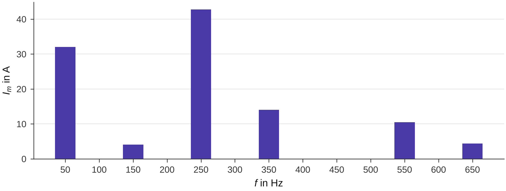
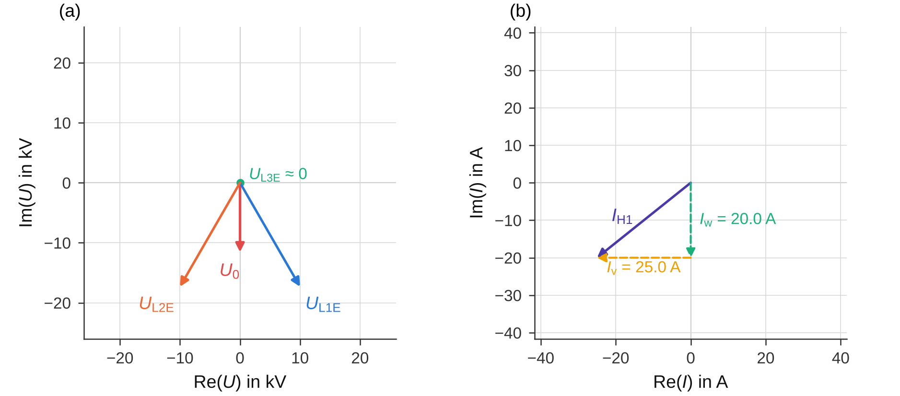

# Evaluating a recording

This page follows one recording from opening the COMTRADE file to the result file: corrections, channel roles,
raw-data diagnostics, the choice of the analysis intervals, the settings, the evaluation and how to read its tables.
In the notebook these are sections 1 to 4 and 7 of `evaluate_measurement.ipynb` ([Notebooks](notebooks.md)); the
station-specific results are described in [Stations and the LV network](station.md).

What [`evaluate`](../reference/evaluation.md) does, in short:

1. read the analysis intervals (steady-state fault, pre-fault, post-fault) of all channels – optionally with a time
   offset for channels of another recorder subsystem;
2. estimate the network frequency f1 per interval (reference: the line-to-line voltage U_L1-L2, cross-checked with a
   second method);
3. divide the steady-state interval into 200-ms windows and compute, for all channels and from the same window, the
   true RMS value and the RMS phasors of the orders 1…40 (DC removed per window by the median, Hann window, DFT at
   m·f1);
4. take the window with the **largest residual earth-fault current** – the *max window* – and derive the assessment
   quantities from it: angle method (active and reactive component Iw, Iv), polarity check, harmonic content,
   measurement uncertainty and, optionally, the scaling to the 95 % quantile of a power-quality measurement;
5. analyse the voltages before, during and after the fault (sequence components per order, THD);
6. at a station: earth potential rise, touch voltage, shield and PEN currents, per frequency
   ([Stations and the LV network](station.md)); with line currents: the transformer power;
7. plausibility checks and statistics over all windows of the steady-state interval.

The signal processing itself is described in [Signal processing](../methods/signal-processing.md).

## Opening a recording

```python
import os
import tempfile

import groundfault as gf
from groundfault import corrections, demo

base = tempfile.mkdtemp()
d = demo.make_campaign(base, layout="en")
campaign = d["campaign"]

rec = gf.open_recording(os.path.join(campaign, "raw/SUB/SUB_0_10_000kHz.cfg"))
corr = corrections.load(campaign)                 # notes/corrections.csv of the campaign
log = corr.apply(rec)                             # applied once per recording; log: one row per corrected channel
roles = gf.detect_roles(rec.channel_names, rec.units, corr.role_overrides(rec), corr.main_channel(rec),
                        corr.distances(rec))
print(rec)
print(roles.table()[["no", "short", "unit", "role", "meaning", "main_channel"]].to_string(index=False))
print(roles.measurement_kind(), roles.capabilities())
```

```text
<Recording SUB_0_10_000kHz.cfg | 7 channels | 10000 Hz | 9.00 s | BINARY>
 no short unit   role                       meaning main_channel
  1    V1    V  u_l1e line-to-earth voltage L1 (MV)            ✓
  2    V2    V  u_l2e line-to-earth voltage L2 (MV)            ✓
  3    V3    V  u_l3e line-to-earth voltage L3 (MV)            ✓
  4   IF1    A  i_res  residual earth-fault current            ✓
  5   IF2    A  i_res  residual earth-fault current             
  6 ISp21    A i_coil                  coil current            ✓
  7 ISp22    A i_coil                  coil current             
substation {'fault_current': True, 'voltage_analysis': True, 'angle_method': True, 'coil_currents': True, 'station': False, 'transformer': False}
```

[`open_recording`](../reference/comtrade.md) reads COMTRADE files of the revisions 1991, 1999 and 2013 (ASCII,
BINARY, BINARY32 and FLOAT32 data, secondary values converted to primary values). A binary `.dat` file is opened as a
memory map, so even recordings of several gigabytes need little memory (ASCII data are read completely); use the
recording as a context manager (`with gf.open_recording(path) as rec:`) to close the file. Options:

| Parameter | Meaning |
|---|---|
| `fs_source_pref` | `"auto"`/`"cfg"` (default): sampling rate from the `.cfg` file, the time stamps serve as a check (and as the source if the `.cfg` file gives the rate 0); `"timestamps"`: from the time stamps |
| `fs_override` | enforce a sampling rate in Hz – only for a defective time base (`FS_OVERRIDE` in the notebook) |
| `primary_values` | convert secondary to primary values (default `True`) |
| `emit_warnings` | issue the findings of the reader as `UserWarning` (default `True`) |

Findings of the reader – a channel skew in the `.cfg` file, a truncated `.dat` file, a sample count that differs from
the `.cfg` file, a sampling rate from the time stamps that deviates by more than 0.5 % – are in `rec.warnings`.
`rec.info()` returns the header data (file, device, sampling rate and its source, duration, start and trigger time,
line frequency, encoding, warnings).

**Corrections** of the measuring chain (CT ratio, polarity, roles, main channel, probe distances) are kept per campaign
in `notes/corrections.csv` and applied when a recording is read; see [Corrections](corrections.md). Every applied
correction appears in the hints, in the plausibility table and in the result file.

### Channel roles

The **role table** (`roles.table()`, section 2 of the notebook) shows per channel: `no`, `channel` (full name),
`short` (short name), `unit`, `role` (code, `–` without a role), `meaning`, `main_channel` (✓ for the channel the
evaluation uses), `distance_m` (probe distance), `position` (PEN currents only: before or after the transformer star
point) and `source` – `automatic` (from the name), `override` (from the corrections file or `ROLE_OVERRIDES`) or the
text of a touch voltage derived from the probe distances. How roles are detected is described in
[Campaigns, folders and files](campaigns.md#channel-names); wrong roles are fixed in the
[corrections file](corrections.md).

The roles decide what can be evaluated (`roles.capabilities()`) and the **kind of measurement**
(`roles.measurement_kind()`, column `measurement_kind` of the register):

| Capability | Needs |
|---|---|
| `fault_current` | a fault-current channel (`i_res`) |
| `voltage_analysis` | the three line-to-earth voltages `u_l1e`, `u_l2e`, `u_l3e` |
| `angle_method` | `i_res` and the line-to-earth voltages or the neutral displacement voltage `u_ne` |
| `coil_currents` | at least one coil current (`i_coil`) |
| `station` | an earth potential rise (`u_e`) or a touch voltage (`u_t`) |
| `transformer` | three line currents and the line-to-earth voltages of the MV or HV side |

The kind of measurement is `station`, `substation` (fault current and line-to-earth voltages, no station channels)
and/or `transformer`, joined with `+`, or `undetermined`.

## Raw-data diagnostics

Before you choose the intervals, [`diagnostics.diagnose`](../reference/diagnostics.md) checks whether the file is
usable: the structure of the `.dat` file, the time base (sampling rate from the `.cfg` file against the time stamps,
jumps, irregular steps, consecutive sample numbers), and per channel the active range, the event time (largest step of
the RMS value), the DC offset, the share of the fundamental, saturation (flat tops of the raw values) and flat or
broken channels. Voltage and current channels that show the fault inception at different times point to an export
error with a time offset between recorder subsystems.

```python
from groundfault import diagnostics

dg = diagnostics.diagnose(rec, roles)
print(dg.text())
print(dg.channels[["channel", "role", "active_from_s", "active_to_s", "event_s", "DC", "share_H1_pct", "note"]]
      .to_string(index=False))
```

```text
File: SUB_0_10_000kHz.cfg | BINARY | 7 channels | 90,000 samples | 9.000 s
Sampling rate: cfg 10000.000 Hz | time stamps 10000.000 Hz | used 10000.000 Hz (cfg)
Time stamps: jumps 0 | irregular 0.000 % | sample numbers consecutive: yes
Event time (largest step): voltages 1.980 s | currents 1.960 s
✓ no anomalies
channel   role  active_from_s  active_to_s  event_s         DC  share_H1_pct                                   note
     V1  u_l1e           0.01         8.99     6.04 -23.298887     99.989413                                       
     V2  u_l2e           0.01         8.99     1.96 -21.496330     99.955676                                       
     V3  u_l3e           0.01         8.99     1.98   0.000000      3.094210 ≈ 0 at the check time (faulted phase?)
    IF1  i_res           2.01         5.99     1.96   1.986702     56.640397                                       
    IF2  i_res           2.01         5.99     1.96   0.023180     56.763087                                       
  ISp21 i_coil           2.01         5.99     1.96  -0.247884    100.004141                                       
  ISp22 i_coil           2.01         5.99     1.96  -0.191260    100.003703                                       
```

The table `dg.channels` also contains `unit`, `peak_rms`, `rms_ac` and `saturation_pct`; `dg.digital` lists the
digital channels with their number of edges. The last lines of `dg.text()` are either “✓ no anomalies” or one line
per finding (⚠):

| Finding | What to do |
|---|---|
| `Subsystems not synchronous – suggestion: alignment = {…}` with “Voltage and current channels show the fault inception at different times …” | export the file again from the recorder software; if that does not help, use the suggestion: `ALIGNMENT` in the notebook, `evaluate(…, alignment=…)` in Python |
| `Time stamps with … jumps/backward steps – check the time base.` or a deviating sampling rate | check the export; for a defective time base enforce the sampling rate (`FS_OVERRIDE`, `open_recording(…, fs_override=…)`) |
| `Sample numbers not consecutive – the file may be concatenated or corrupt.` | export the file again |
| `Channel … is flat – do not use it as a reference.` | the channel carries no signal; ignore it in the corrections file if it has a role |
| note `saturation … %` | clipped waveform: the values of this channel are distorted; prefer another CT (main channel) |

## Choosing the analysis intervals

The analysis intervals are read off **by hand** from the RMS trend – nothing is automatic, because only the person who
knows the test sequence can tell a steady fault from an active residual current increase or a coil adjustment. In the
notebook, section 3 shows the moving true RMS value of all channels (20-ms windows, DC removed per window) with zoom
and range slider; in Python it is `interactive.rms_values(rec, roles, intervals=…)` (a Plotly figure).

| Interval | Choose it … | Used for |
|---|---|---|
| `steady_state` | after the transient and the decay of the DC component (often 0.5 s or more after the fault inception, longer without additional impedance) and **before** an active residual current increase, a coil adjustment or the fault clearance | all assessment quantities: the max window lies in it; statistics over all its windows |
| `pre_fault` | in the operation without fault before the fault, a few seconds | voltage levels and harmonics without fault; background at a station; equivalent-source method |
| `post_fault` | in the operation without fault after the fault, once the neutral displacement voltage has decayed | as `pre_fault` |

The evaluation divides the steady-state interval into 200-ms windows and assesses the window with the largest residual
earth-fault current (**max window**). Its time is printed in the summary and shaded in the figures; the signal
explorer jumps to it ([Signal explorer](explorer.md)). Several plausibility checks look at the whole interval: if the
fundamental component of the fault current varies, or a decaying DC component is still present in the max window, a
hint asks for a narrower or later interval.


The figure shows the demo recording `SUB_0_10_000kHz`: the fault starts at 2 s and is cleared at 6 s; between 4.6 and
5.4 s an active residual current increase raises the fault current. The steady-state interval 2.6…4.4 s therefore
ends before the increase.

```python
intervals = gf.Intervals(steady_state=(2.6, 4.4), pre_fault=(0.2, 1.8), post_fault=(7.0, 8.8))
print(intervals.check(rec.duration_s))           # hints on overlapping intervals; ValueError if outside the file
try:
    gf.Intervals((2.6, 9.5)).check(rec.duration_s)
except ValueError as ex:
    print(ex)
```

```text
[]
Interval steady_state=(2.6, 9.5) is not within 0 … 9.000 s or t0 ≥ t1.
```

`Intervals` takes the three intervals as `(t0, t1)` in seconds from the start of the recording; missing ones are
`None`. Without a steady-state interval the whole recording is used – useful only for a first look. A pre-fault
interval that ends after the start of the steady-state interval (or a post-fault interval that starts before its end)
only gives a hint.

## Settings

[`Settings`](../reference/evaluation.md) holds the parameters of the evaluation. The defaults of the analysis
parameters are meant to be kept; the limits and margins at the end of the table have no preset values (see below).

| Field | Default | Meaning |
|---|---|---|
| `f_nominal` | `50.0` | rated network frequency in Hz |
| `T_win` | `0.200` | window length in s |
| `T_hop` | `None` | hop between two windows in s; `None` = `T_win` (no overlap) |
| `window` | `"hann"` | window function of the DFT: `"hann"`, `"hann_periodic"` or `"rectangular"` |
| `dc` | `"median"` | removal of the DC component per window: `"median"`, `"mean"` or `"none"` |
| `harmonics` | `(1, 3, 5, 7)` | orders of the fault current in the table `assessment_quantities` (the fundamental is always included) |
| `export_orders` | `1 … 25` | orders whose phasors are stored in the result file (input of the equivalent-source method) |
| `voltage_harmonics` | odd orders up to 25 | orders of the voltage levels before and after the fault |
| `thd_max_order` | `40` | highest order of the THD (orders 2…40 as in IEC 61000-4-7) |
| `estimate_frequency` | `True` | estimate f1 per interval; `False` = use `f_nominal` |
| `f1_method` | `"phase"` | frequency estimation: `"phase"` (phase progression of the fundamental) or `"spectral"`; the other method serves as a cross-check |
| `uncertainty_I` | `0.0` | measurement-uncertainty margin m_I of currents (assessed current = measured · (1 + m_I)), defined by the user; `0.0` = no margin |
| `uncertainty_U` | `0.0` | measurement-uncertainty margin m_U of voltages (assessed voltage = measured · (1 − m_U)), defined by the user; `0.0` = no margin |
| `correct_polarity` | `True` | Iw < 0 → rotate the fault-current phasors by 180° |
| `max_search_hop` | `None` | finer hop in s for the search of the max window; `None` = `T_hop` |
| `u_thd95_percent` | `None` | 95 % quantile of the line-to-line THD of a power-quality measurement in % – enables the scaling of the harmonic content |
| `u_thd95_volt` | `None` | alternatively the 95 % quantile of the line-to-line harmonic voltage in V |
| `pq_safety_factor` | `1.0` | factor k_s applied to the 95 % quantile, defined by the user; `1.0` = no factor |
| `thd_reference` | `"mean"` | interval of the measured THD the scaling refers to: `"pre_fault"`, `"post_fault"` or `"mean"` |
| `transformer_voltage` | `"mv"` | voltage set for the transformer power: `"mv"` or `"hv"` |
| `transformer_sign` | `1.0` | +1: consumer reference-arrow system as measured; −1 reverses the signs of P and Q |
| `ires_limits` | `()` | limits of the residual current in A, defined by the user; the station voltages are extrapolated to them, the largest is the reference current of the reduction factor; `()` = none |
| `u_tp` | `None` | permissible touch voltage U_Tp in V, defined by the user; with `f_factor` the limit F·U_Tp of the earth potential rise (relevance of the reduction factor for the assessment) |
| `f_factor` | `None` | factor F of the permissible earth potential rise F·U_Tp, defined by the user |

groundfault contains no limits, safety factors or uncertainty margins. `ires_limits`, `u_tp`, `f_factor`,
`uncertainty_I`, `uncertainty_U` and `pq_safety_factor` are parameters you define for your network – from the
operator's specification, the applicable standard or the accuracy of your measuring chain. With their defaults the
evaluation applies no margin and no factor, and the parts that need a limit are skipped with a hint (the station
voltages are not extrapolated, the relevance of the reduction factor is not determined). The values are checked when
the settings are created: the limits must be currents > 0, `u_tp` and `f_factor` a number > 0 or `None`, a margin
0 ≤ m < 1 and `pq_safety_factor` a factor > 0.

The text options – `window`, `dc`, `f1_method`, `thd_reference`, `transformer_voltage` – are checked when the settings
are created (and again by `evaluate`, in case a field was changed afterwards). An unknown value raises a `ValueError`
with the allowed values; a value of the predecessor tool, copied by hand from an old notebook, is not taken for
another one but named with its current name:

```python
try:
    gf.Settings(thd_reference="mittel")
except ValueError as ex:
    print(ex)
```

```text
thd_reference='mittel' is not allowed – allowed: 'pre_fault', 'post_fault', 'mean' ('mittel' is the former name of 'mean')
```

## Running the evaluation

```python
res = gf.evaluate(rec, intervals, gf.Settings(), roles, name="SUB_0_10_000kHz", z_fault_ohm=0.0,
                  metadata=dict(campaign="2026-01-15_Demo", site="SUB"))
print(res.summary())
```

```text
Measurement: SUB_0_10_000kHz  (SUB_0_10_000kHz.cfg)
Max window: 4.300 s  | f1 = 50.0200 Hz (phase)
IRES = 56.53 A | IG = 32.01 A | Iw = 20.00 A | Iv = 25.00 A | IH = 46.59 A
```

| Parameter | Meaning |
|---|---|
| `rec` | the recording (instantaneous values), with the corrections applied |
| `intervals` | the analysis intervals |
| `settings` | `Settings` (default `Settings()`) |
| `roles` | the role assignment; detected from the channel names if omitted (then without the corrections file) |
| `alignment` | time offset of channels of another recorder subsystem: `dict(dt_s=…, roles=[…], channels=[…])` – the listed channels are read `dt_s` later; other keys and unknown roles raise a `ValueError` |
| `name` | name of the measurement (default: file name without extension) |
| `z_fault_ohm` | additional impedance (fault resistance) in Ω, stored with the result; `None` at a station |
| `metadata` | extra entries of the section `meta` of the result file; `campaign` and `site` are taken from the path of a recording inside a campaign folder unless given |

`evaluate` raises a `ValueError` if an interval lies outside the recording or is shorter than one window, or if the
sampling rate is too low for a harmonic analysis (an RMS export instead of the instantaneous values). The summary
lists the measurement, the max window with f1 and the method of the frequency estimation, the main currents and – one
per line, marked ⚠ – all **hints**. The hints are also in `res.hints`; they are the first thing to read after an
evaluation ([Troubleshooting](troubleshooting.md) lists them with what to do).

## The result

[`Result`](../reference/evaluation.md) holds the tables (`res.tables`, a dict; `res.table(name)` returns one), the
scalar values (`res.values`), the hints (`res.hints`), the role assignment, the settings, the intervals and the window
analyses of the three intervals (`res.steady_state`, `res.pre_fault`, `res.post_fault` with the RMS values and phasors
of every window; `res.phasor(channel_index, order)` returns one phasor of the max window).

| Table | Content | Present |
|---|---|---|
| `assessment_quantities` | assessment quantities in the max window with the measurement-uncertainty margins | with a fault-current channel |
| `plausibility` | checks of the measurement and of the evaluation | always |
| `harmonics` | magnitude and angle of the orders 1…40 of every channel in the max window | always |
| `statistics` | RMS values (and the assessed orders of currents and probes) over all steady-state windows | always |
| `coil_currents` | coil currents in the max window | with coil currents (else empty) |
| `voltage_metrics`, `voltage_pre_fault`, `voltage_fault`, `voltage_post_fault` | voltages before, during and after the fault | with the three line-to-earth voltages |
| `transformer_power` | active and reactive power and sequence currents per order and interval | with line currents |
| `station_…` | station tables | at a station, see [Stations and the LV network](station.md) |

### Assessment quantities

```python
aq = res.table("assessment_quantities")
print(aq[["quantity", "measured_value", "assessment", "unit", "angle_deg"]].round(2).to_string(index=False))
```

```text
quantity  measured_value  assessment unit  angle_deg
    IRES           56.53       56.53    A        NaN
      Iw           20.00       20.00    A        NaN
      Iv           25.00       25.00    A        NaN
     IH1           32.01       32.01    A    -141.34
     IH3            4.04        4.04    A    -135.98
     IH5           42.74       42.74    A      54.05
     IH7           14.06       14.06    A      16.58
IH_total           46.59       46.59    A        NaN
  IH_sum           46.58       46.58    A        NaN
    UH1n        11547.07    11547.07    V     -90.00
```

Columns: `quantity` (code), `description` (text in the output language), `measured_value`, `assessment` (with the
measurement-uncertainty margins: currents increased by m_I, voltages reduced by m_U), `unit`, `equation` (the formula,
the same in both languages) and `angle_deg` (angle referred to the fundamental of U_L1-L2). With the default margins
of 0 the assessment equals the measured value; the next example sets margins of its own.

| Quantity | Meaning |
|---|---|
| `IRES` | residual earth-fault current: true RMS value of the max window (all frequencies, DC removed) |
| `Iw`, `Iv` | active and reactive (detuning) component of the fundamental from the angle between the fault current and the zero-sequence voltage; Iv > 0 means over-compensation |
| `IH1`, `IH3`, `IH5`, `IH7` … | magnitude of the fault current at the orders of `Settings.harmonics` |
| `IH_total` | total harmonic content √(I_RES² − I_G²) |
| `IH_sum` | root sum of squares of the orders 2…40 – a cross-check of `IH_total` |
| `UH1n` | fundamental component of the zero-sequence voltage (neutral displacement voltage) |
| `UTHD_meas`, `UTHD_95`, `IH_scaled`, `IRMS_forecast` | only with `u_thd95_percent`/`u_thd95_volt`: measured THD (or harmonic voltage), its 95 % quantile × safety factor, the harmonic content scaled to it and the residual current with the scaled harmonic content |

With a power-quality quantile the table gets the four scaling rows:

```python
k_s, m_I, m_U = 1.2, 0.03, 0.02          # illustrative values – define your own
settings_pq = gf.Settings(u_thd95_percent=3.0, pq_safety_factor=k_s, uncertainty_I=m_I, uncertainty_U=m_U)
res_pq = gf.evaluate(rec, intervals, settings_pq, roles, z_fault_ohm=0.0)
print(res_pq.table("assessment_quantities").tail(4)[["quantity", "measured_value", "assessment", "unit",
                                                     "equation"]].round(2).to_string(index=False))
```

```text
     quantity  measured_value  assessment unit                      equation
    UTHD_meas            2.16        2.12    %   U_assess = U_meas·(1 − m_U)
      UTHD_95            3.60        3.60    %           U_95 = U_PQ,95%·k_s
    IH_scaled           77.55       81.51    A  I_H,scaled = I_H·U_95/U_meas
IRMS_forecast           83.90       87.93    A I_RMS = √(I_G² + I_H,scaled²)
```

The quantities are explained in [Assessment quantities](../methods/assessment.md).

### Plausibility checks

```python
print(res.table("plausibility")[["check", "status", "value"]].to_string(index=False))
```

```text
                                     check status                                         value
      Windows in the steady-state interval     OK                                             9
                      Network frequency f1     OK            50.0200 Hz (comparison 50.0200 Hz)
Network frequency constant in the interval     OK                              spread 0.0000 Hz
               RMS ↔ √ΣX² (orders 1,3,5,7)     OK                                         2.1 %
                  RMS ↔ √ΣX² (orders 1…40)     OK                                         0.0 %
      Stationarity of I_H1 in the interval     OK             span 0.0 % (ΔIw 0.0 A, ΔIv 0.0 A)
 Low-frequency component of I_RES (< f1/2)     OK             0.08 A (I_RES increased by 0.0 %)
             Polarity of the fault current     OK Iw = 20.00 A (margin 38.7° to the ±90° limit)
                Fault-current CT IF2 ↔ IF1     OK                 RMS ratio 1.008, Δφ(H1) -0.5°
                             Faulted phase     OK                       L3: 0 V (0.0 % of max.)
                         Pre-fault IF1 ≈ 0     OK                                        0.05 A
                         Pre-fault IF2 ≈ 0     OK                                        0.05 A
                       Pre-fault ISp21 ≈ 0     OK                                        3.90 A
                       Pre-fault ISp22 ≈ 0     OK                                        3.25 A
```

The fourth column, `comment`, explains each check. The status is `OK`, `NOTE`, `WARNING`, `CORRECTED`, `UNCERTAIN` or
`INFO`:

| Check | Not `OK` when … | What to do |
|---|---|---|
| Corrections (`notes/corrections.csv`) | `CORRECTED`: corrections were applied (value: total factor per channel) | nothing – documents the corrections |
| Windows in the steady-state interval | fewer than 3 windows (`NOTE`) | choose a longer interval |
| Network frequency f1 | the estimate is implausible (`WARNING`) | check the reference voltage; the rated frequency is used |
| Network frequency constant in the interval | f1 per window spreads by more than 0.02 Hz (`NOTE`) – magnitude errors at high orders | choose a narrower interval |
| RMS ↔ √ΣX² (assessed orders) | the RMS value deviates by 5 % or more from the root sum of squares of the assessed orders (`NOTE`) | further components (higher orders, interharmonics) – look at the spectrum |
| RMS ↔ √ΣX² (orders 1…40) | deviation of 3 % or more (`WARNING`): interharmonics, noise or transients in the window | look at the window in the signal explorer |
| Stationarity of I_H1 in the interval | the fundamental varies by 5 % or more (`WARNING`); the comment names the cause: active component changes (active residual current increase), reactive component changes (coil adjustment, network switching) or both | choose a narrower steady-state interval; with a coil adjustment Iv refers to the time of the max window |
| Coil current balance ΔIv ↔ ΔΣI_coil | only if the coil currents change within the interval: Iv does not change by the same amount as the measured coil currents (slope outside 0.8…1.25 or R² < 0.8, `WARNING`) | a coil channel with a wrong ratio or a clamp around only one of several parallel feeders – correction in the corrections file |
| Low-frequency component of I_RES (< f1/2) | a decaying DC component or drift raises I_RES by 1 % or more (`WARNING`); the value without it is given | start the steady-state interval later |
| Polarity of the fault current | Iw was negative and the current phasors were rotated (`CORRECTED`), or the margin to the ±90° limit is below 10° (`UNCERTAIN`) | `CORRECTED`: usually a reversed clamp – fine; `UNCERTAIN`: check the clamp polarity, `correct_polarity=False` if it is known |
| Fault-current CT … ↔ … | two fault-current channels differ by 5 % or more in RMS value or by 5° or more in angle (`WARNING`; a reversal by 180° is tolerated) | one CT saturated or scaled wrongly – choose the right main channel |
| Faulted phase | the smallest line-to-earth voltage is 10 % or more of the largest (`WARNING`) | not a solid earth fault, or wrong voltage channels |
| Pre-fault … ≈ 0 | a fault or coil current is clearly present before the fault (`NOTE`) | check the DC offset of the clamps and the pre-fault interval |
| Transformer zero-sequence current ↔ coil current/3 | information only (`INFO`) | equal if the measured coils are connected to the star point of this transformer |
| Saturation … | flat tops in more than 0.01 % of the samples (`WARNING`) | the channel is clipped – values distorted |

### Voltages, harmonics, statistics, coil currents

With the three line-to-earth voltages the evaluation analyses the voltages per interval. `voltage_metrics` has one row
per interval (`pre_fault`, `fault` = max window, `post_fault`) with the start time `t0_s`, `f1_Hz`, the positive-sequence
fundamental `U_pos_H1_V`, the 5th harmonic in the negative sequence `UH5g_V`, the 7th harmonic in the positive sequence
`UH7m_V`, per line-to-line loop the THD and the harmonic voltage (`UTHD12_pct`, `UH12_V`, `UTHD23_pct` …) and the
zero-sequence fundamental `Uzero_H1_V`. `voltage_pre_fault`, `voltage_fault` and `voltage_post_fault` list per order
the median magnitudes of the line-to-earth (`U_L1E`…), line-to-line (`U_L12`…) and sequence voltages (`U_zero`,
`U_pos`, `U_neg`).

```python
vm = res.table("voltage_metrics")
print(vm[["interval", "f1_Hz", "U_pos_H1_V", "UH5g_V", "UH7m_V", "UTHD12_pct", "Uzero_H1_V"]].round(2)
      .to_string(index=False))
```

```text
  interval  f1_Hz  U_pos_H1_V  UH5g_V  UH7m_V  UTHD12_pct  Uzero_H1_V
 pre_fault  50.02    11547.01  220.00  109.97        2.16      150.00
     fault  50.02    11546.92  220.05  109.94        2.16    11547.07
post_fault  50.02    11547.00  219.98  109.99        2.16      150.01
```

`harmonics` lists every channel and order of the max window (`channel`, `role`, `order`, `f_Hz`, `magnitude`,
`angle_deg`, `angle_ref_ULL_deg`, `unit`); `statistics` the RMS value and the assessed orders over all windows of the
steady-state interval (`value_max_window`, `n`, `mean`, `std`, `min`, `max`, `p95`) – a large spread shows that the
interval is not steady; `coil_currents` the RMS value, the fundamental and its angle per coil channel.

```python
st = res.table("statistics")
print(st[st["channel"] == "IF1"][["channel", "quantity", "value_max_window", "n", "mean", "std", "min", "max",
                                  "p95"]].round(2).to_string(index=False))
print(res.table("coil_currents").round(2).to_string(index=False))
```

```text
channel quantity  value_max_window  n  mean  std   min   max   p95
    IF1      RMS             56.53  9 56.52  0.0 56.52 56.53 56.53
    IF1       H1             32.01  9 32.02  0.0 32.01 32.02 32.02
    IF1       H3              4.04  9  4.04  0.0  4.04  4.04  4.04
    IF1       H5             42.74  9 42.74  0.0 42.74 42.74 42.74
    IF1       H7             14.06  9 14.06  0.0 14.05 14.06 14.06
channel  RMS_A  H1_A  H1_angle_ref_ULL_deg
  ISp21 299.99 300.0                -180.0
  ISp22 249.99 250.0                -180.0
```

`transformer_power` (with three line currents) has one row per interval and order up to 13: `P_kW`, `Q_kvar` and the
positive-, negative- and zero-sequence currents `I_pos_A`, `I_neg_A`, `I_zero_A`.

`res.values` holds the scalar results – among them `IRES`, `IG`, `Iw`, `Iv`, `IH_total`, `IH_sum`, `U0` (phasor),
`faulted_phase`, `main_channel_i_res`, `polarity_margin_deg` and, if computed, `ires_low_frequency_A`,
`IRES_without_lf`, `coil_balance_slope` and the scaling values.





### Conventions

* Phasors are RMS phasors (cosine convention). Angles in columns such as `angle_ref_ULL_deg` are referred to the
  fundamental of the line-to-line voltage U_L1-L2 in the same window (order m: X_m·e^(−j·m·φ)) and are therefore
  independent of the time origin of the recording.
* Polarity: the active component of the fundamental must be positive (Iw > 0). If it is negative, the fault-current
  phasors are rotated by 180° (hint and plausibility row). With this orientation **Iv > 0 means over-compensation**
  (Iv = ΣI_coil − I_C) – the one sign convention of groundfault
  ([conventions](../methods/index.md#orientation-of-the-fault-current-and-sign-of-the-detuning)).
* The DC component is removed per window by the median. The RMS value is the true RMS value over all frequencies, not
  only over the selected harmonics.

## The result file

`res.save_json(path)` writes the result without the raw data – the input of the campaign notebook and the archive of
the evaluation. Its place is `results/<measurement>/<measurement>_result.json` (German layout:
`2_Auswertung/<Messung>/<Messung>_ergebnis.json`); the layout object builds the path:

```python
from groundfault.layout import ENGLISH

path = res.save_json(ENGLISH.result_path(campaign, res.name))
print(os.path.relpath(path, campaign))
r = gf.load_result(path)
print(r, r.values["IRES"], r.z_fault_ohm)
print(r.settings.ires_limits, r.settings.u_tp, r.settings.f_factor)
```

```text
results/SUB_0_10_000kHz/SUB_0_10_000kHz_result.json
<ResultFile SUB_0_10_000kHz> 56.52565693412697 0.0
() None None
```

The JSON file (format `groundfault-result`, version 3) contains `meta` (start time, campaign, site, measurement, tool
version, applied corrections), `measurement` (file, sampling rate, intervals, max window, f1, polarity, alignment,
roles, main channels, settings), `signals` (per channel: role, RMS values and the phasors of the orders 1…25 in the max
window), `assessment_quantities`, `hints`, `plausibility`, `voltage` (levels and sequence phasors per interval),
`tables` (all tables), `statistics` and `values`; at a station also the times and frequency sources of the
superposition and the PEN channels used.

[`load_result`](../reference/evaluation.md) returns a `ResultFile` with the interface the campaign evaluation, the
report tables and the groundmeas functions need: `name`, `values`, `tables` (`table(name)`), `hints`, `settings`
(`f_nominal`, `T_win`, `ires_limits`, `u_tp`, `f_factor`), `measurement` and `z_fault_ohm`. Result files of the
predecessor tool (German keys) are translated when they are read
([Language and folder layout](language.md#files-of-the-predecessor-tool)).
A file inside a campaign folder whose `meta` names no campaign or site – files of early versions of the predecessor –
gets both from its path, as `evaluate` does for a recording: the campaign folder, and the site from the folder of the
recording (`measurement.cfg_file`) in `raw/`. The groundmeas export then finds the site in the sites file.
