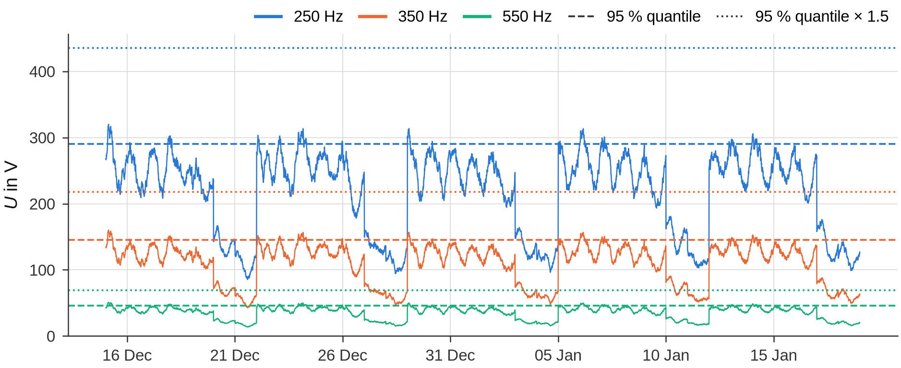
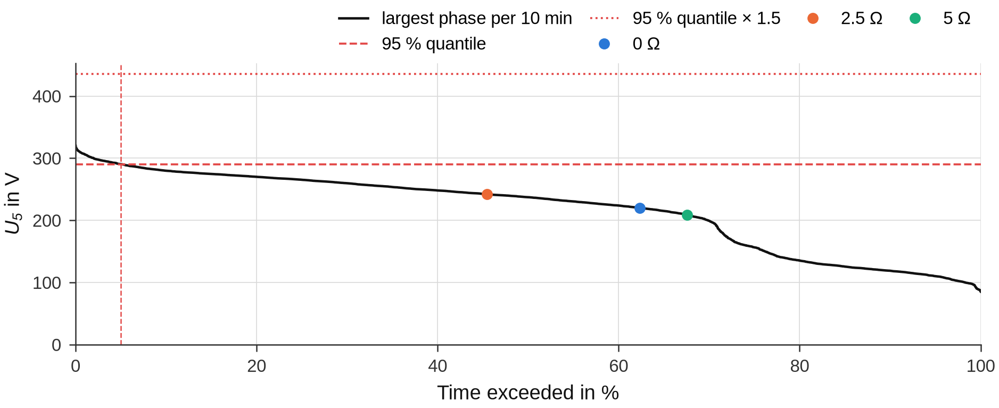
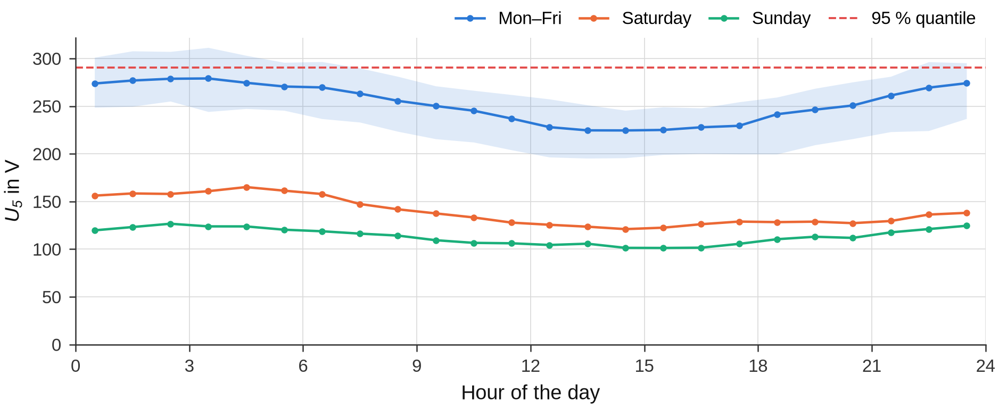

# Power-quality measurements

The harmonic voltages of the network during the fault tests are a snapshot – often of a quiet time such as a weekend,
when the harmonic level is low. A power-quality (PQ) measurement of the same busbar in undisturbed operation – the same
network and switching state – shows how high this level is over weeks or a year. groundfault reads the export of the
PQ instrument, forms 10-min values, takes a high quantile of the largest phase per interval, applies a factor that you
define from the duration of the gapless values, shows where the tests lie in the distribution of the PQ measurement
and passes the values on to the evaluation of a recording, the equivalent-source method of the campaign and the
forecast. What is scaled follows the sequence of each order:

| Orders | Scaling |
|---|---|
| positive or negative sequence – odd, not a multiple of 3 (5, 7, 11, 13, 17, 19 …) | with its own voltage, U95,m/U_level,m (the 250-Hz current with the 250-Hz voltage); without a value of its own with the THD |
| zero sequence – odd multiples of 3 (3, 9, 15 …) | as measured: the zero sequence arises in the earth fault |
| even orders (2, 4, 6, 8 …) | as measured and listed separately – unusual in the voltage of a network, they may point to another cause |

The functions are in [`groundfault.pq`](../reference/pq.md); the method is described in
[Power-quality measurement](../methods/assessment.md#power-quality-measurement). In the notebooks the settings are
`PQ_FILES`, `PQ_TIMEZONE`, `PQ_QUANTILE`, `PQ_FACTORS` and `PQ_SAFETY_FACTOR`
([Notebooks](notebooks.md#power-quality-measurement)).

## Reading an export

`pq.read(paths, timezone=None)` reads one or several exports:

* **WinPQ mobil** – the CSV export of the software of the *PQ-Box* instruments (A. Eberle): the header (instrument,
  serial number, measurement, interval, nominal voltage) and the columns `H5_UL1_[V]` (harmonic voltage of order 5,
  line-to-earth L1, primary volts), `THD12_[%]` (THD of the line-to-line voltage L1-L2), `U12_[V]` (RMS value),
  `UNE_[V]`; columns of maxima (`H5_UL1_max_[V]`) are kept separately. Comma or semicolon as separator and a decimal
  point or comma are recognised. An export with the THD only is refused with a message: the scaling needs the
  harmonic voltages per order. If there is nothing else, give the quantile of its THD by hand (`THD95_PERCENT` in
  the campaign notebook, `u_thd95_percent` in the evaluation – the largest loop of the 10-min values, as `assess`
  forms it): every order of the positive or negative sequence then takes the THD factor.
* **LEM Memobox** – the file `*.PQL` of the software CODAM (`pq.read_pql`, also recognised by `pq.read`): the job
  (title, interval, nominal and transformer voltages) and the interval values. Per phase or loop the mean fundamental
  and the harmonic voltages of the orders 2 … 50 of each interval are read in primary volts – line-to-line
  (`L12`, `L23`, `L31`) for a three-wire job, otherwise line-to-earth; the THD is computed from the orders 2 … 40.
  The scale is checked against the nominal voltage of the job (a factor 10ⁿ is corrected with a hint), and rows with
  a wrong number of values are skipped with a hint. CODAM stores the harmonic voltages in steps of about 0.05 % of
  the fundamental (≈ 10 V at 20 kV); a hint gives the step. Orders whose level is only a few steps – often from
  the 11th on – are hardly resolved, their quantiles are uncertain, and a quantile of 0 V scales with the THD
  instead of its own voltage.
* **Other instruments** – read the export with pandas and pass the table to `pq.from_frame(frame, interval_s=…)`:
  one row per interval, the time in the index or in a column, columns such as `H5_L1` (V or `H5_L1_[%]` in % of the
  fundamental), `THD_L12` and `U_L12`. Unknown columns are left out with a hint.

Several files are combined in time order: a file with the same content as another (or the same time stamps) is used
once, overlapping time stamps keep the values of the first file, and exports with different intervals are refused
(form the 10-min values of each first). The time stamps mark the **end** of each interval and are the local time of
the instrument clock; `timezone` (e.g. `"Europe/Berlin"`) localises them, which is needed to compare them with the
recorder time stamps of the tests (UTC). The hour repeated at the end of daylight saving time is told apart by the
order of the file; a clock that does not follow daylight saving time needs a fixed offset such as `"Etc/GMT-1"`
(UTC+1) – otherwise the stamps of the skipped hour in spring are left out with a hint. The interval is taken from the
header and checked against the step of the time stamps.

The examples use a synthetic export of the demo (`demo.make_pq_export`: 30-s values over 35 days with a weekly and a
daily pattern; the quantiles of its 10-min values are known):

```python
import os
import tempfile

from groundfault import demo, pq

folder = tempfile.mkdtemp()
truth = demo.make_pq_export(os.path.join(folder, "busbar_pq.csv"), days=35.0, interval_s=30.0)
data = pq.read(os.path.join(folder, "busbar_pq.csv"), timezone="Europe/Berlin")
print(data.meta["instrument"], "|", data.interval_s, "s |", "orders", data.orders, "|", data.phases)
c = data.coverage()
print(c["start"], "…", c["end"], "| %.1f days, %d values, %.0f %% complete, gaps: %d"
      % (c["span_days"], c["n"], 100 * c["completeness"], len(c["gaps"])))
```

```text
PQ-Box 50 | 30.0 s | orders [1, 2, 3, 4, 5, 7, 9, 11, 13, 15, 17, 19] | ['L1', 'L2', 'L3']
2025-12-15 00:00:00+01:00 … 2026-01-19 00:00:00+01:00 | 35.0 days, 100800 values, 100 % complete, gaps: 0
```

`data` is a `PQData` with the harmonic voltages (`harmonics`, columns `(order, phase)`), `thd`, `rms`, the interval,
the metadata of the export and the hints of reading.

## 10-min values

`pq.ten_minute_values(data)` forms clock-aligned 10-min intervals (…:00–…:10, …), labelled with their end, as the
square root of the mean of the squares of the shorter values (IEC 61000-4-30); `how="mean"` takes the arithmetic mean
instead. An interval with missing values is left out and counted (`min_share` lowers the share of values it needs). An
export of 10-min values is taken as it is. `pq.assess` does this step itself.

```python
ten = pq.ten_minute_values(data)
print(len(ten.harmonics), "10-min values |", ten.hints[-1])
print(ten.harmonics[(5, "L1")].head(3).round(2).to_string())
```

```text
5040 10-min values | 10-min values formed from 20 values of 30 s each (square root of the mean of the squares).
2025-12-15 00:10:00+01:00    252.89
2025-12-15 00:20:00+01:00    251.66
2025-12-15 00:30:00+01:00    252.44
Freq: 10min
```

## Quantile and factor

`pq.assess(data, quantile=0.95, factor=None, factors=None)` takes per 10-min interval the **largest of the three
phases** – line-to-earth, per order – and the **largest of the three loops** of the line-to-line THD, and of these
values the quantile over the whole measurement. This is the quantile of the "worst" phase per interval; it is at least
the largest of the quantiles of the single phases.

The factor on the quantile is yours: groundfault contains none. `factor=k` sets it directly; `factors={D: k, …}` is a
rule by the duration of the measurement: the factor of the longest minimum duration D (in days) the measurement
reaches. The duration is the longest stretch of **gapless** values – an interval without a value, also an incomplete
10-min interval, interrupts it (`max_gap_minutes` tolerates short gaps; their time does not count). A measurement
shorter than every D is **not valid** for the assessment: `a.valid` is False, the factor is NaN, and `a.scaling()`,
`a.settings()`, `a.voltages()` and `a.series()` raise a ValueError – the tables and figures stay available for
information. Without both, the factor is 1. A rule of two durations, e.g. one for a year and one for a shorter period
with a factor of its own, makes a shorter measurement invalid.

Intervals with an earth fault or a voltage dip of one phase are not undisturbed operation: an interval whose smallest
line-to-earth fundamental voltage is below `fault_threshold` (default 0.8) times the largest is left out of the
quantiles, with a hint (`fault_threshold=None` keeps all). The unbalance of a resonant-earthed network in operation
is a few per cent. With shorter values in the export (e.g. 30 s) the criterion is applied to them as well: an earth
fault of a few seconds lowers the 10-min value of the faulted phase by only about 1 %, but it distorts the 10-min
harmonic values – the 10-min interval that contains such a value is left out, and a hint names the short values.

```python
rule = {360.0: 1.0, 20.0: 1.5}                # invented rule {minimum days: factor} – define your own
a = pq.assess(data, factors=rule)
print(a.summary())
print(a.factor_hint, "| valid:", a.valid, "| gapless %.1f days" % a.coverage["gapless_days"])
print(a.table().query("order in (3, 5, 7, 11, 13)")[["order", "U_quantile_L1_V", "U_quantile_L2_V", "U_quantile_L3_V",
      "U_quantile_V", "U_assessment_V", "U_median_V", "share_of_UH_pct"]].round(1).to_string(index=False))
print("THD95 %.2f %% (largest loop), U_H,95 %.1f V (line-to-line), dominant order %d"
      % (a.thd95(), a.uh95_ll, a.dominant_order))
print({m: round(u, 2) for m, u in truth["quantiles"][0.95].items() if m in (5, 7)}, "(truth of the demo)")
```

```text
PQ measurement 2025-12-15 00:00:00+01:00 … 2026-01-19 00:00:00+01:00 (35.0 days, 5040 10-min values, 100.0 % complete): quantile 0.95 of the largest phase per interval
Measurement with 35.0 days of gapless values (≥ 20 days) → factor 1.5 on the quantile. | valid: True | gapless 35.0 days
 order  U_quantile_L1_V  U_quantile_L2_V  U_quantile_L3_V  U_quantile_V  U_assessment_V  U_median_V  share_of_UH_pct
     3             31.2             29.3             33.0          33.0            49.5        27.0             10.0
     5            274.2            257.7            290.6         290.6           435.9       237.3             87.6
     7            137.1            128.9            145.3         145.3           218.0       118.7             43.8
    11             43.6             41.0             46.2          46.2            69.4        37.8             13.9
    13             31.2             29.3             33.0          33.0            49.5        27.0             10.0
THD95 2.69 % (largest loop), U_H,95 539.8 V (line-to-line), dominant order 5
{5: 290.61, 7: 145.31} (truth of the demo)
```

The table has per order the quantile of each phase, of the largest phase (`U_quantile_V`), the quantile times the
factor (`U_assessment_V`), median and maximum of the largest phase, the share of the fundamental and of the whole
harmonic voltage (median) and the number of 10-min values. `a.summary_table()` lists the characteristic values
(period, completeness, longest gapless stretch, quantile, factor, validity, THD and harmonic voltage of the loops,
dominant order); `a.u95()` and `a.thd95()` give the quantiles (`factored=True`: times the factor), `a.largest(m)` the
10-min values of the largest phase and `a.series()` the 10-min values per phase.

A measurement too short for the rule:

```python
short = pq.assess(data.select(end="2025-12-29"), factors=rule)     # the first two weeks
print(short.valid, short.factor, "|", short.factor_hint)
try:
    short.scaling()
except ValueError as e:
    print(e)
```

```text
False nan | Measurement with 14.0 days of gapless values is shorter than the shortest duration of the rule (20 days) – not valid for the assessment: no factor, no scaling with this measurement.
The PQ measurement is not valid for the assessment (14.0 days of gapless values, shortest duration of the rule 20 days) – no scaling and no forecast voltages from it.
```

How well a measurement of a few weeks determines the quantile shows the **bootstrap over days**:
`a.quantile_bootstrap(n=200, block_days=1.0, seed=0)` draws whole days (blocks of `block_days`, so that the daily
pattern stays inside a block) with replacement until the length of the measurement is reached and takes the quantile
of every sample – one row per sample, one column per order and `THD_LL_pct`:

```python
b = a.quantile_bootstrap(n=200, block_days=1.0, seed=0)          # 200 samples of whole days
print(b[[5, 7]].quantile([0.05, 0.5, 0.95]).round(1).to_string())
print("quantile of the measurement: 5th order %.1f V, 7th order %.1f V" % (a.u95()[5], a.u95()[7]))
```

```text
          5      7
0.05  284.5  142.2
0.50  290.6  145.3
0.95  295.7  147.8
quantile of the measurement: 5th order 290.6 V, 7th order 145.3 V
```

The spread is the uncertainty of the quantile from the limited sample – not a substitute for the factor by the duration,
which covers the seasons and network states the measurement did not see. The [Word report](document.md) shows it in its
table of uncertainties.

What a shorter measurement would have needed shows the **sub-window analysis**: `a.window_factors(days=7)` takes every
window of seven days (a new start every day) and divides the quantile of the whole measurement by the quantile of the
window – the factor that window alone would have needed to reach the quantile of the measurement (largest phase per
interval, as in `assess`; windows with more than 10 % missing intervals are left out):

```python
w = a.window_factors(days=7)                                    # every 7-day window, a new start every day
print(w.head(3)[["start", "n_intervals", 5, 7]].to_string(index=False, float_format="%.3f"))
print(w[[5, 7]].quantile([0.5, 0.95]).to_string(float_format="%.3f"))
```

```text
                    start  n_intervals     5     7
2025-12-15 00:10:00+01:00         1008 0.989 0.989
2025-12-16 00:10:00+01:00         1008 1.026 1.026
2025-12-17 00:10:00+01:00         1008 0.993 0.993
         5     7
0.50 0.999 0.999
0.95 1.034 1.034
```

With a measurement over a year this is a way to derive the factor of your rule from your own data:
`window_factors(days=30)` and the 95 % quantile of its ratios give the factor that brings a one-month measurement to
the yearly quantile with 95 % probability – seasons included. With a measurement of a few weeks the ratios show only
the part of the factor that comes from the variation between days and weeks.

### Several measuring periods

Exports of the same busbar from different seasons are read together (`pq.read([…])`): the quantile is taken over all
of them, the rule of the factor counts the longest **gapless** stretch – a measurement in three periods of 37, 28 and
17 days gets the factor of 37 days. The stretches between gaps of at least a day (`PERIOD_GAP_DAYS`) are the measuring
periods: `a.coverage["periods"]` lists them, `a.periods()` gives the quantile per period with the definition of
`assess`, and a hint of `assess` names the quantile of the dominant order per period:

```python
a = pq.assess(pq.read(["spring.csv", "summer.csv", "autumn.csv"], timezone="Europe/Berlin"), factors=rule)
p = a.periods()                                               # one row per period: start, end, days, n_intervals, …
print(p[["start", "days", 5, 7, "THD_LL_pct"]].round(2).to_string(index=False))
print((p.attrs["whole"][5] / p[5]).round(3).tolist())         # the factor each period alone would need (5th order)
```

The spread between the periods shows how much the season matters at this busbar; `window_factors` takes its windows
only within the periods (`min_share`), so with several seasons it gives the factor of a shorter measurement against
the quantile over all of them. The [Word report](document.md) names the periods, the quantile of the dominant order
per period against the assessment voltage, and in its table of uncertainties I_RES(Z_E) scaled with each period
alone.

To keep the measurement of the scaling (e.g. one month with the factor of your rule) and use further exports of the
same busbar **only to check that factor**, assess them separately – the scaling does not change:

```python
check = pq.assess(pq.read(["spring.csv", "summer.csv", "autumn.csv"]), factor=1.0)   # only for the check
w = check.window_factors(days=28)                        # every 28-day window within the periods
need = w[[5, 7, 11, 13]].quantile(0.95)                  # factor a 28-day measurement needs against all periods
p = check.periods()[[5, 7, 11, 13]]
print(need.round(3).to_dict(), (p.max() / p.min()).round(3).to_dict())   # … and the highest against the lowest period
```

If the factor of your rule is at least `need` (and covers the spread of the periods), the further measurements confirm
it; `check.quantile_bootstrap()` adds the spread from the limited sample.

## The tests in the distribution

The scaling assumes that the tests and the PQ measurement see the same network: the same busbar, switching state and
harmonic sources. `pq.pre_fault_levels(result, kind=a.reference)` gives the pre-fault voltage of a test per order
(largest phase line-to-earth, or largest loop for line-to-line data) and its start time; `a.comparability(levels,
times)` shows where these levels lie in the distribution of the PQ measurement – over the whole measurement
(`percentile_all`) and in the time window of the test: the same time of the week, ± `window_h` hours
(`percentile_window`, `window_min_V`, `window_max_V`; the recorder time stamps are taken as UTC, `times_timezone`; a
PQ clock without a time zone is named in `attrs["hints"]`). `factor_to_test` is the quantile divided by the level of
the test.

```python
import groundfault as gf

levels, times, tests = {}, {}, {}
for w in demo.make_substation_series(folder):                   # the three demo tests: 0, 2.5 and 5 Ω
    rec = gf.open_recording(os.path.join(folder, w["file"]))
    b = w["intervals"]
    iv = gf.Intervals(tuple(b["steady_state"]), tuple(b["pre_fault"]), tuple(b["post_fault"]))
    res = gf.evaluate(rec, iv, z_fault_ohm=w["Z_F"])
    res.save_json(os.path.join(folder, w["file"].replace(".cfg", "_result.json")))
    levels[res.name], times[res.name] = pq.pre_fault_levels(res)
    tests[w["Z_F"]] = (rec, iv)
tab = a.comparability(levels, times, orders=[5, 7])
print(tab[["test", "order", "U_test_V", "percentile_all", "window", "percentile_window", "position_in_range",
           "factor_to_test"]].round(2).to_string(index=False))
```

```text
             test  order  U_test_V  percentile_all          window  percentile_window position_in_range  factor_to_test
  SUB_0_10_000kHz      5    220.00           37.62 Thu 10:00 ± 1 h               0.00            inside            1.32
  SUB_0_10_000kHz      7    109.99           37.62 Thu 10:00 ± 1 h               0.00            inside            1.32
SUB_2_5_10_000kHz      5    242.05           54.46 Thu 10:15 ± 1 h              36.92            inside            1.20
SUB_2_5_10_000kHz      7    121.00           54.40 Thu 10:15 ± 1 h              35.38            inside            1.20
  SUB_5_10_000kHz      5    209.01           32.44 Thu 10:30 ± 1 h               0.00            inside            1.39
  SUB_5_10_000kHz      7    104.54           32.44 Thu 10:30 ± 1 h               0.00            inside            1.39
```

A low percentile over the whole measurement is normal for a test at a time of low harmonic voltage (night, weekend);
then the time window of the same weekday shows whether the network behaved as usual at that time. A level above the
largest value of the PQ measurement (`position_in_range == "above"`) points to another state of the network during
the tests – switching state, capacitances, transformer – and the scaling to the quantile is then questionable.

Three figures show the PQ measurement: the 10-min values of the largest phase over the period with the quantile
(dashed) and the quantile times the factor (dotted), the duration curve of one order with the levels of the tests,
and the weekly profile (median and 5–95 % band per hour for working days, Saturday and Sunday):

```python
from groundfault import report

report.pq_series(a)                                            # default: the three largest orders
report.pq_duration(a, levels={n: lv[5] for n, lv in levels.items()})
report.pq_profile(a)                                           # default: the dominant order
```







## Use in the evaluation

### A single recording

`a.settings()` gives the keyword arguments of `Settings` for the scaling of the harmonic content of a recording
([Scaling to the 95 % quantile](../methods/assessment.md#scaling-to-the-95-quantile-of-a-power-quality-measurement)):
`pq_u95` (the quantile per order, line-to-earth of the largest phase), `u_thd95_percent` (the THD quantile of the
largest loop), `pq_safety_factor` (the factor) and `pq_u95_reference`. Every order of the positive or negative
sequence is scaled with its own quantile and its level in the test – the natural sequence of the order before and
after the fault (`thd_reference`) – an order without a quantile or with a level below `pq_min_level_V` (1 V) with the
THD; the zero sequence, the even orders and the content not assigned to an order (`IH_other`: interharmonics, DC and
low-frequency parts, orders without a phasor) keep their measured value. The table `harmonic_scaling` shows every
order.

```python
from dataclasses import replace

rec, iv = tests[0.0]                                           # the 0-Ω test
res = gf.evaluate(rec, iv, replace(gf.Settings(), **a.settings()), z_fault_ohm=0.0)
print(res.table("assessment_quantities").set_index("quantity").loc[
    ["IH_total", "UTHD_meas", "UTHD_95", "IH_zero", "IH_even", "IH_other", "IH_scaled", "IRMS_forecast"],
    ["measured_value", "unit"]].round(2).to_string())
print(res.table("harmonic_scaling").query("order <= 13").round(2).to_string(index=False))
```

```text
               measured_value unit
quantity
IH_total                46.58    A
UTHD_meas                2.16    %
UTHD_95                  4.04    %
IH_zero                  4.04    A
IH_even                  0.01    A
IH_other                 0.18    A
IH_scaled               92.05    A
IRMS_forecast           97.46    A
 order   f_Hz category   I_A  U_level_V  U95_V  factor        rule  I_scaled_A
     2 100.04     even  0.00       0.06   1.59    1.00 as measured        0.00
     3 150.06     zero  4.04      25.01  33.02    1.00 as measured        4.04
     4 200.08     even  0.00       0.05   1.27    1.00 as measured        0.00
     5 250.10  pos_neg 42.74     219.99 290.61    1.98 own voltage       84.69
     6 300.12     even  0.00       0.04    NaN    1.00 as measured        0.00
     7 350.14  pos_neg 14.06     109.98 145.31    1.98 own voltage       27.86
     8 400.16     even  0.00       0.05    NaN    1.00 as measured        0.00
     9 450.18     zero  0.00       0.06   2.65    1.00 as measured        0.00
    10 500.20     even  0.00       0.06    NaN    1.00 as measured        0.00
    11 550.22  pos_neg 10.51      35.02  46.23    1.98 own voltage       20.82
    12 600.24     even  0.00       0.06    NaN    1.00 as measured        0.00
    13 650.26  pos_neg  4.36      25.00  33.02    1.98 own voltage        8.64
```

A recording evaluated before – or with another PQ measurement – is scaled again without a new evaluation by
`evaluation.rescale_harmonics(result, u95=…, u95_reference=…, thd95_percent=…, safety_factor=…)`: the same rules per
order with the currents and levels stored in the result (the table `harmonic_scaling`, else the harmonics and voltages
of the result file) and the margins of the evaluation; with the quantiles and the factor of the evaluation it gives the
stored values. The [Word report](document.md) scales every test of a campaign this way with the PQ measurement of the
campaign:

```python
from groundfault import evaluation

s2 = evaluation.rescale_harmonics(res, u95=a.u95(), u95_reference="seq", thd95_percent=a.thd95(), safety_factor=2.0)
print("I_H,scaled = %.2f A, I_RES = %.2f A with the factor 2.0 (evaluated with %.1f: %.2f A)"
      % (s2["IH_scaled"], s2["IRES_scaled"], a.factor, res.values["IRES_scaled"]))
```

```text
I_H,scaled = 122.68 A, I_RES = 126.79 A with the factor 2.0 (evaluated with 1.5: 97.46 A)
```

### The campaign: residual current at the earthing impedance

`a.scaling(thd_measured_percent=…)` gives the keyword arguments of
[`ires_at_impedance`](../reference/equivalent_source.md#groundfault.equivalent_source.ires_at_impedance): `u95` (the
quantiles per order, line-to-earth of the largest phase, `u95_reference="seq"`) and `safety_factor` (the factor), and
with the THD of the test series also `thd95_percent`. Each order of the positive or negative sequence is scaled with
k_m = factor × U95,m / level of the order during the tests – the orders of the model and, with the levels of its
test, the orders of the remainder outside the model
([Scaling to the 95 % quantile](../methods/equivalent-source.md#scaling-to-the-95-quantile)). The result per order is
in `r["table"]`.

```python
import pandas as pd

from groundfault import equivalent_source as es

entries = [dict(file=os.path.join(folder, n + "_result.json"), Z=z, name=n)
           for n, z in (("SUB_2_5_10_000kHz", 2.5), ("SUB_5_10_000kHz", 5.0), ("SUB_0_10_000kHz", 0.0))]
measured = es.measured_source(es.fit_equivalent_source(es.load_series(entries)))
scaling = a.scaling()
r0 = es.ires_at_impedance(measured, 2.5)
r = es.ires_at_impedance(measured, 2.5, **scaling)
print("without scaling: I_H = %.2f A, I_RES = %.2f A" % (r0["IH"], r0["IRES"]))
print("scaled:          I_H = %.2f A, I_RES = %.2f A | factors %s"
      % (r["IH_scaled"], r["IRES_scaled"], {m: round(k, 2) for m, k in r["factors"].items()}))
print(r["table"].query("order <= 13").round(3).to_string(index=False))
V = pd.DataFrame({m: a.largest(m) for m in a.data.orders if m >= 2})
ts = es.ires_over_time(measured, 2.5, V, safety_factor=a.factor)
print("time series:     I_RES 95 %% quantile = %.2f A (%d 10-min values)" % (ts["IRES"].quantile(0.95), len(ts)))
```

```text
without scaling: I_H = 32.45 A, I_RES = 45.59 A
scaled:          I_H = 64.12 A, I_RES = 71.67 A | factors {3: 1.0, 5: 1.98, 7: 1.98, 11: 1.98, 13: 1.98}
 order   f_Hz category      part              test    I_A  U_level_V   U95_V  factor        rule  I_scaled_A
     2 100.04     even remainder SUB_2_5_10_000kHz  0.002      0.012   1.591   1.000 as measured       0.002
     3 150.06     zero     model                    2.879        NaN  33.025   1.000 as measured       2.879
     4 200.08     even remainder SUB_2_5_10_000kHz  0.002      0.027   1.273   1.000 as measured       0.002
     5 250.10  pos_neg     model                   29.598    219.985 290.614   1.982 own voltage      58.652
     6 300.12     even remainder SUB_2_5_10_000kHz  0.001      0.005     NaN   1.000 as measured       0.001
     7 350.14  pos_neg     model                   10.863    109.988 145.307   1.982 own voltage      21.526
     8 400.16     even remainder SUB_2_5_10_000kHz  0.002      0.023     NaN   1.000 as measured       0.002
     9 450.18     zero remainder SUB_2_5_10_000kHz  0.002      0.032   2.652   1.000 as measured       0.002
    10 500.20     even remainder SUB_2_5_10_000kHz  0.000      0.030     NaN   1.000 as measured       0.000
    11 550.22  pos_neg     model                    6.411     35.022  46.234   1.980 own voltage      12.696
    12 600.24     even remainder SUB_2_5_10_000kHz  0.001      0.011     NaN   1.000 as measured       0.001
    13 650.26  pos_neg     model                    3.123     25.012  33.025   1.981 own voltage       6.186
time series:     I_RES 95 % quantile = 71.67 A (5040 10-min values)
```

The rules per order are the same for the model and the remainder (column `rule` of the table):

* `own voltage` – an order of the positive or negative sequence with a quantile and a level of at least
  `settings["min_level_V"]` (1 V) in the tests: k_m = factor × U95,m / U_level,m;
* `THD` – an order of the positive or negative sequence without its own value: factor × THD95 / THD of the tests (only
  with `thd95_percent`; without it `no information`, as measured with a hint);
* `as measured` – the zero sequence (it arises in the earth fault) and the even orders (a hint names them from 5 % of
  the harmonic content – unusual for the voltage of a network, check for another cause such as a DC component or
  saturation at the fault inception); also the content of the remainder without an order (`IH_other`).

The remainder comes from the test with the largest scaled remainder (`r["rest_test"]`), independent of Z_E. The quantile
per order assumes that all orders reach their quantile at the same time;
[`ires_over_time`](../reference/equivalent_source.md#groundfault.equivalent_source.ires_over_time) computes I_RES for
every 10-min value instead; its quantile is smaller when the orders do not rise together (in the demo they do, so both
agree).

`a.scaling_methods(series, Z_E, IG=…, uncertainty_I=…, uncertainty_U=…)` puts the methods side by side – without
scaling, the quantile per order (the result), the quantile of the time series and, with a THD of the tests, the THD
factor – with I_H, I_RES and the assessment value with the margins; the campaign notebook and the
[Word report](document.md) show this table ([The campaign notebook](notebooks.md#the-campaign-notebook)).

### The forecast

`a.voltages()` gives the quantile per order times the factor (the largest phase line-to-earth) and `a.series()` the
10-min values per phase – the voltages of the forecast of the optional network model
([Working with the network model](../forecast/guide.md)): `model.forecast(a.voltages(), reference=a.reference)` for
one value per order, `model.forecast(a.series(), reference=a.reference)` for the time series and its quantile. With
line-to-line data both keep the line-to-line values (`a.reference == "LL"`, `series()` then the largest loop per
interval). The orders of the zero sequence and the even orders are not scaled: they keep the pre-fault voltage of the
calibration tests, `{**a.voltages(), **model.test_voltages([3, 9, 15])}` – the forecast notebook does this for every
such order of the model.

## Points to check

* **Duration and season** – a measurement over a few weeks does not contain the whole year (holidays, the seasons of
  PV infeed and load); this is what the factor on the quantile is for. It counts the gapless values: export the whole
  period without gaps, or several exports that join without a gap. Exports of further seasons do not lengthen the
  gapless stretch, but the quantile then covers them and `periods()` shows their spread.
* **The same network** – the PQ measurement and the tests must see the same network and switching state (busbar,
  transformer, network section); the comparison of the tests with the PQ measurement (above) checks this assumption.
* **Even harmonics** – in the fault current they are unusual: a hint names them, and they are never scaled.
* **Orders of the export** – the remainder can only be scaled with its own voltage up to the highest order of the
  export (WinPQ mobil: choose the orders of the export); higher orders get the THD factor.
* **Reference of the voltages** – the quantile per order is a line-to-earth value of the largest phase; the level of
  the tests in the equivalent-source method is the natural-sequence voltage at the faulted phase. The largest phase
  contains the other sequences of the order as well, so U95 divided by this level is at least the factor of the
  largest phases themselves (`factor_to_test`) – the scaling errs on the safe side in this respect.
* **Instrument clock** – without `timezone` the time window of the comparison is only right if the instrument clock
  and the recorder clock agree.
