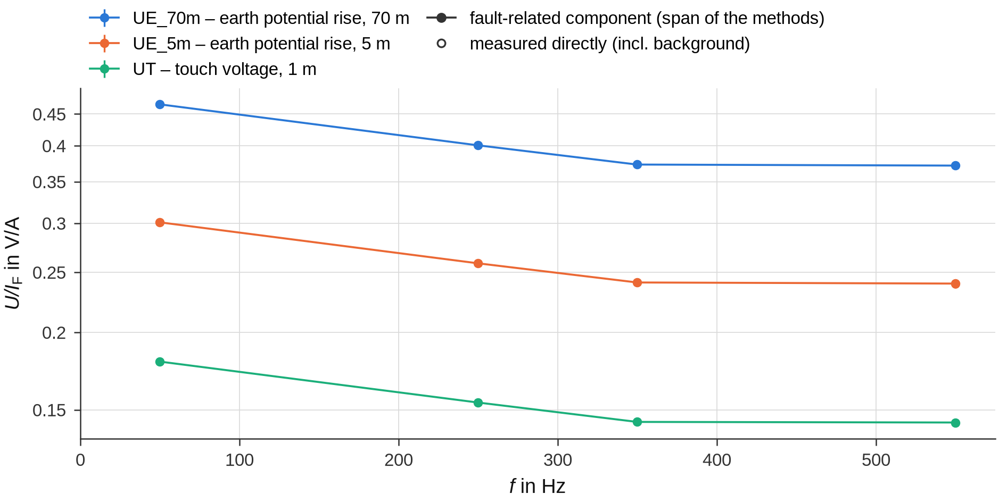
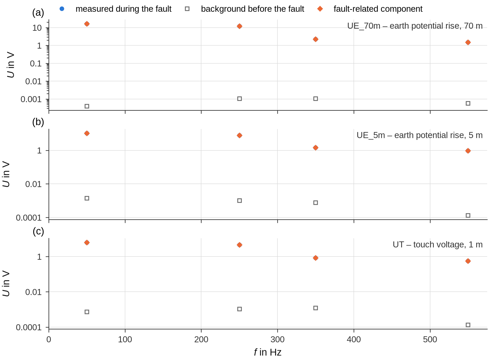

# Stations and the LV network

At a secondary substation (MV/LV station) the recording contains the fault current at the station, the voltages of
one or more probes against the station earth, often a shield current and the PEN currents, sometimes the line-to-earth
voltages. For such recordings `evaluate` adds the **station evaluation**: earth potential rise and touch voltage per
frequency – as measured and as the component caused by the fault current –, the extrapolation to the limits of the
residual current, the fault-related PEN and shield currents, and the current into the LV network with the earthing
impedance of the LV network. This page explains how to read these results; the theory is in
[Superposition at the station](../methods/superposition.md) and
[Reduction factor and LV network](../methods/reduction-factor.md). The comparison with an earthing measurement follows
in [Earthing measurements](earthing.md).

## Example: the demo station

```python
import os
import tempfile

import groundfault as gf
from groundfault import corrections, demo

base = tempfile.mkdtemp()
d = demo.make_campaign(base, layout="en")
campaign = d["campaign"]

rec = gf.open_recording(os.path.join(campaign, "raw/Station_Elm_Road/Station_Elm_Road_10_000kHz.cfg"))
corr = corrections.load(campaign)            # the demo campaign gives the probe UT a distance of 1 m
corr.apply(rec)
roles = gf.detect_roles(rec.channel_names, rec.units, corr.role_overrides(rec), corr.main_channel(rec),
                        corr.distances(rec))
res = gf.evaluate(rec, gf.Intervals((2.5, 5.3), (0.2, 1.8), (5.8, 7.8)), roles=roles)
print(roles.table()[["short", "role", "main_channel", "distance_m"]].head(3).to_string(index=False))
print(res.summary())
```

```text
 short role main_channel  distance_m
 UE_5m  u_e                      5.0
UE_70m  u_e            ✓        70.0
    UT  u_t            ✓         1.0
Measurement: Station_Elm_Road_10_000kHz  (Station_Elm_Road_10_000kHz.cfg)
Max window: 2.800 s  | f1 = 49.9800 Hz (phase)
IRES = 46.66 A | IG = 35.00 A | Iw = 33.20 A | Iv = 11.07 A | IH = 30.86 A
⚠ No extrapolation of the station voltages to limits of the residual current: Settings.ires_limits is empty (the limits are defined by the user).
```

The demo station has two earth-potential probes (5 m and 70 m), a touch-voltage probe, the line-to-earth voltages, the
fault current `IF1`, the shield current `IS` and the PEN currents `IPEN_v` and `IPEN_n`. Its background is negligible,
so direct and fault-related values agree; the [second example](#uncertainty-and-the-mark) shows a station with a large
background. The hint says that no limits of the residual current were given – they are defined by the user
([extrapolation](#values-in-the-max-window-and-extrapolation)).

## Probes and touch voltage

* **Earth potential rise** (`u_e`): voltage between the station earth and a probe, with the probe distance from the
  channel name (`UE_70m`, `U70m`, `UE100`) or from the column `distance_m` of the
  [corrections file](corrections.md) (`UE`, `UEr`). With several probes the remote one is the main channel.
* **Touch voltage** (`u_t`, prospective, without body resistance): a channel named `UT…` or `UB…`, or the role `u_t`
  in the corrections file. Without such a channel, every probe at most **1.5 m** away (`U1m`, `UE1`) becomes the
  touch voltage (role-table source “automatic (probe 1 m)”). Without such a probe, but with at least two probes with a
  known distance, the **shortest probe up to 5 m** serves as an approximation if it is not the farthest one (source
  “automatic (shortest probe 5 m – approximation)”, hint “Touch voltage from the shortest probe … – approximation, not
  a 1-m measurement.”). The voltage to a probe grows with its distance, so the approximation is usually an upper
  estimate of the touch voltage.

Only automatically detected roles are reinterpreted; a role from the corrections file stays as it is. To keep a 5-m
probe as an earth potential rise, give it the role `u_e` there.

## Direct and fault-related values

At a secondary substation a voltage is often present at the earthing **before** the earth fault – the
**background**: currents from the LV network through PEN conductors and earth electrodes, mainly at 50 and 150 Hz.
During the fault the component caused by the fault current adds to it as a phasor:

\[
\underline{U}_\text{fault} = \underline{U}_\text{background} + \underline{Z}\,\underline{I}_\text{F}
\]

An earthing measurement with current injection measures only Z. The comparable quantity is therefore the
**fault-related component** ΔU = U_fault − U_background, not the voltage as measured. groundfault determines the
transfer ratio Z = U/I_F (V/A) per probe and frequency in up to five ways:

| Method (code) | Idea | Needs |
|---|---|---|
| direct (`direct`) | U/I_F in the max window – as measured, including the background | always |
| superposition at fault inception (`inception`) | phasors of 1.2 s before the inception (background) and of 1.2 s after the settling of the fault current (fault), both referred to the network phase at the inception | fault inception in the recording, at least 0.4 s of windows on each side |
| superposition at fault clearance (`clearance`) | the same at the fault clearance | fault clearance in the recording |
| superposition with voltage reference (`voltage`) | phase reference U_L1-L2 of every window; background from the pre-/post-fault intervals, fault component fitted over all steady-state windows | the three line-to-earth voltages and a pre- or post-fault interval |
| fault-related component (`fault`) | mean of the available superposition methods – **the value for comparisons** | at least one superposition method |

For the time-reference methods the network frequency is estimated on both sides of the switching instant – from the
line-to-line voltage if it is measured; otherwise during the fault from the fault current and before or after it from
the most distinct network-synchronous background (at probes often the 150-Hz component) – and assumed to change
linearly in between. Which sources were used is recorded in `res.values["station_frequency"]` (instants of fault
inception and clearance, `f_background_source`, `f_fault_source`, window counts).

Evaluated are the orders up to 25 whose fault current in the max window is at least max(0.1 A, 1 % of the
fundamental); the fundamental is always included.

## The table `station_frequency`

One row per probe and order:

| Column | Meaning |
|---|---|
| `channel`, `role`, `distance_m` | probe (`u_e` earth potential rise, `u_t` touch voltage) and its distance in m |
| `order`, `f_Hz`, `I_F_A` | harmonic order, frequency and fault current at this frequency (max window) |
| `U_during_fault_V` | voltage during the fault (max window), as measured |
| `U_background_V` | background before the fault |
| `Z_direct_Ohm`, `Z_direct_angle_deg` | U/I_F as measured, including the background, in V/A (= Ω); angle referred to I_F |
| `Z_inception_Ohm`, `Z_clearance_Ohm`, `Z_voltage_Ohm` and their `…_angle_deg` | the single superposition methods (only those available) |
| `Z_fault_Ohm`, `Z_fault_angle_deg` | fault-related component (mean of the methods) – **the value for comparisons** |
| `U_fault_V` | fault-related voltage |
| `method_spread_pct` | largest deviation between two methods, as phasors (magnitude and angle), in % of the mean |
| `background_to_fault` | background divided by the fault-related component (above 1: the background is larger) |
| `background_forecast_error_pct` | null test: how accurately the background can be predicted across the same gap |
| `frequency_uncertainty_pct` | part of the uncertainty from the frequency reference through the fault current (only without a voltage measurement) |
| `uncertainty_pct` | estimated uncertainty of the fault-related component due to the background – a typical value (median), not a bound |
| `uncertain` | `True` if `method_spread_pct` or `uncertainty_pct` exceeds 20 % |
| `V_per_100A_direct`, `V_per_100A_fault` | voltage per 100 A of fault current |
| `F_direct`, `F_fault` | touch-voltage rows only: ratio F = U_E/U_T with the remote earth-potential probe |

```python
sf = res.table("station_frequency")
print(sf[["channel", "order", "f_Hz", "I_F_A", "U_during_fault_V", "Z_direct_Ohm", "Z_fault_Ohm",
          "Z_fault_angle_deg", "method_spread_pct", "uncertain"]].head(4).round(3).to_string(index=False))
print(res.values["station_frequency"]["method"])
```

```text
channel  order   f_Hz  I_F_A  U_during_fault_V  Z_direct_Ohm  Z_fault_Ohm  Z_fault_angle_deg  method_spread_pct  uncertain
 UE_70m      1  49.98 34.999            16.326         0.466        0.466             -5.428              0.009      False
 UE_70m      5 249.90 30.000            12.019         0.401        0.401              1.799              0.008      False
 UE_70m      7 349.86  6.002             2.239         0.373        0.373              4.245              0.069      False
 UE_70m     11 549.78  4.001             1.487         0.372        0.372             11.339              0.118      False
['direct', 'inception', 'clearance', 'voltage', 'fault']
```

The columns `Z_<method>_Ohm` are the voltage per ampere of fault current, U/I_F in V/A (German output:
`U_zu_I_F_…`), for every probe. For an earth-potential probe this is **r·Z_E** – the earthing impedance times the
reduction factor, because only the earth current I_E = r·I_F flows into the earthing system; groundfault does not call
it Z_E. Compared with an earthing measurement (which gives Z_E itself) it gives the reduction factor
([Earthing measurements](earthing.md)).
At 50 Hz the angle of Z (referred to I_F) is expected to lie roughly between −30° and +60°; outside −45…+75° a hint
“Angle U_E/I_F (…, 50 Hz) = …° – atypical for an earthing impedance …” points to a reversed probe or clamp. The
magnitudes are not affected by the polarity.



The figure (`report.station_frequency`) shows per probe the fault-related component (filled, the bar spans the single
methods), uncertain values as ⊗ and the direct quotient as open circles. `report.station_background` shows per probe the
voltage during the fault, the background before the fault and the fault-related component – the reason why direct and
fault-related values differ:



## Uncertainty and the ⊗ mark

How reliable is the fault-related component? Three quantities answer this:

* **Agreement of the methods** – `method_spread_pct` compares the superposition methods as phasors. If they disagree,
  the background probably changed during the fault.
* **Null test** – in the fault-free sections of the recording (up to 20 s before the inception and after the
  clearance) the same calculation is carried out as for the fault: how accurately can the background be predicted
  across the same gap? (`background_forecast_error_pct`; empty if the fault-free sections are too short.)
* **Frequency reference** – without a voltage measurement the network frequency during the fault follows the fault
  current, whose frequency can deviate from the network frequency by a few mHz; an assumed deviation of 3 mHz
  (`station.DF_FAULT_CURRENT_HZ`) gives `frequency_uncertainty_pct`.

The null test and the frequency part are each multiplied by `background_to_fault` and added in quadrature to
`uncertainty_pct`. If the spread of the methods or this uncertainty exceeds **20 %**, the row is marked `uncertain`,
the figures show the value as **⊗** and a hint names the frequencies (at most six, those with the most fault current).
Typical are frequencies at which the background is larger than the fault-related component – often 150 Hz – and
orders with little fault current.

A synthetic station without voltage measurement and with a fluctuating background at 50 and 150 Hz shows the effect
(the true r·Z_E at the 70-m probe is 0.513 V/A at 50 Hz and 0.526 V/A at 150 Hz):

```python
cfg = os.path.join(base, "Station_B_10_000kHz.cfg")
truth = demo.make_station_recording(
    cfg, duration=14.0, t_on=4.5, t_off=9.0, with_voltages=False,
    I_harm={3: demo.polar(1.5, 20.0), 5: demo.polar(30.0, 35.0), 7: demo.polar(6.0, -20.0)},
    background={1: demo.polar(4.0, 40.0), 3: demo.polar(3.0, -20.0)}, background_fluctuation=0.1, seed=3)
b = truth["intervals"]
res_b = gf.evaluate(gf.open_recording(cfg), gf.Intervals(b["steady_state"], b["pre_fault"], b["post_fault"]))
for h in res_b.hints:
    print("⚠", h)
sf_b = res_b.table("station_frequency")
print(sf_b[sf_b["channel"] == "UE_70m"][["order", "U_during_fault_V", "U_background_V", "Z_direct_Ohm",
                                         "Z_fault_Ohm", "method_spread_pct", "background_to_fault",
                                         "uncertainty_pct", "uncertain"]].round(3).to_string(index=False))
```

```text
⚠ No extrapolation of the station voltages to limits of the residual current: Settings.ires_limits is empty (the limits are defined by the user).
⚠ Station: uncertain values – 150 Hz (methods differ by 56 %, uncertainty ≈ 70 %). The superposition methods contradict each other there, or the background is large compared with the fault-related component and fluctuates; compare these frequencies with earthing measurements only with caution (column 'uncertain' in station_frequency).
 order  U_during_fault_V  U_background_V  Z_direct_Ohm  Z_fault_Ohm  method_spread_pct  background_to_fault  uncertainty_pct  uncertain
     1            16.532           3.752         0.472        0.511              3.137                0.210            2.286      False
     3             3.163           2.739         2.109        0.488             54.874                3.745           70.250       True
     5            16.529           0.001         0.551        0.551              0.007                0.000            0.004      False
     7             3.519           0.000         0.586        0.586              0.008                0.000            0.006      False
```

At 150 Hz the direct quotient (2.27 V/A) is mostly background, the fault-related value (0.488 V/A) comes close to the
truth but is marked uncertain; at 50 Hz the background lowers the direct value by 8 %, and the fault-related value is
reliable.

What to do with uncertain values: do not use them for reduction factors or comparisons (the comparison tables carry
the column `uncertain` along); look at the background in the [signal explorer](explorer.md); record the line-to-earth
voltages at future tests – the voltage reference removes the frequency part of the uncertainty and adds a third
method. Further hints of the station evaluation:

| Hint | Meaning |
|---|---|
| `Station: background before the fault up to … % of the earth potential rise/touch voltage during the fault (50 Hz) …` | use the fault-related component for comparisons (done automatically) |
| `Station: only one superposition method available (…) – no mutual check …` | the fault starts before or ends after the recording: no check by a second method; `uncertain` relies on the null test alone |
| `Station: fault-related component not determinable (…) – direct values only.` | fault too short (at least 0.4 s of windows per side needed) or inception and clearance not recorded, and no voltage measurement |
| `Station (fault inception): network frequency before the fault not estimable (…) …` | no distinct network-synchronous background; uncritical as long as the background is small |

## Values in the max window and extrapolation

Three further tables describe the max window:

* `station_voltages` – per probe: `RMS_V`, the magnitudes `H<m>_V` of the assessed orders, r·Z_E per order
  (`rZE_H<m>_Ohm`, `rZE_H<m>_angle_deg`) and as RMS ratio (`rZE_RMS_Ohm`, `V_per_100A_RMS`);
* `station_metrics` – `UE_max_V` (largest RMS value of the earth-potential probes), `UT_V`, `F_UE_to_UT`, `IF_A` and,
  with limits of the residual current, the proportional extrapolation `UE_at_<limit>A_V`, `UT_at_<limit>A_V`;
* `station_currents` – shield and PEN currents: `RMS_A`, `H<m>_A`, share of the fault current `share_H<m>` and its
  angle `angle_to_IF_H<m>_deg`; for the shield current also r = |I_F − I_S|/|I_F| (`r_H<m>_complex`),
  1 − |I_S|/|I_F| (`r_H<m>_magnitude`) and Z_E = U_E/I_E (`ZE_H<m>_Ohm`). A shield current in phase opposition to
  the fault current is rotated (`polarity` = −1, hint).

`station_extrapolation` extrapolates the voltages to the limits of the residual current that you define
(`Settings.ires_limits`), with the factor limit / RMS value of I_F in the max window. groundfault contains no limits:
without them the table is empty and the hint above names the setting.

| Column | Meaning |
|---|---|
| `channel`, `role`, `I_limit_A` | probe and limit of the residual current |
| `U_proportional_V` | measured RMS value scaled proportionally (contains the background) |
| `U_fault_V` | only the fault-related component scaled (RMS value over the evaluated orders) |
| `U_background_plus_fault_V` | scaled fault-related component plus the unchanged background – added as phasors per order with the phase relation of the test, the background at the other frequencies as RMS value |
| `U_background_plus_fault_in_phase_V` | upper bound: background and scaled fault-related component **in phase** at every order, \( \sqrt{\sum_m (\lvert U_{\text{bg},m}\rvert + s\,\lvert\Delta U_m\rvert)^2 + U_\text{rest}^2} \). At a real fault the phase relation differs from the test – another faulted line turns the fault current by ±120° against the network voltage, the load is another – so the phasor sum of the test is only one case; a background in antiphase even makes the measured voltage smaller than the fault-related component |

```python
limits = (50.0, 100.0)                                       # illustrative values – define your own
res_lim = gf.evaluate(rec, gf.Intervals((2.5, 5.3), (0.2, 1.8), (5.8, 7.8)), gf.Settings(ires_limits=limits),
                      roles=roles)
print(res_lim.table("station_extrapolation").head(2).round(2).to_string(index=False))
```

```text
channel role  I_limit_A  U_proportional_V  U_fault_V  U_background_plus_fault_V  U_background_plus_fault_in_phase_V
 UE_70m  u_e       50.0             21.91      21.92                      21.92                               21.92
 UE_70m  u_e      100.0             43.83      43.83                      43.83                               43.83
```

## PEN currents and the LV network

The PEN current at a station is usually measured at two points with the transformer star point in between:

| Channel | Position | Measuring point |
|---|---|---|
| `IPEN_v` | `feeders` | before the star point: sum of the PEN conductors of all outgoing LV cables |
| `IPEN_n` | `busbar` | after the star point: connection to the main earthing busbar of the station |

The position comes from the channel name ([Campaigns, folders and files](campaigns.md#channel-names)) or from the roles
`i_pen_feeders`/`i_pen_busbar` in the corrections file. A PEN channel without a position is used as well – its
fault-related component is the same at both points. With several channels of one position the first one is used (hint
“LV network: several PEN channels with position …”).

Both currents carry the load unbalance already before the fault. The same superposition as for the probes separates
the **fault-related current into the LV network** I_LV from it. `station_currents_frequency` lists it per PEN and
shield channel and order: `position`, `I_F_A`, `I_during_fault_A`, `I_background_A` (load unbalance), the ratio ΔI/I_F
of every method with its angle (`share_direct`, `share_inception` … `share_fault`, `…_angle_deg`), the fault-related
current `I_fault_A` and the same reliability columns as `station_frequency`.

```python
sc = res.table("station_currents_frequency")
print(sc[sc["order"] == 1][["channel", "position", "I_during_fault_A", "I_background_A", "I_fault_A",
                            "share_fault", "share_fault_angle_deg"]].round(3).to_string(index=False))
```

```text
channel position  I_during_fault_A  I_background_A  I_fault_A  share_fault  share_fault_angle_deg
 IPEN_v  feeders            20.562          18.000      4.367        0.125                -11.125
 IPEN_n   busbar             4.784           4.001      4.368        0.125                168.863
     IS                     18.024           0.000     18.024        0.515                  9.703
```

The current of the transformer star point (the load unbalance) does not change because of the earth fault, so by
Kirchhoff's current law the fault-related current flows through **both** measuring points with the same magnitude.
groundfault aligns the counting directions of the two clamps, compares them (`kcl_deviation_pct`) and averages them
weighted with their reliability (1/u², u at least m_I; columns `weight_feeders`, `weight_busbar`) – the measuring
point with a large load unbalance is less certain. A deviation beyond the uncertainties gives the hint
“LV network: the fault-related PEN currents before … and after the transformer star point … differ by … % at 50 Hz –
more than their uncertainties explain …”: check the clamps, the ratio and a load change during the fault.

The **earthing impedance of the LV network** is Z_E,LV = ΔU_E/I_LV – per probe and order, and as an RMS value over the
orders. Because the potentials spread differently and every probe measures at most the full earth potential rise,
the rows with `channel` = `max(UE)` – the **probe maximum** – use per order the probe with the highest fault-related
voltage (column `probe`; the touch-voltage probe counts too), in the RMS table the probe with the highest RMS value.
These rows come first; rows per earth-potential probe follow for comparison.

**Parallel check.** The LV network is one branch of the total earthing, so at every frequency

\[
|\underline{Z}_\text{E,LV}| \ge |r\,\underline{Z}_\text{E}| = \left|\frac{\max(\underline{U}_\text{E})}{\underline{I}_\text{F}}\right|
\quad\Leftrightarrow\quad |\underline{I}_\text{LV}| \le |\underline{I}_\text{F}|
\]

(column `parallel_check`, ratio `Z_LV_to_rZE_fault`). The condition depends only on the currents, not on the probe.
With a measured shield current the stricter condition against the earth current I_E = I_F − I_S (sum of all
shield-current channels) is checked as well: |I_LV| ≤ |I_E| (column `earth_current_check`, ratio `I_LV_to_I_E`). The
result is `satisfied`, `borderline` (deviation within the estimated uncertainty, column `check_uncertainty_pct`) or
`violated`; in the RMS table `satisfied` or `violated (see orders)`. A violation (hint “LV network: current into the LV
network larger than the earth current …”) means a wrongly scaled PEN or shield clamp or a clamp around more than the
PEN conductors.

| Column of `station_lv_network` | Meaning |
|---|---|
| `channel`, `probe`, `distance_m` | `max(UE)` or the probe; the probe used in this row and its distance |
| `order`, `f_Hz`, `I_F_A` | order, frequency, fault current |
| `I_LV_A`, `share_I_LV` | fault-related current into the LV network and its share of I_F |
| `I_LV_feeders_A`, `I_LV_busbar_A`, `weight_feeders`, `weight_busbar` | the two measuring points and their weights (`I_LV_PEN_A` for a channel without position) |
| `kcl_deviation_pct`, `I_LV_uncertainty_pct` | deviation between the measuring points; uncertainty of I_LV |
| `U_E_fault_V` | fault-related earth potential rise |
| `Z_E_LV_Ohm`, `Z_E_LV_angle_deg`, `Z_E_LV_uncertainty_pct` | earthing impedance of the LV network |
| `rZE_fault_Ohm`, `Z_LV_to_rZE_fault`, `parallel_check` | r·Z_E = ΔU_E/I_F, the ratio Z_E,LV/(r·Z_E) and the parallel check |
| `total_earthing_reference` | `I_E = I_F − I_S (shield current …)` or `I_F (without shield current – weaker condition)` |
| `Z_E_earth_current_Ohm`, `I_LV_to_I_E`, `earth_current_check`, `check_uncertainty_pct` | Z_E = ΔU_E/I_E (earthing impedance from the fault test with the earth current), the ratio and the earth-current check |
| `uncertain` | the probe value or I_LV is uncertain |

`station_lv_network_eff` holds the RMS values per probe and for the probe maximum: `orders`, `I_F_eff_A`, `I_LV_eff_A`,
`share_I_LV_eff`, `U_E_fault_eff_V`, `Z_E_LV_eff_Ohm`, `rZE_fault_eff_Ohm`, `parallel_check`,
`total_earthing_reference`, `Z_E_earth_current_eff_Ohm`, `I_LV_to_I_E_eff`, `earth_current_check` and
`uncertain_share_pct` (share of I_LV² from uncertain orders).

```python
lv = res.table("station_lv_network")
print(lv[lv["channel"] == "max(UE)"][["probe", "order", "I_F_A", "I_LV_A", "kcl_deviation_pct", "Z_E_LV_Ohm",
                                      "Z_LV_to_rZE_fault", "parallel_check", "I_LV_to_I_E",
                                      "earth_current_check"]].round(3).to_string(index=False))
eff = res.table("station_lv_network_eff")
print(eff[["channel", "probe", "I_LV_eff_A", "Z_E_LV_eff_Ohm", "rZE_fault_eff_Ohm", "parallel_check",
           "earth_current_check"]].round(3).to_string(index=False))
```

```text
 probe  order  I_F_A  I_LV_A  kcl_deviation_pct  Z_E_LV_Ohm  Z_LV_to_rZE_fault parallel_check  I_LV_to_I_E earth_current_check
UE_70m      1 34.999   4.368              0.039       3.738              8.013      satisfied        0.250           satisfied
UE_70m      5 30.000   2.890              0.030       4.159             10.381      satisfied        0.241           satisfied
UE_70m      7  6.002   0.493              0.241       4.540             12.172      satisfied        0.235           satisfied
UE_70m     11  4.001   0.269              0.202       5.521             14.858      satisfied        0.225           satisfied
channel  probe  I_LV_eff_A  Z_E_LV_eff_Ohm  rZE_fault_eff_Ohm parallel_check earth_current_check
max(UE) UE_70m       5.267           3.883              0.438      satisfied           satisfied
 UE_70m UE_70m       5.267           3.883              0.438      satisfied           satisfied
  UE_5m  UE_5m       5.267           2.505              0.283      satisfied           satisfied
```

`res.values["station_lv_network"]` records which PEN channels were used with which sign, the shield channels and the
reference of the total earthing. The comparison of Z_E,LV with the earthing measurement is described in
[Earthing measurements](earthing.md#lv-network-and-earthing-measurement).


`report.lv_network(res.table("station_lv_network"))` draws the upper panel with Z_E,LV (●) and the total earthing from
the fault test max(U_E)/I_F (◇, with a shield current also ΔU_E/I_E, △); given the check against an earthing
measurement it adds that measurement (■), as in the figure above. The lower panel shows the currents: I_LV (●) with the
two measuring points (▲ before, ▼ after the star point), the fault current I_F (□) and the earth current I_E (◇) –
I_LV must lie below them.

## Figures and interactive views

| Report figure (`report.…`) | Interactive (`interactive.…`) | Content |
|---|---|---|
| `station_frequency(res)` | `station_frequency(res)` | U/I_F per probe over the frequency, fault-related and direct; interactive with a second panel of the voltages and all values on hover |
| `station_background(res)` | – | voltage during the fault, background and fault-related component per probe |
| `station_voltages(res)` | – | magnitudes and r·Z_E per order in the max window |
| `lv_network(table, check=None)` | `lv_network(table, check=None)` | earthing impedance of the LV network and currents |

The report figures accept a `Result` or a loaded result file; see [Reports and exports](report.md).
